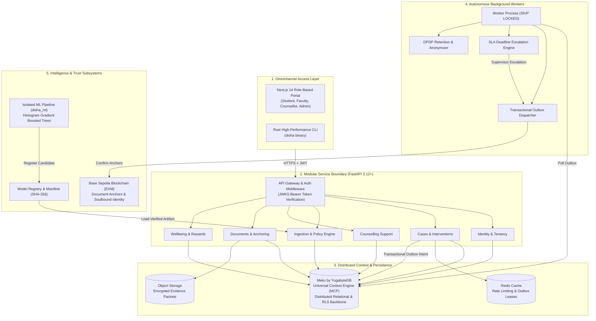

# 🎓 DISHA — Direction, Intervention, Support & Holistic Assistance
### *Enterprise Multi-Campus Student Early-Warning & Accountable Intervention Platform*

<div align="center">

[](https://python.org)
[](https://fastapi.tiangolo.com)
[](https://nextjs.org)
[](https://yugabyte.com)
[](https://rust-lang.org)
[](https://soliditylang.org)
[](anamoly%20report.md)
[](#license)

<br/>

**Transforming disjointed academic signals into timely, accountable human care to prevent student dropout.**

</div>

* `api/` — Modular FastAPI backend with domain-driven modules, row-level security, and audit logging.
* `worker/` — Standalone background task worker for outbox dispatch, deadline escalations, and retention purges.
* `web/` — Frontend portal with role-based routing and minimal high-contrast UI.
* `cli/` — High-performance Rust CLI (`disha`) for operator sync and management.
* `ml/` — Isolated ML pipeline. Primary model: the rolling risk model (`ml/disha_ml/rolling/`, trained on OULAD, scores at every assessment due date; contract in [docs/architecture/INSIGHTS_SPEC.md](docs/architecture/INSIGHTS_SPEC.md)). Legacy semester models (`cp0`/`cp1`/`cp2`, UCI and UPV) are secondary.
* `meko/` — Optional Meko client (`disha_meko`): fail-safe MCP client, PII guard, intervention catalogue, outcome playbook.
* `contracts/` — Smart contracts for verifiable document anchoring and non-transferable student identity.
* `infra/` — Docker, Docker Compose, monitoring, and deployment configurations.
* `docs/` — Architecture decision records (ADRs), API specs, security policies, and audit documentation.
* `blueprint/` — Rebuild specifications and architectural requirements.
* `tests/` — End-to-end, contract, and dataset integrity verification suites.

## Meko (agent memory & decision traces)

DISHA records ML experiments, per-student academic-story updates (on tier change or drift only, hashed ids, no raw marks), human decisions on flags and case outcomes in [Meko](https://cloud.mekodata.ai) (Yugabyte's agent context engine). Repo docs are not synced to it. It is optional and never blocks anything. See [docs/architecture/MEKO_INTEGRATION.md](docs/architecture/MEKO_INTEGRATION.md).

## Quickstart

---

## ⚡ The Higher Education Dropout Crisis

Every academic year, millions of students enter higher education institutions full of potential, yet **30% to 40% drop out or experience severe academic delay**. The cost is devastating: derailed student futures, lost tuition, wasted public subsidies, and institutional attrition.

Current institutional approaches fail due to four critical blind spots:

1. **Disjointed & Siloed Signals:** Attendance records, mid-term grade slips, exam no-shows, sudden fee distress, and student mental health indicators live in isolated software silos. Nobody sees the full student trajectory until after they drop out.
2. **Alert Fatigue & "Alerts Without Action":** Legacy early-warning tools blast advisors with noisy, low-precision flags (often 40%–50% false positives). Overwhelmed advisors develop alert fatigue; urgent cases fall through the cracks.
3. **Absence of Accountable Workflows:** Traditional systems stop at passive dashboards. There is no designated case owner, no strict SLA deadline, no follow-up enforcement, and zero tracking of whether interventions actually worked.
4. **Algorithmic Bias & Privacy Risks:** Opaque black-box models that rely on protected demographics (gender, caste, region) risk algorithmic bias and violate stringent data privacy laws, such as India's **Digital Personal Data Protection (DPDP) Act 2023**.

---

## 💡 The DISHA Solution

DISHA is an enterprise-grade, multi-campus early warning and intervention platform built on a foundational operating principle:

> ### 🛡️ **"No Alert Without Action"**
> *Every single warning signal must lead to a human review, an accountable designated owner, an explicit action with a tracked deadline, and an auditable outcome record.*

```mermaid
flowchart LR
    A["Raw Observation<br/>(Academics, Attendance, Fee Status)"] --> B["Frozen Evidence Packet<br/>(Cutoff Snapshot + SHA-256)"]
    B --> C["Calibrated ML Engine<br/>(≥85% Precision Tier + Rules)"]
    C --> D["Advisor Review Gate<br/>(Approve / Modify / Dismiss)"]
    D --> E["Accountable Case<br/>(Single Owner + SLA Deadline)"]
    E --> F["Auditable Intervention<br/>(Tutoring, Counselling, Aid)"]
    F --> G["Outcome Verification<br/>(Helped / Mixed / Not Helped)"]
    G -.->|Closes the Loop| H["Continuous Model Refinement"]
```



---

## 🌟 Key Differentiators & Innovations

* **Calibrated Multi-Checkpoint ML Pipeline (`disha_ml`):**
  Evaluates students strictly as of chronological checkpoints (`cp0` Admission, `cp1` Semester 1, `cp2` Semester 2) to eliminate future data leakage. Flags are raised only when calibrated risk exceeds a target cutoff where **precision is ≥85%**, backed by transparent academic reason codes (`LOW_PASS_RATE`, `EXAM_NO_SHOW`, `FAILED_UNITS`, `GRADE_DROP`).
* **Universal Context Memory via Meko (by YugabyteDB):**
  Geo-distributed, multi-campus context fabric powered by YugabyteDB and Meko Context Engine via Model Context Protocol (MCP). Unifies multi-semester student journeys, previous interventions, and wellbeing trends with sub-millisecond retrieval and strict tenant isolation.
* **Capacity-Aware Throttling (15% Cohort Cap):**
  Never overwhelms student support personnel. Signals are throttled to the highest-urgency tier to match actual campus advisor capacity.
* **Zero Protected Attribute Inputs (DPDP 2023 Compliant):**
  Demographics (gender, age, caste, religion, region) are **strictly barred** from model inputs and are used solely for post-evaluation fairness auditing.
* **14-State Deterministic Workflow Engine:**
  Governs cases from `suggested` through `assigned`, `accepted`, `contact_attempted`, `support_in_progress`, to `outcome_reviewed` and `closed` with versioned optimistic locking (`409 Conflict` prevention).
* **Restricted Domain Privacy Partitioning:**
  Sensitive student counselling notes and emergency bursary details are strictly partitioned so general staff cannot view confidential mental health or financial records.
* **On-Chain Verifiable Trust Layer:**
  Smart contracts on Ethereum Layer 2 (Base Sepolia) anchor document SHA-256 hashes for permanent auditability (`DishaDocumentRegistry.sol`) and issue non-transferable Soulbound student identity credentials (`DishaStudentIdentityNFT.sol`).

---

## 🏛️ System Architecture



---

## 📊 Proven Dataset Integrity & Benchmark

DISHA's machine learning engine has been validated on the benchmark **UCI Student Dropout and Academic Success** dataset (4,424 students, 37 attributes):

```
+--------------------------------------------------------------------------------------------------+
|                               DATASET INTEGRITY & HEALTH STATUS                                 |
+--------------------------+------------------------------+----------------------------------------+
| Metric                   | Before Correction            | DISHA Verified Pipeline                |
+--------------------------+------------------------------+----------------------------------------+
| Total Student Records    | 4,424                        | 4,424 (100% Preserved, Zero Drop)      |
| Total Features           | 37 (36 Features + 1 Target)  | 37 (36 Features + 1 Target)            |
| BOM Header Anomaly       | Present (\xef\xbb\xbf)       | Stripped (Clean UTF-8)                 |
| Column Typos & Syntax    | 'Nacionality', Trailing Tabs | Standardized & Cleaned                 |
| Missing / Imputed Values | 0                            | 0 (Zero Synthetic Fabrication)         |
| Automated Integrity Tests| 64.3% (9/14 pass, 5 fail)    | 100.0% (14/14 PASS in tests/test_dataset.py) |
+--------------------------+------------------------------+----------------------------------------+
```

---

## 🖥️ Interactive Portals in Action

The web application (`web/`) delivers four dedicated, role-tailored portals:

| Portal | Intended Users | Primary Capabilities |
|---|---|---|
| **👨‍🏫 Teacher / Faculty** | Course instructors, advisors | View assigned student cases, review automated risk signals, schedule support calls, manage active intervention protocols. |
| **🧑‍🎓 Student Portal** | Enrolled students | Confidential support requests, weekly wellbeing pulse check-ins, guided breathing exercises, points ledger & rewards shop. |
| **🩺 Counsellor Cockpit** | Licensed counsellors, psychologists | Secure caseload management, urgent wellbeing escalation directory, authority contact protocols with isolated sensitive records. |
| **🏛️ Campus Administrator** | Deans, HODs, campus admins | Cohort retention analytics, roster management, intervention catalogue configuration, on-chain document verification. |

---

## 📂 Repository Structure

```
c:\disha-main
├── api/                     # Modular FastAPI backend service
│   ├── app/
│   │   ├── modules/         # Domain-driven packages (cases, ingestion, policy, counselling, etc.)
│   │   ├── core/            # Typed settings, security, DB session, RLS
│   │   └── main.py          # Application entry point and router assembly
│   └── migrations/          # Alembic schema versioning
├── worker/                  # Autonomous background job worker
│   ├── jobs/                # Outbox dispatcher, deadline escalation, retention purges
│   └── scheduler.py         # Job loops utilizing SKIP LOCKED concurrency
├── web/                     # Next.js 14 / Vite frontend application
│   ├── src/components/      # Student, Teacher, Counsellor, Admin dashboards & modals
│   ├── src/context/         # Global AppContext and role switcher
│   └── .env.example         # Web environment including Meko MCP & Google OAuth
├── ml/                      # Isolated machine-learning pipeline (disha_ml)
│   ├── disha_ml/            # Feature extraction, calibration, fairness audit, scoring
│   ├── training/            # Model training routines with out-of-fold thresholds
│   └── kaggle_train.py      # Script for training directly on Kaggle or headless GPU
├── contracts/               # EVM Smart Contracts (Foundry)
│   └── src/
│       ├── DishaDocumentRegistry.sol      # Tamper-evident hash anchoring
│       └── DishaStudentIdentityNFT.sol    # Soulbound student achievement credential
├── cli/                     # High-performance operator CLI written in Rust
├── docs/                    # Architectural decision records (ADRs), audit docs & runbooks
├── blueprint/               # Comprehensive rebuild specifications (01 through 18)
├── tests/                   # End-to-end, contract, and dataset integrity verification suites
├── data.csv                 # Cleaned benchmark dataset (4,424 records)
├── anamoly report.md        # Complete before-and-after audit and verification report
└── Makefile                 # Root developer commands
```

---

## 🚀 Quickstart Guide

### 1. Prerequisites
* **Python 3.12+**
* **Node.js 20+** & **pnpm**
* **Docker & Docker Compose** (for PostgreSQL, Redis, and local services)
* **Rust 1.78+** *(optional, for compiling the `disha` CLI)*

### 2. Environment Setup
Copy the environment template files for the backend and frontend:
```bash
# Root environment configuration
cp .env.example .env

# Web application configuration
cp web/.env.example web/.env
```

### 3. Launch with Docker Compose
```bash
docker compose up -d
```

### 4. Running Locally for Development

#### A. Backend API (FastAPI) & Migrations
```bash
cd api
python -m venv .venv
source .venv/bin/activate  # On Windows: .venv\Scripts\activate
pip install -e .
alembic upgrade head
uvicorn app.main:app --reload --port 8000
```
Interactive Swagger docs: `http://localhost:8000/docs`

#### B. Frontend Portal
```bash
cd web
npm install
npm run dev
```
Access the application at: `http://localhost:5173`

#### C. Background Worker
```bash
cd worker
python -m venv .venv
source .venv/bin/activate  # On Windows: .venv\Scripts\activate
pip install -e .
python main.py
```

#### D. ML Pipeline & Verification
```bash
cd ml
pip install -r requirements.txt
python -m pytest tests -q
# Score a snapshot with the rolling model:
python -m disha_ml.rolling.score --tables data/processed/oulad --as-of 120 --no-meko
```

Optional local translation (IndicTrans2): `pip install -e "api[translate]"`, set `DISHA_TRANSLATE_ENABLED=true` and `HF_TOKEN`, then `POST /api/v1/translate`. API endpoints: `blueprint/05-api-specification.md` §4.

---

## 🛠️ Technology Stack

| Domain | Technologies & Libraries |
|---|---|
| **Backend & Core API** | Python 3.12, FastAPI, SQLAlchemy 2 (Async), Pydantic v2, Alembic |
| **Distributed Context Memory** | **Meko by YugabyteDB** (Universal Context Engine via MCP), PostgreSQL with Row-Level Security (RLS) |
| **Caching & Leases** | Redis (Outbox leases, distributed rate-limiting) |
| **Worker & Tasks** | Python asyncio, PostgreSQL `SKIP LOCKED` concurrency, transactional outbox |
| **Frontend Web** | React 19, TypeScript, Tailwind CSS, Lucide Icons |
| **Machine Learning** | `scikit-learn` (Histogram Gradient Boosting), Isotonic Calibration, Pandas, NumPy |
| **Smart Contracts** | Solidity 0.8.24, Foundry, Base Sepolia Layer 2 |
| **Operator CLI** | Rust, `clap`, `tokio`, `reqwest` |
| **Security & Privacy** | JWKS asymmetric JWT validation, DPDP 2023 compliance, small-cell suppression |

---

## 🗺️ Roadmap & Future Enhancements

* [x] **Calibrated Multi-Checkpoint Risk Forecaster** with zero protected-attribute leakage.
* [x] **14-State Deterministic Case Workflow** with optimistic locking & auto-escalation.
* [x] **Meko by YugabyteDB Distributed Context Layer** for enterprise multi-campus scaling.
* [x] **On-Chain Document Verification & Soulbound Identity** on Base Sepolia.
* [ ] **Live LMS / SIS Connectors:** Turnkey plugins for Canvas, Moodle, and Ellucian Banner.
* [ ] **Vernacular Multilingual Voice Assistant:** Integration with Sarvam AI for native Indian language phone outreach.
* [ ] **Programmable CBDC Digital Rupee Vouchers:** Automated incentive disbursement for verified student attendance and academic milestones.

---

## 📄 License
Proprietary — All rights reserved. Built for institutional student retention and academic success.
