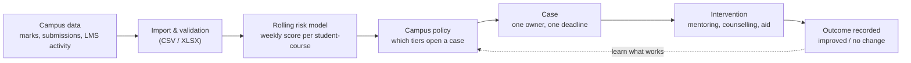

# DISHA

**Catch struggling students weeks earlier, and make sure every warning ends in a human action.**

DISHA is a campus early-warning and intervention platform. A calibrated machine-learning model scores every student in every course each week and explains why. A campus policy turns the strongest warnings into cases. Each case has one owner, a deadline, an intervention and a recorded outcome.

> **No alert without action.** Every warning leads to a human review, a named owner, a tracked action and an auditable result.

---

## What judges can see in the demo

Sign in with Google. The role the server assigns decides which portal opens.

| Portal | Who | What they do |
|---|---|---|
| **Admin** | Deans, HODs, campus admins | Campus risk overview, model health, case governance, data import, scoring runs, policy |
| **Counsellor** | Student-wellbeing team | Caseload, accept and work cases, notes, follow-ups, counselling sessions |
| **Faculty** | Instructors, mentors | Classes, attendance, assessments and marks, students flagged in their sections |
| **Student** | Enrolled students | Own progress, weekly wellbeing check-in, support requests, rewards |

The demo campus (Northfield Institute of Technology) is seeded with 84 students, 12 courses, 5 faculty, 2 counsellors, 40 cases at different stages, counselling sessions, wellbeing check-ins and three weekly scoring runs. The campus data is **synthetic** (invented names, no real students). The model that scores it is trained on a real public dataset.

---

## How it works



1. **Import.** Marks, assessment due dates, submissions and weekly activity are uploaded through the admin portal. Files are validated and every import is versioned.
2. **Score.** The model scores each student in each course as of the current day of term, producing a probability, a tier and plain-language reasons.
3. **Decide.** The campus policy (for example "open a case for HIGH, cap at 45 new cases per run, 14-day cool-down") turns scores into suggested cases. Nothing is created without passing the policy.
4. **Act.** A counsellor reviews, accepts, contacts the student, plans an intervention and schedules follow-ups. A 14-state workflow with optimistic locking keeps this orderly.
5. **Measure.** Outcomes and follow-up completion feed the analytics so the campus can see what is actually helping.

---

## The risk model

One production model: the **rolling risk model** (`ml/disha_ml/rolling/`, bundle in `ml/artifacts_rolling/`). Its output contract is [docs/architecture/INSIGHTS_SPEC.md](docs/architecture/INSIGHTS_SPEC.md).

**What it predicts.** The chance that a student will fail or withdraw from a course this term, re-estimated every week as new marks, missed submissions and activity arrive. It uses 23 features in groups: score level and trend, submission behaviour, online engagement, prior record and course load.

**Why it can be trusted.**
- **Trained on real data, tested on a term it never saw.** Open University Learning Analytics Dataset (OULAD, CC BY 4.0): about 174,000 training rows from three terms (17,488 students) and a held-out test term of 80,411 rows (8,931 students).
- **Calibrated.** Gradient boosting with isotonic calibration: when it says 80%, about 80% of those students struggle. Brier score 0.145, expected calibration error 0.037.
- **Honest about alert quality.** Tiers are set on out-of-fold data so that HIGH targets 85% precision. On the held-out term HIGH alerts were **81.7% precise**; HIGH and MEDIUM together were 79.9% precise. These are alert precision figures, not overall accuracy.
- **Early.** Test ROC-AUC rises from 0.73 at 10% of the term to 0.81 at 25%, 0.88 at 50% and 0.93 at 75%. The overall held-out ROC-AUC is **0.857** (PR-AUC 0.794); a rules-only baseline reaches 0.689. Of students who later withdrew, **70.5%** were flagged beforehand, with a median of 54 days of warning.
- **Not overfit.** Train 0.894, student-grouped cross-validation 0.883, test 0.857; unseen students alone score 0.854.
- **Explainable.** Every flag carries the top reasons with effect sizes ("Missed 3 of the last 3 assessments", "Online activity down 100% over two weeks").
- **Fair by construction.** Gender, region, deprivation band, disability and age are never model inputs. They are used only for the post-hoc fairness audit in `ml/artifacts_rolling/report.md`, which reports signal and false-positive rates per group.
- **Monitored.** The admin portal shows data drift (population stability against the training reference) for every run.
- **Capacity aware.** The tier cut-offs respect a cap on the share of students flagged, so advisors are not flooded.

Full numbers, fairness tables and method: [ml/artifacts_rolling/report.md](ml/artifacts_rolling/report.md) and [ml/README.md](ml/README.md).

Earlier semester-based prototypes were superseded by this model. They remain under `ml/` for reference only and are not used by the product.

---

## Privacy and safety

- **Role-scoped data.** Students never see cases or scores. Faculty see only cases for students in their own sections. Counsellors see cases assigned to them or still unassigned. Counselling notes are readable only by counsellors. The audit trail is admin-only.
- **Small-cell suppression.** Analytics groups smaller than 5 are shown as "<5".
- **Campus isolation.** Every row carries a campus id and every request is checked against an active membership.
- **No client-chosen roles.** Google sign-in is verified against Supabase's signing keys. New accounts become students; staff roles come only from invitations or provisioning.
- **Append-only audit chain** with hash verification, and an append-only rewards ledger.
- **Idempotent writes** (`X-Idempotency-Key`) and versioned cases (`409` on conflicting edits).

---

## Architecture

| Layer | Technology |
|---|---|
| Web | React 19, TypeScript, Vite, Tailwind, TanStack Query |
| API | FastAPI, SQLAlchemy 2 (async), Pydantic v2, Alembic |
| Database | **Supabase PostgreSQL** (any Postgres works) |
| Sign-in | Supabase Auth with Google, exchanged for a short-lived DISHA JWT |
| ML | scikit-learn (histogram gradient boosting + isotonic calibration), pandas |
| Background jobs | Optional worker (outbox delivery, deadline escalation) |
| Agent memory | Optional [Meko](docs/architecture/MEKO_INTEGRATION.md) for experiment notes; never required |

```
api/        FastAPI app: identity, campus, cases, counselling, interventions, faculty, student,
            ingestion, ml, policy, analytics, wellbeing, rewards, audit, notifications
web/        Role-based portals (admin, counsellor, faculty, student)
ml/         Rolling risk model, training code, model bundle and report
worker/     Optional background worker
infra/      Seed script and deployment files
docs/       Architecture and API documents       blueprint/   Specifications
tests/      Dataset and end-to-end suites         cli/         Optional Rust operator CLI
```

---

## Run it

Requirements: Python 3.11+, Node 20+, a Postgres database (a Supabase project is what the demo uses).

```bash
cp .env.example .env            # then edit it, see below
python -m venv .venv && source .venv/bin/activate
pip install -e api -e meko
cd api && alembic upgrade head && cd ..
make seed                       # builds the demo campus and scores it with the real model
cd api && uvicorn app.main:app --port 8000
```

```bash
cd web && cp .env.example .env && npm install && npm run dev      # http://localhost:5173
```

**Environment (`.env`)**

| Variable | Purpose |
|---|---|
| `DISHA_DATABASE_URL` | Postgres URL. For Supabase use the **Session pooler** string (the direct host is IPv6-only). `postgresql://` is accepted. |
| `DISHA_JWT_SECRET` | Secret that signs DISHA tokens. Use a long random value. |
| `DISHA_CORS_ORIGINS` | Allowed web origins, include `http://localhost:5173`. |
| `SUPABASE_URL` | Your project URL. Tokens are verified against its public keys. |
| `SUPABASE_JWT_SECRET` | Only for legacy HS256 Supabase projects. |
| `VITE_SUPABASE_URL`, `VITE_SUPABASE_ANON_KEY` (web) | Google sign-in. Enable the Google provider in Supabase. |

**Giving yourself a role in the demo.** Everyone who signs in with an unlinked Google account is a student. To open another seeded role with your Google address:

```bash
python infra/scripts/link_google_account.py admin@demo.disha.edu you@gmail.com
```

Seeded roles: `admin@`, `counsellor@`, `faculty@`, `student@` (all `@demo.disha.edu`). `make seed` re-creates the demo campus without touching other campuses.

**Tests**

```bash
cd api && pytest tests -q         # 268 tests: authorization, workflow, ingestion, ML, policy
cd ml && pytest tests -q          # model and feature tests
```

Interactive API docs: `http://localhost:8000/docs`.

---

## Not in this release

On-chain document anchoring, student identity tokens and wallet features exist as unused code under `contracts/` and `api/app/modules/documents`, `student_identity`. They are disabled and not part of the product.

Planned: live LMS/SIS connectors (Canvas, Moodle), multilingual outreach, and AI-written case briefs (the endpoint is built and returns "disabled" until a provider key and data-processing agreement are configured).

---

## More documentation

[Product requirements](blueprint/01-product-requirements.md) · [System architecture](blueprint/02-system-architecture.md) · [API specification](blueprint/05-api-specification.md) · [Case workflow](blueprint/07-case-workflow-and-worker.md) · [Model guide](blueprint/17-model-training-guide.md) · [Insights contract](docs/architecture/INSIGHTS_SPEC.md) · [Docs index and changelog](blueprint/README.md)

License: proprietary, all rights reserved.
