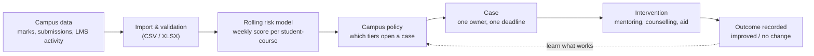

# DISHA

**Catch struggling students weeks earlier, and make sure every warning ends in a human action.**

DISHA is a campus early-warning and intervention platform. A calibrated machine-learning model scores every student in every course each week and explains why. A campus policy turns the strongest warnings into cases. Each case has one owner, a deadline, an intervention and a recorded outcome.

> **No alert without action.** Every warning leads to a human review, a named owner, a tracked action and an auditable result.

---

## What judges can see in the demo

Sign in with Google. The role the server assigns decides which portal opens.

| Portal | Who | What they do |
|---|---|---|
| **Admin** | Deans, HODs, campus admins | Campus risk overview, model health, case governance, data import, scoring runs, policy |
| **Counsellor** | Student-wellbeing team | Caseload, accept and work cases, notes, follow-ups, counselling sessions |
| **Faculty** | Instructors, mentors | Classes, attendance, assessments and marks, students flagged in their sections |
| **Student** | Enrolled students | Own courses and attendance, weekly wellbeing check-in, support requests, notifications |

### Where the data comes from

| | Demo campus (what the dashboards show) | Model training data |
|---|---|---|
| What | Sample data for the demo: a fictional campus, "Northfield Institute of Technology", with 84 students (invented names), 12 courses, 5 faculty, 2 counsellors, 40 cases, 30 counselling sessions, 306 wellbeing check-ins and 3 weekly scoring runs | **OULAD**, the Open University Learning Analytics Dataset: about 32,600 real, anonymised enrolments, 173,913 assessment results and 10.6 million learning-platform click records, from four course terms (2013B, 2013J, 2014B, 2014J) |
| Source | `infra/scripts/seed_demo.py`, reproducible with `make seed` | Open University UK, CC BY 4.0. Citation: Kuzilek, Hlosta, Zdrahal, *Scientific Data* 4, 170171 (2017). Provenance and checksum in `ml/data/raw/oulad/SOURCE.md`. |
| Used for | Everything the portals display | Training and testing the model only |

The risk scores in the demo are produced by the trained model itself: the seed script loads the campus's marks, submissions and activity through the normal admin import and runs the model at day 49, 63 and 77 of the term. The signals and cases come from that run.

---

## How it works



1. **Import.** Marks, assessment due dates, submissions and weekly activity are uploaded through the admin portal. Files are validated and every import is versioned.
2. **Score.** The model scores each student in each course as of the current day of term, producing a probability, a tier and plain-language reasons.
3. **Decide.** The campus policy (for example "open a case for HIGH, cap at 45 new cases per run, 14-day cool-down") turns scores into suggested cases. Nothing is created without passing the policy.
4. **Act.** A counsellor reviews, accepts, contacts the student, plans an intervention and schedules follow-ups. A 14-state workflow with optimistic locking keeps this orderly.
5. **Measure.** Outcomes and follow-up completion feed the analytics so the campus can see what is actually helping.

---

## The risk model

**One production model**, the rolling risk model: code in `ml/disha_ml/rolling/`, trained bundle in `ml/artifacts_rolling/` (`model.joblib`, `manifest.json`, `report.md`). Its output contract is [docs/architecture/INSIGHTS_SPEC.md](docs/architecture/INSIGHTS_SPEC.md). The API loads this bundle and checks its SHA-256 on load.

| | |
|---|---|
| **Algorithm** | scikit-learn `HistGradientBoostingClassifier` (learning rate 0.05, up to 300 iterations with early stopping, 15 leaves per tree, L2 1.0) inside a pipeline, wrapped in `CalibratedClassifierCV` with isotonic regression over 5 folds that never split a student. 1,500 trees and 44,340 parameters in total, 4.1 MB. scikit-learn 1.7.2, Python 3.11. |
| **Target** | Probability that the student **fails or withdraws** from the course this term (`fail` or `withdrawn` outcome in the training data). |
| **Unit scored** | One student in one course at one snapshot day of the term, re-scored as new marks and activity arrive. |
| **Inputs (23)** | Score level and trend (mean, weighted, last, change, slope, standing in class, gap to class median), submissions (share submitted, missed, late, consecutive misses, missed last three), online engagement (activity versus class median, engagement ratio, days since last activity), term progress, baseline versus class, previous attempts, credit load, programme level, year of study. |
| **Never inputs** | Gender, region, deprivation band, disability, age band. Used only for the fairness audit. |
| **Output** | Calibrated probability, a tier (HIGH, MEDIUM, WATCH, ON_TRACK) set from cut-offs chosen on out-of-fold data to hit 85%, 70% and 50% precision, the top reasons with effect sizes, direction since the last run, and a drift check against the training population. |
| **Trained on** | OULAD terms 2013B, 2013J, 2014B: 173,960 snapshot rows, 17,488 students, 41.9% at-risk base rate. |
| **Tested on** | Held-out term 2014J, never seen in training: 80,411 rows, 8,931 students, 35.4% base rate. |

**Results on the held-out term** (from `ml/artifacts_rolling/report.md`; retraining reproduces them exactly):

| Measure | Result |
|---|---|
| ROC-AUC / PR-AUC | **0.857** / 0.794 (rules-only baseline: 0.689) |
| Calibration | Brier 0.145, expected calibration error 0.037 |
| HIGH alerts | 81.7% precision (target 85%), recall 54.7%, 23.7% of rows |
| HIGH + MEDIUM | 79.9% precision |
| Early detection (ROC-AUC) | 0.727 at 10% of the term, 0.809 at 25%, 0.881 at 50%, 0.933 at 75% |
| **Lead time** | 70.5% of students who later withdrew were flagged first (1,246 of 1,768), with a **median of 54 days** warning (middle half: 25 to 112 days) |
| Overfitting check | Train 0.894, student-grouped cross-validation 0.883, test 0.857; unseen students only 0.854 |

Alert precision means "of the students we flagged, how many ended at risk". It is not accuracy.

**How early students are flagged.** The admin dashboard and `GET /api/v1/ml/early-warning` report this directly: the median day a student is first flagged and the share flagged in the first half of the term (measured on the campus's own scoring runs, so as precise as the run schedule), and the days of warning before a student left a course, alongside the held-out benchmark above.

**Fairness and limits.** `ml/artifacts_rolling/report.md` lists signal rate and false-positive rate by gender, region, deprivation band, disability and age. The largest false-positive-rate gap between groups is about 2x (deprivation band and age band). The model was trained on a UK distance-learning university, so a campus with different assessment patterns will drift from it. On the demo campus the drift report shows most inputs as shifted, and retraining on a campus's own history is recommended before real use.

Earlier semester-based prototypes (UCI dropout benchmark, checkpoints `cp0`/`cp1`/`cp2`) are superseded. They remain under `ml/` for reference only and are not used by the product.

---

## Privacy and safety

- **Role-scoped data.** Students never see cases or scores. Faculty see only cases for students in their own sections. Counsellors see cases assigned to them or still unassigned. Counselling notes are readable only by counsellors. The audit trail is admin-only.
- **Small-cell suppression.** Analytics groups smaller than 5 are shown as "<5".
- **Campus isolation.** Every row carries a campus id and every request is checked against an active membership.
- **No client-chosen roles.** Google sign-in is verified against Supabase's signing keys. New accounts become students; staff roles come only from invitations or provisioning.
- **Append-only audit chain** with hash verification, and an append-only rewards ledger.
- **Idempotent writes** (`X-Idempotency-Key`) and versioned cases (`409` on conflicting edits).

---

## Architecture

| Layer | Technology |
|---|---|
| Web | React 19, TypeScript, Vite 6, Tailwind 4, TanStack Query, Recharts |
| API | FastAPI 0.162, SQLAlchemy 2.1 (async, asyncpg), Pydantic 2.14, Alembic |
| Database | **Supabase PostgreSQL** (any Postgres works) |
| Sign-in | Supabase Auth with Google, exchanged for a short-lived DISHA JWT |
| ML | scikit-learn 1.7.2 (histogram gradient boosting, isotonic calibration), pandas 3.1, NumPy 2.4 |
| Background jobs | Optional worker (outbox delivery, deadline escalation) |
| Agent memory | Optional [Meko](docs/architecture/MEKO_INTEGRATION.md) for experiment notes; never required |

```
api/        FastAPI app: identity, campus, cases, counselling, interventions, faculty, student,
            ingestion, ml, policy, analytics, wellbeing, rewards, audit, notifications
web/        Role-based portals (admin, counsellor, faculty, student)
ml/         Rolling risk model, training code, model bundle and report
worker/     Optional background worker
infra/      Seed script and deployment files
docs/       Architecture and API documents       blueprint/   Specifications
tests/      Dataset and end-to-end suites         cli/         Optional Rust operator CLI
```

---

## Run it

Requirements: Python 3.11+ (3.11 is what it was built and tested on), Node 20+, a Postgres database (a Supabase project is what the demo uses).

```bash
cp .env.example .env            # then edit it, see below
python -m venv .venv && source .venv/bin/activate
pip install -e api -e meko
cd api && alembic upgrade head && cd ..
make seed                       # builds the demo campus and scores it with the real model
cd api && uvicorn app.main:app --port 8000
```

```bash
cd web && cp .env.example .env && npm install && npm run dev      # http://localhost:5173
```

**Environment (`.env`)**

| Variable | Purpose |
|---|---|
| `DISHA_DATABASE_URL` | Postgres URL. For Supabase use the **Session pooler** string (the direct host is IPv6-only). `postgresql://` is accepted. |
| `DISHA_JWT_SECRET` | Secret that signs DISHA tokens. Use a long random value. |
| `DISHA_CORS_ORIGINS` | Allowed web origins, include `http://localhost:5173`. |
| `SUPABASE_URL` | Your project URL. Tokens are verified against its public keys. |
| `SUPABASE_JWT_SECRET` | Only for legacy HS256 Supabase projects. |
| `VITE_SUPABASE_URL`, `VITE_SUPABASE_ANON_KEY` (web) | Google sign-in. Enable the Google provider in Supabase. |

**One login for every role in the demo.** Anyone who signs in with an unlinked Google account is a student. To let your own Google account hold every role (admin, counsellor, faculty, student), each with full data, and switch between them from the dashboard header:

```bash
python infra/scripts/seed_demo.py --reset --grant-all you@gmail.com     # reseed and grant
python infra/scripts/seed_demo.py --grant-only you@gmail.com            # grant without reseeding
```

The API accepts an `X-Role` header naming one of the roles the signed-in user actually holds on the campus; any other role is refused. `make seed` re-creates the demo campus without touching other campuses.

**Tests**

```bash
cd api && pytest tests -q         # 268 tests: authorization, workflow, ingestion, ML, policy
cd ml && pytest tests -q          # 76 tests: model, features, scoring
```

Interactive API docs: `http://localhost:8000/docs`.

---

## Not in this release

On-chain document anchoring, student identity tokens and wallet features exist as unused code under `contracts/` and `api/app/modules/documents`, `student_identity`. They are disabled and not part of the product.

Planned: live LMS/SIS connectors (Canvas, Moodle), multilingual outreach, and AI-written case briefs (the endpoint is built and returns "disabled" until a provider key and data-processing agreement are configured).

---

## More documentation

[Product requirements](blueprint/01-product-requirements.md) · [System architecture](blueprint/02-system-architecture.md) · [API specification](blueprint/05-api-specification.md) · [Case workflow](blueprint/07-case-workflow-and-worker.md) · [Model guide](blueprint/17-model-training-guide.md) · [Insights contract](docs/architecture/INSIGHTS_SPEC.md) · [Docs index and changelog](blueprint/README.md)

License: proprietary, all rights reserved.
