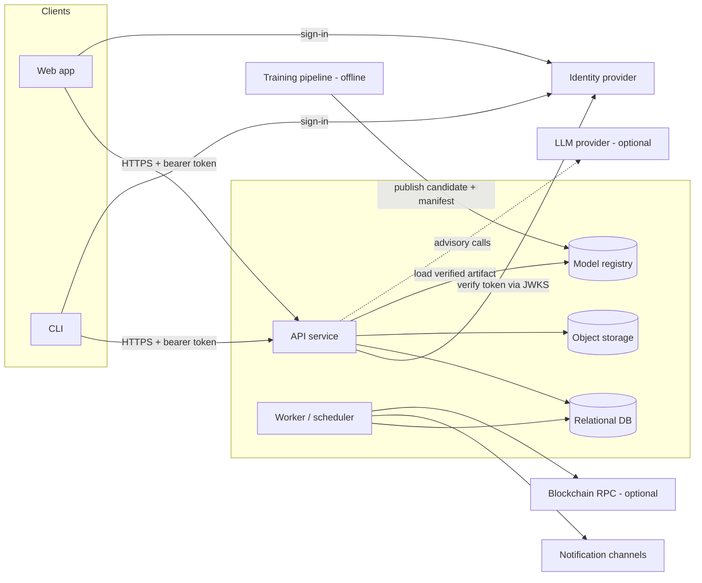
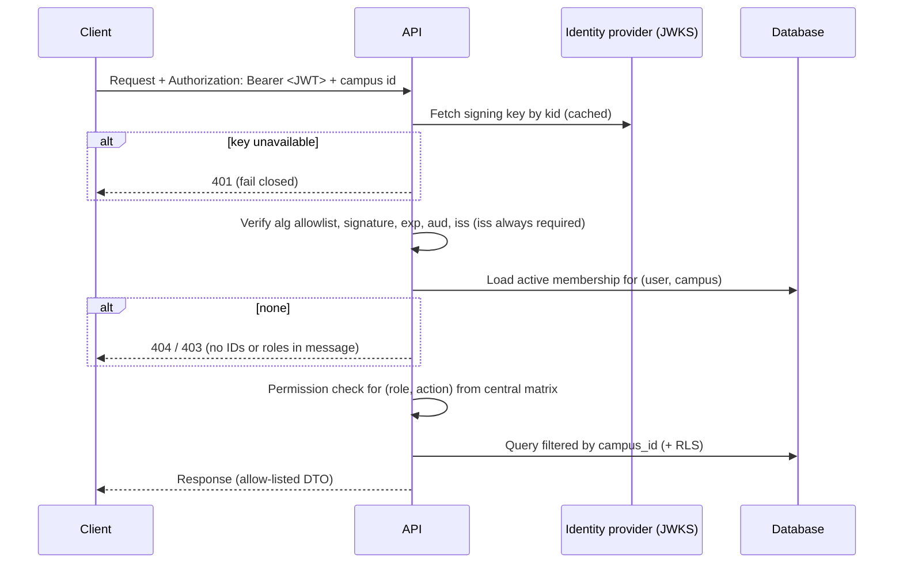

# 02 · System Architecture

## 1. Components



| Component | Responsibility | Must not |
|---|---|---|
| Web app | UI, session handling, server-side route protection | Hold business rules that affect students (audit F5); hold secrets; call third parties with record data |
| CLI | Operator and staff access to the same API | Bypass the API |
| API service | All business logic, authorisation, validation, persistence | Run blocking I/O on the event loop |
| Worker / scheduler | Outbox delivery, deadline escalation, chain confirmations, retention purges | Share code paths with demo fixtures |
| Relational DB | System of record; row-level security as second layer | Be reachable by clients with a public key unless RLS covers every table (audit S6) |
| Object storage | Uploaded and generated documents | Be local disk (audit A4) |
| Model registry | Versioned model artifacts with SHA-256 manifest | Be git-ignored local files (audit M5) |
| Training pipeline | Offline training, evaluation, promotion gate | Be imported by the API at runtime except via the registry |

## 2. Architectural style

**Current implementation:** a modular monolith (ADR-001). One FastAPI process
mounts all routers under `/api/v1`. The ML package (`ml/`, installed as
`disha_ml`) is imported in-process. A separate superseded prototype
(`backend/`) still exists in the repo and is not used (audit A1).

**Requirement ARCH-01:** one backend code base. Do not keep a second backend or
prototype in the repository.

**Requirement ARCH-02:** internal modules with explicit boundaries. Each module
owns its tables, schemas, services and routes. Cross-module access goes through
the owning module's service interface, not its tables.

| Module | Owns |
|---|---|
| `identity` | Users, memberships, roles, student-account links, invites |
| `campus` | Institutions, configuration |
| `roster` | Students, processing authorisations |
| `ingestion` | Source imports, observations, finance observations |
| `policy` | Policy versions, evidence packets, signals, signal reviews |
| `cases` | Intervention catalogue, cases, tasks, restricted task details, follow-ups, outcomes, case events |
| `notifications` | Outbox, channel adapters, delivery log |
| `counselling` | Counsellor profiles, authority contacts, escalations, call requests |
| `analytics` | Read models and aggregate queries |
| `ml` | Model loading, feature validation, inference logging |
| `ai` | Provider abstraction, prompt building, AI audit log |
| `wellbeing` | Pulse questionnaires, submissions, aggregates |
| `rewards` | Points ledger, catalogue, redemptions |
| `documents` | Document records, storage, hashing, anchoring |
| `student_identity` | Pseudonymous profile, avatar config, collectible |
| `audit` | Hash-chained audit log, export |

**Requirement ARCH-03:** the worker runs as a separate process (or scheduled
job) from the same code base, not inside API request handlers.

## 3. Runtime topology

Minimum production layout:

| Unit | Count | Notes |
|---|---|---|
| Web app | ≥ 1 | Server-rendered routes with session middleware |
| API | ≥ 2 | Stateless; any instance can serve any request |
| Worker | 1 active (leader) or N with `SKIP LOCKED` | Scheduled loops listed in §5 |
| Database | 1 primary (+ replica optional) | Postgres-compatible; required for `SELECT … FOR UPDATE SKIP LOCKED`, RLS, JSONB |
| Object storage | 1 bucket per environment | Private; signed URLs for download |

**Requirement NFR-DUR-01:** API instances are stateless. Rate-limit counters,
caches and idempotency records live in the database or a shared cache.

## 4. Request flow (authenticated campus route)



## 5. Background jobs

| Job | Trigger | Behaviour |
|---|---|---|
| Outbox dispatch | Every N seconds | Lock due `pending` rows with `SKIP LOCKED`, call adapter, mark `sent` only on success, exponential backoff, `dead_letter` after max attempts |
| Deadline escalation | Every N minutes | Find non-terminal cases with `due_at < now` not yet escalated for the current deadline; write event + outbox intent; idempotent per (case, deadline version) |
| Anchor confirmation | On demand + periodic | Confirm pending chain transactions off the request path (audit A6) |
| Retention purge | Daily | Delete or redact rows past `expires_at` per retention class |
| Model drift report | Daily / weekly | Compute score distribution and alert rate from inference log |

**Current implementation:** `worker/scheduler.py` (APScheduler) registers the jobs, but `outbox_dispatch` and `deadline_escalation` are **not yet implemented (stubs)**; the case service writes notification outbox rows and nothing dispatches them ([07](07-case-workflow-and-worker.md) §8).

## 6. Clients

### 6.1 Web app

See [12](12-frontend-architecture.md).

### 6.2 CLI

**Current implementation:** Rust (`clap`, `tokio`, `reqwest`), binary `disha`,
command groups `auth`, `health`, `students`, `signals`, `cases`, `catalogue`,
`predict`, `datasets`, `ai`. Session files written with mode 0600 and atomic
writes (audit: "What to keep").

**Requirement CLI-01:** the CLI uses the same API, the same auth flow as the web
app (device or PKCE flow from the identity provider), and stores tokens with
file mode 0600.

### 6.3 Avatar customiser

**Current implementation:** separate Next.js 14 app (`avatar-customizer/`)
using `three`, `@react-three/fiber`, `@pixiv/three-vrm`, `zustand`. Produces an
avatar configuration. The API validates avatar configs against an approved
cosmetic catalogue (`app/schemas/identity.py`).

**Requirement AV-01:** if kept, the avatar editor is a route or package inside
the web app, and saved configurations are validated server-side against the
catalogue.

## 7. External integrations

| Integration | Current implementation | Requirement |
|---|---|---|
| Identity provider | Supabase Auth; ES256/RS256 via JWKS, HS256 via shared secret | Asymmetric only in production; pinned issuer and audience; fail closed when JWKS is unavailable; no fallback key (audit S3) |
| Database host | Supabase Postgres | Any Postgres-compatible service; RLS generated from the model list in CI (audit S6) |
| LLM | `mock` provider active; `OpenAIProvider` present but `openai` package not in requirements; `GEMINI_API_KEY` configured but no provider (audit A7, T4) | See [09](09-ai-assistance.md) |
| Translation | Third-party translation API via Next.js route `/api/translate` (audit F1) | Local AI4Bharat IndicTrans2 on the API host: `POST /api/v1/translate`, flag `DISHA_TRANSLATE_ENABLED`, no cache, no external call. Built; see [05](05-api-specification.md) §4.4. Static UI strings from a reviewed catalogue remain the target for the frontend |
| Blockchain | Base Sepolia (chain id 84532) via `web3.py`; document registry and identity NFT contracts | See [11](11-documents-and-anchoring.md) |
| IPFS pinning | Pinata (`PINATA_JWT`) for identity artwork | Optional |
| CBDC | `SimulatedSBIDigitalRupeeProvider`; interface `issue_incentive_voucher`, `redeem_voucher`, `query_voucher_status` | Out of scope until a real sandbox and agreement exist; do not ship a simulated provider in production builds |

## 8. Configuration

**Current implementation:** `app/core/config.py` (`pydantic-settings`, reads
`.env`). Exceptions: `app/ai/providers.py` reads `AI_PROVIDER` and
`OPENAI_API_KEY` with `os.getenv`, so values in `.env` are ignored (audit A7).
`ENVIRONMENT` is defined but never read. Defaults include a public JWT secret
string and a hardcoded identity-provider URL (audit S2, S8).

**Requirements:**

- **CFG-01** One typed settings object. No direct environment reads elsewhere.
- **CFG-02** No secret has a default value. Startup fails if a required secret
  is missing or equals a known placeholder outside `development`.
- **CFG-03** `ENVIRONMENT` ∈ {`development`, `test`, `staging`, `production`}
  and controls: docs exposure, CORS list, log level, allowed JWT algorithms.
- **CFG-04** One `.env.example` at the repo root listing every setting.
- **CFG-05** Settings groups: database, identity provider, CORS, storage,
  notifications, ML registry, AI provider, translation, chain, rate limits,
  retention.

## 9. Repository layout (target)

```
/api            backend service (modules as packages)
/api/migrations schema migrations
/worker         entry point for background jobs (imports /api modules)
/web            web app
/cli            command-line client
/ml             training pipeline (not imported by /api)
/contracts      smart contracts + tests (if anchoring kept)
/infra          container files, IaC, deployment config
/docs           specs, ADRs, runbooks
```

Not committed: phase reports at the root, generated model binaries,
agent-tool folders, symlinks to docs (audit A8).
