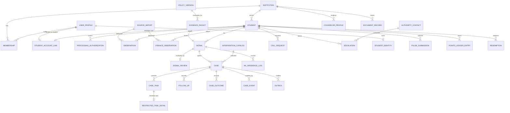

# 03 · Domain Model

All tables below carry `id` (UUID primary key) and `created_at` unless stated.
Every campus-owned table carries `institution_id` and a composite unique key
`(institution_id, id)` so child foreign keys can include the campus.

"Current" lists the table as it exists in `app/models/`. "New" marks tables the
current backend does not have; the reason is given.

## 1. Entity relationship overview

## 2. Identity and tenancy

### `institutions` (current)
| Field | Type | Notes |
|---|---|---|
| name | text | |
| status | text | `active`, `suspended` |

### `user_profiles` (new)
Local mirror of identity-provider users. Reason: display names are currently
hardcoded strings such as `"Faculty Mentor"` (audit D6).
| Field | Type | Notes |
|---|---|---|
| id | UUID | Equals identity-provider `sub` |
| email | text | Verified email |
| display_name | text | |
| status | text | `active`, `disabled` |

### `institution_memberships` (current)
| Field | Type | Notes |
|---|---|---|
| institution_id | UUID FK | |
| user_id | UUID FK → user_profiles | |
| role | text | Canonical role enum ([01](01-product-requirements.md) §2) |
| is_active | bool | |
| granted_by | UUID | New: who granted it |
| granted_via | text | New: `invite`, `roster`, `bootstrap` |
Unique `(institution_id, user_id, role)`.

### `membership_invites` (new)
Reason: memberships must come from invite or roster (audit S1).
| Field | Type | Notes |
|---|---|---|
| institution_id | UUID | |
| email | text | |
| role | text | |
| token_hash | text | SHA-256 of single-use token |
| expires_at | timestamptz | |
| accepted_at | timestamptz null | |
| created_by | UUID | |

### `student_account_links` (new)
Reason: student accounts are currently matched by email prefix (audit S7).
| Field | Type | Notes |
|---|---|---|
| institution_id | UUID | |
| student_id | UUID FK | Unique |
| user_id | UUID FK | Unique per institution |
| verified_by | UUID | Admin who verified |
| verified_at | timestamptz | |
| method | text | `admin_manual`, `roster_email_match_confirmed` |

## 3. Roster

### `students` (current)
| Field | Type | Notes |
|---|---|---|
| external_ref | text | Unique per institution |
| display_name | text | |
| cohort_code | text null | |
| enrollment_status | text | `active`, `inactive`, `graduated`, `withdrawn` |
| updated_at | timestamptz | |
Index `(institution_id, cohort_code, enrollment_status)`.

### `processing_authorizations` (current)
| Field | Type | Notes |
|---|---|---|
| student_id | UUID | |
| purpose_key | text | e.g. `early_warning`, `counselling_referral` |
| basis_type | text | Legal basis |
| status | text | `active`, `withdrawn`, `expired` |
| notice_or_policy_version | text null | |
| effective_at / expires_at | timestamptz | |
| changed_by | UUID | |
| note_code | text null | |

## 4. Ingestion

### `source_imports` (current)
| Field | Type | Notes |
|---|---|---|
| source_system | text | |
| schema_version | text | |
| file_digest | text | SHA-256 of canonical payload |
| idempotency_key | text | Unique per institution |
| status | text | `received`, `completed`, `failed` |
| received_by | UUID | |
| received_at / completed_at | timestamptz | |
| rows_received / accepted / duplicate / rejected | int | |
| row_errors | JSON | `[{row_index, code, message, ref}]` |

### `student_observations` (current)
| Field | Type | Notes |
|---|---|---|
| student_id | UUID FK | |
| domain | text | `attendance`, `academic`, `participation`, `skills`, `faculty_feedback` |
| metric_key | text | |
| value | JSON | Scalars wrapped as `{"val": …}` |
| unit | text null | |
| event_at | timestamptz | When it happened |
| available_at | timestamptz | When decision-makers could see it; ≥ `event_at` |
| ingested_at | timestamptz | |
| source_system, source_record_ref, source_version | | Unique per institution |
| quality_state | text | `valid`, `stale`, `missing`, `conflicting` |
| supersedes_observation_id | UUID null | |
| import_id | UUID FK null | |

### `finance_observations` (current, restricted)
Same temporal and source fields; payload is `fee_support_status` ∈
`review_requested`, `support_in_progress`, `resolved`, `unknown`.

## 5. Policy and signals

### `policy_versions` (current)
| Field | Type | Notes |
|---|---|---|
| policy_key | text | |
| version | int | Unique `(institution_id, policy_key, version)` |
| status | text | `draft`, `published`, `retired` |
| definition | JSON | Rule list ([06](06-ingestion-and-rules-engine.md)) |
| checksum | text | SHA-256 of canonical JSON |
| evaluator_version | text | |
| published_at, effective_from, effective_to | timestamptz | |
Published versions are immutable.

### `evidence_packets` (current)
| Field | Type | Notes |
|---|---|---|
| student_id | UUID | |
| policy_version_id | UUID FK RESTRICT | |
| schema_version | text | |
| as_of_at | timestamptz | Cutoff |
| snapshot | JSON | Inputs used |
| digest | text | SHA-256 of snapshot |
| retention_class | text | |
| expires_at | timestamptz null | |

### `signals` (current)
| Field | Type | Notes |
|---|---|---|
| student_id | UUID FK | |
| policy_version_id | UUID FK RESTRICT | |
| evidence_packet_id | UUID FK RESTRICT | |
| rule_key | text | Primary triggered rule or reason |
| result | text | `attention_suggested`, `no_rule_triggered`, `unknown` |
| quality_state | text | `sufficient`, `insufficient_evidence`, `stale_source` |
| explanation | JSON | |
| evaluated_at | timestamptz | |
| supersedes_signal_id | UUID null | |
Current code stores review fields (`reviewed_decision`, `reviewed_by`,
`reviewed_at`, `review_reason_code`) on the signal row.

### `signal_reviews` (new, optional)
Reason: keeps signals append-only; allows `request_more_data` followed by a
later decision. Fields: `signal_id`, `decision`, `reason_code`,
`selected_intervention_key`, `reviewed_by`, `reviewed_at`.

## 6. Cases

### `intervention_catalog` (current)
| Field | Type | Notes |
|---|---|---|
| intervention_key | text | Unique `(institution_id, key, version)` |
| domain | text | |
| display_label, description | text | |
| recipient_role | text | |
| required_purpose_key | text | Must have active processing authorisation |
| requires_human_approval | bool | |
| active | bool | |
| version | int | |

### `cases` (current)
| Field | Type | Notes |
|---|---|---|
| student_id | UUID FK | Change to RESTRICT (audit D3) |
| originating_signal_id | UUID FK RESTRICT | Unique per institution |
| selected_intervention_key | text | |
| state | text | See [07](07-case-workflow-and-worker.md) |
| primary_owner_user_id | UUID null | |
| due_at | timestamptz null | |
| deadline_version | int | New: incremented on each due-date change; escalation is idempotent per value |
| accepted_at | timestamptz null | |
| is_escalated | bool | Replace with `escalated_deadline_version int null` |
| version | int | ORM version column (audit A3) |
| created_by, created_at, updated_at | | |

### `case_tasks` (current)
| Field | Type | Notes |
|---|---|---|
| case_id | UUID FK | |
| domain | text | `academic`, `mentor`, `finance`, `placement`, `counselling` |
| generic_label | text | Safe to show to non-specialists |
| state | text | `pending`, `accepted`, `in_progress`, `completed`, `cancelled` |
| assignee_user_id | UUID null | |
| due_at, accepted_at, completed_at | timestamptz | |
| deadline_version | int | |
| idempotency_key | text | Unique per institution |

### `restricted_task_details` (current, restricted)
| Field | Type | Notes |
|---|---|---|
| task_id | UUID FK | Unique per institution |
| restricted_domain | text | |
| details | JSON | Encrypted at rest (application-level) recommended |
| purpose_key | text | |
| retention_class | text | |
| expires_at | timestamptz | |

### `follow_ups` (current)
| Field | Type | Notes |
|---|---|---|
| case_id | UUID FK | |
| follow_up_type | text | `contact_attempt`, `student_response`, `support_delivered`, `follow_up_check` |
| contact_status | text null | `attempted`, `student_reached`, `unreachable`, `declined` |
| proof_kind | text | `staff_attestation`, `student_confirmation`, `appointment_record`, `service_provider_confirmation`, `none` |
| occurred_at | timestamptz | |
| recorded_by | UUID | |
| sanitized_note | text | |
| proof_ref | text null | |
| idempotency_key | text | |

### `case_outcomes` (current)
| Field | Type | Notes |
|---|---|---|
| case_id | UUID FK | |
| outcome_status | text | `helped`, `not_helped`, `mixed`, `unknown` |
| follow_up_window_start / end | timestamptz | |
| rationale | text | |
| evidence_kind | text | `staff_review`, `student_feedback`, `academic_record`, `service_record`, `insufficient_evidence` |
| recorded_by, recorded_at | | |

### `case_events` (current, audit)
| Field | Type | Notes |
|---|---|---|
| case_id | UUID FK RESTRICT | Currently CASCADE (audit D3) |
| actor_user_id | UUID null | |
| actor_kind | text | `user`, `system_worker` |
| event_type | text | e.g. `CASE_CREATED_FROM_SIGNAL`, `OWNER_ASSIGNED`, `CASE_ESCALATED` |
| from_state, to_state | text | |
| reason_code | text | |
| metadata | JSON | No sensitive payloads |
| request_id | text | |
| idempotency_key | text | Unique per institution |
| prev_hash | text | New: hash of previous event in chain |
| hash | text | New: SHA-256 over canonical row + prev_hash |

## 7. Notifications

### `notification_outbox` (current)
| Field | Type | Notes |
|---|---|---|
| case_id, task_id | UUID null | |
| adapter_key | text | Current default `in_app_demo`; target: real adapter keys |
| template_key | text | e.g. `CASE_ACTION_PLANNED`, `CASE_ESCALATION_SUPERVISOR` |
| destination_ref | text null | |
| safe_payload | JSON | IDs only, no names or notes |
| status | text | `pending`, `sent`, `failed`, `dead_letter` |
| attempts | int | |
| next_attempt_at | timestamptz | |
| last_error_code | text | |
| idempotency_key | text | |
| sent_at | timestamptz | |
Index `(status, next_attempt_at)`.

### `notifications` (new)
In-app notification inbox per user, written by the in-app adapter.

## 8. Counselling

### `counselor_profiles` (current; no migration today, audit D1)
Fields: `user_id`, `campus_id`, `full_name`, `email`, `phone`, `designation`,
`department`, `specializations[]`, `qualification`, `certifications[]`,
`registration_number`, `credentials_verified`, `contact_methods[]`,
`availability_schedule`, `availability_status` (`available`, `in_session`,
`away`), `preferred_notification`, `assigned_cohorts[]`, `onboarding_status`,
`rejection_reason`, `approved_by`, `approved_at`. Unique `(campus_id, user_id)`.

### `authority_contacts` (current; no migration today)
Fields: `campus_id`, `service_name`, `contact_name`, `designation`,
`department`, `escalation_category`, `contact_number`, `contact_email`,
`communication_method`, `availability`, `verified`, `is_emergency`.

### `case_escalations` (current; no migration today)
Fields: `campus_id`, `case_id` null, `student_id` FK, `authority_contact_id`,
`escalation_category`, `initiated_by_user_id`, `reason`,
`communication_method`, `status`, `follow_up_notes`.

### `counselor_call_requests` (current; no migration today)
Fields: `campus_id`, `student_id` FK, `case_id` null, `signal_id` null,
`risk_score`, `preferred_contact_method`, `preferred_time_slot` (`morning`,
`afternoon`, `flexible`), `student_notes`, `status`, `assigned_counselor_id`,
`contact_attempt_count`, `last_attempt_at`, `resolution_notes`, `updated_at`.
Current code defaults `risk_score` to 0.5 when absent; the rebuild stores null.

## 9. ML and AI audit

### `ml_inference_logs` (current)
Fields: `signal_id` null, `student_id` null, `external_student_ref`,
`model_name`, `model_version`, `model_sha256` (new), `prediction_cutoff`,
`risk_probability`, `threshold`, `classification`, `top_attributions` (JSON),
`latency_ms`.

### `model_registry_entries` (new)
Reason: artifact not versioned or verified (audit M5).
Fields: `model_name`, `version`, `artifact_uri`, `sha256`, `feature_contract_version`,
`training_data_ref`, `metrics` (JSON), `fairness_report` (JSON),
`calibration_method`, `threshold`, `threshold_basis`, `status`
(`candidate`, `approved`, `serving`, `retired`), `approved_by`, `approved_at`.

### `ai_orchestration_logs` (current; no migration today)
Fields: `institution_id`, `user_id`, `target_entity_type`, `target_entity_id`,
`endpoint`, `provider`, `model_name`, `status`, `prompt_tokens`,
`completion_tokens`, `latency_ms`. Prompt text is not stored.

## 10. Wellbeing and rewards

**Current implementation:** pulse submissions are module-level Python lists in
`app/api/v1/happiness.py`; points, stock and redemptions are a Next.js server
singleton in `frontend/lib/shop-data.ts` (audit A4). No tables exist.

### `pulse_questionnaires` (new)
`version`, `dimensions` (JSON), `questions` (JSON), `active`.

### `pulse_periods` (new)
`period_key`, `label`, `starts_at`, `ends_at`.

### `pulse_submissions` (new, restricted)
`student_id`, `period_id`, `questionnaire_version`, `responses` (JSON, 1–5),
`reflection` (text, restricted, encrypted), `submitted_at`. Unique
`(student_id, period_id)`.

### `points_ledger_entries` (new)
Append-only. `student_id`, `activity_key`, `points` (signed int),
`source_ref`, `period_id`, `idempotency_key`, `created_by`. Balance is the sum.

### `reward_catalog_items` (new)
`sku`, `title`, `category`, `points_cost`, `stock`, `active`.

### `redemptions` (new)
`student_id`, `item_id`, `points`, `status` (`requested`, `approved`,
`fulfilled`, `cancelled`), `idempotency_key`.

## 11. Documents and identity

### `document_records` (current)
| Field | Type | Notes |
|---|---|---|
| document_ref | text | Unique per institution |
| title | text | |
| doc_type | text | `intervention_plan`, `support_summary`, `case_decision`, `uploaded_proof` |
| file_name, mime_type, file_size_bytes | | |
| storage_key | text | Replaces `file_path` (local disk today) |
| sha256_hash | text(64) | Exact bytes |
| status | text | `draft`, `finalized`, `anchor_pending`, `anchored`, `anchor_failed`, `verification_mismatch` |
| created_by, finalized_by, finalized_at | | |
| chain_id, contract_address, tx_hash, block_number, anchored_at, anchoring_mode | | `anchoring_mode` ∈ `unavailable`, `onchain` |
| last_verified_at, verification_status, last_verified_by | | `verified_match`, `mismatch`, `unanchored` |
| metadata_payload | JSON | No PII |
| error_message | text | |

### `student_identities` (current)
Fields: `user_id` (unique), `institution_id`, `sutra_id` (unique random public
handle, format `SUTRA-XXXX-XXXX-XXXX`), `display_name`, `avatar_config`
(JSON), `profile_avatar_url`, `art_seed` (private 256-bit hex),
`collectible_status` (`unminted`, `pending`, `minted`, `failed`),
`collectible_token_id`, `collectible_tx_hash`, `collectible_error`,
`wallet_address`, `wallet_verified_at` (new), `minted_at`, `updated_at`.

## 12. Idempotency

### `idempotency_records` (current)
Fields: `institution_id`, `idempotency_key`, `request_path`, `request_hash`
(SHA-256), `response_status_code`, `response_json`. Unique
`(institution_id, idempotency_key)`. Add `user_id` and `expires_at`; purge
after `IDEMPOTENCY_TTL` (current setting: 86,400 s).

## 13. Referential and audit rules

| Rule | Requirement |
|---|---|
| Audit tables (`case_events`, `evidence_packets`, `signals`, `ml_inference_logs`, `ai_orchestration_logs`, audit chain) | FK `ON DELETE RESTRICT`; application DB role has no `UPDATE`/`DELETE` grant (audit D3) |
| Students | No hard delete while cases exist; use `enrollment_status` and retention purge |
| Every model table | Has a migration; CI fails on model/migration drift (audit D1) |
| Every exposed table | Has an RLS policy; CI checks the list against the models (audit S6) |
| Foreign keys | Enforced in tests (tests run on Postgres, audit D4) |

## 14. Retention classes

**Open decision:** retention period per class. Classes present in current code:
`demo_short_lived` (evidence packets), `restricted_short_lived` (restricted task
details). The rebuild needs, at minimum: `operational` (cases, events),
`restricted` (finance, counselling, reflections), `evidence` (packets, signals),
`telemetry` (inference and AI logs), `idempotency`.
