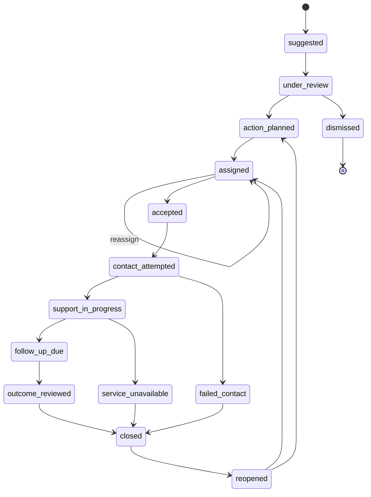

# 07 · Case Workflow and Worker

> **Status (2026-11-01).** Sections 1 to 7 are the target specification and
> describe the earlier SUTRA code as "Current implementation". The new backend
> (`api/app/modules/cases/`, `worker/`) implements most of it; section 8 lists
> exactly what is built and what is not. Where they differ, section 8 wins.

## 1. Case state machine

**Earlier (SUTRA) implementation:** `ALLOWED_TRANSITIONS` in
`app/services/case_service.py` (14 states); the new `TRANSITIONS` table in
`api/app/modules/cases/services.py` has the same transitions (§8). Cases are created directly in
`action_planned` from an approved signal.



### 1.1 Transition events (current)

| From → To | Event type |
|---|---|
| suggested → under_review | `CASE_REVIEW_STARTED` |
| under_review → action_planned | `INTERVENTION_APPROVED` |
| under_review → dismissed | `SIGNAL_DISMISSED` |
| action_planned → assigned | `OWNER_ASSIGNED` |
| assigned → assigned | `OWNER_REASSIGNED` |
| assigned → accepted | `ASSIGNMENT_ACCEPTED` |
| accepted → contact_attempted | `CONTACT_ATTEMPTED` |
| contact_attempted → support_in_progress | `SUPPORT_STARTED` |
| contact_attempted → failed_contact | `CONTACT_FAILED` |
| support_in_progress → follow_up_due | `SUPPORT_DELIVERED` |
| support_in_progress → service_unavailable | `SERVICE_UNAVAILABLE` |
| follow_up_due → outcome_reviewed | `OUTCOME_RECORDED` |
| outcome_reviewed / failed_contact / service_unavailable → closed | `CASE_CLOSED` |
| closed → reopened | `CASE_REOPENED` |
| (creation) | `CASE_CREATED_FROM_SIGNAL` |
| (worker) | `CASE_ESCALATED` |

### 1.2 Requirements

| ID | Requirement | Audit |
|---|---|---|
| CASE-SM-01 | The transition table is data (one module constant or table) and the only place transitions are defined | — |
| CASE-SM-02 | Each transition declares the permission action and scope rule required ([04](04-security-and-access.md)) | S4 |
| CASE-SM-03 | Each transition declares guards. Minimum: `→ assigned` needs owner and `due_at`; `→ accepted` only by owner; `→ follow_up_due` needs ≥ 1 follow-up of type `support_delivered`; `→ outcome_reviewed` needs an outcome row; `→ closed` from `outcome_reviewed` needs an outcome | — |
| CASE-SM-04 | Version check and write are one statement: `UPDATE cases SET …, version = version + 1 WHERE id = :id AND institution_id = :c AND version = :v`; 0 rows → 409 | A3 |
| CASE-SM-05 | Clients must send the version on every mutating case call | A3 |
| CASE-SM-06 | State change, case event and outbox intent commit in one transaction | — |
| CASE-SM-07 | Override records the prior state and reason; it may move to any state permitted by an explicit override table | — |
| CASE-SM-08 | Terminal states: `closed` (reopenable), `dismissed` (not reopenable) | — |

**Open decision:** whether `suggested` and `under_review` remain case states
when review already happens on the signal. In the current code no case is
created in those states.

## 2. Tasks

- Task states: `pending → accepted → in_progress → completed`, plus
  `cancelled` from any non-terminal state.
- A task in a restricted domain (`finance`, `counselling`) stores sensitive
  context in `restricted_task_details`; the task row holds only
  `generic_label`.
- Reading restricted details writes an access audit event.
- Each task has its own `due_at` and `deadline_version` and is escalated by
  the same scheduler as cases.

## 3. Follow-ups and outcomes

- A follow-up with `contact_status = attempted` does not imply support was
  delivered (requirement R14 in `docs/docs/01_SCOPE_AND_REQUIREMENTS.md`).
- An outcome can be recorded once per case cycle; reopen starts a new cycle.
- Notes are stored as entered by staff. **Open decision:** whether notes pass
  through automated PII redaction before storage (field name
  `sanitized_note` exists today; no redaction is performed).

## 4. Deadlines and escalation

**Earlier (SUTRA) design, not in the current code (see §8):** `scan_and_escalate_overdue_cases` selects
non-terminal cases with `due_at < now` and `is_escalated = false`, sets
`is_escalated = true`, increments version, writes `CASE_ESCALATED` with
`actor_kind = system_worker` and an outbox intent
`CASE_ESCALATION_SUPERVISOR`. It is not run by any process (audit A2).

**Requirements:**

| ID | Requirement |
|---|---|
| ESC-01 | A scheduler runs the scan at a configured interval in every environment except unit tests |
| ESC-02 | Idempotency key per escalation = `(case_id, deadline_version)`; changing `due_at` increments `deadline_version` and re-arms escalation |
| ESC-03 | Escalation target is resolved from configuration: owner's HOD or a campus escalation contact. **Open decision:** escalation chain per campus |
| ESC-04 | Multi-level escalation (for example +24 h → HOD, +72 h → institution admin) is configurable |
| ESC-05 | The scan uses `FOR UPDATE SKIP LOCKED` so multiple workers do not double-escalate |
| ESC-06 | Tasks follow the same rules |

## 5. Outbox and delivery

**Earlier (SUTRA) implementation, superseded by §8:** `OutboxWorker.process_outbox_batch` locks up to 50
due `pending` rows (`SKIP LOCKED`), calls an optional dispatcher, marks `sent`
even without a dispatcher, retries with backoff `5 s × 2^(attempt-1)`, and sets
`dead_letter` after 5 attempts (audit A2).

**Requirements:**

| ID | Requirement |
|---|---|
| OUT-01 | Adapter registry keyed by `adapter_key`; unknown key → `dead_letter` with code `UNKNOWN_ADAPTER` |
| OUT-02 | No adapter → item stays `pending`; never marked `sent` |
| OUT-03 | Adapters: `in_app` (writes `notifications` rows) required; `email`, `sms`, `whatsapp` optional per campus |
| OUT-04 | Payload contains IDs and template keys only; adapters render content at send time with the recipient's permissions |
| OUT-05 | Each delivery attempt is logged with provider message id |
| OUT-06 | Dead-letter items are visible to `institution_admin` with a retry action |
| OUT-07 | Retry policy (max attempts, base backoff) is configuration |

## 6. Worker process

```
loop every OUTBOX_INTERVAL:     process_outbox_batch(batch_size)
loop every ESCALATION_INTERVAL: scan_and_escalate(cases), scan_and_escalate(tasks)
loop every ANCHOR_INTERVAL:     confirm_pending_anchors()
daily:                          purge_expired(retention classes), purge_idempotency()
```

- One entry point (`worker` command) in the same code base as the API.
- Graceful shutdown: finish the current batch, release locks.
- Health: the worker writes a heartbeat row; `/ready` on the API reports
  worker staleness.
- Metrics: items processed, failed, dead-lettered, escalations created,
  loop duration.

## 7. Audit chain

**Requirement AUD-01 (audit D3):** `case_events` (and other audit tables)
form a hash chain per campus: `hash = SHA-256(prev_hash || canonical_row)`.
A verification endpoint (admin only) recomputes the chain and reports the first
break. The application database role has `INSERT` and `SELECT` only on audit
tables. The superseded prototype (`backend/`) contained a hash-chained
"Support Evidence Ledger"; `app/` has none.

## 8. Implementation status (API `modules/cases`, worker)

The backend team's implementation (merged from their `main`) replaced our earlier SUTRA-port cases, outbox and
campus-membership code. Current state:

- **Lifecycle**: 14 states (`CaseState` in `api/app/shared/enums.py`); transition rules in
  `api/app/modules/cases/state_machine.py`, applied by `CaseLifecycleService` in `services.py`. Models in
  `models.py`: `Case`, `CaseEvent` (`disha_case_events`), `CaseNote`, `Signal`, `Intervention`,
  `InterventionCatalogue`, `InterventionOutcome` (`disha_intervention_outcomes`), `FollowUp`, `FollowUpNote`.
  Audit trail: the `modules/audit` module (hash-chain tests in `api/tests/unit/test_audit_hash_chain.py`).
- **HTTP surface** (`cases/routes.py`, mounted at `/api/v1/cases`): `POST /`, `GET /`, `GET /{id}`, `PATCH /{id}`,
  `POST /{id}/transition`, `/assign`, `/reopen`, `/dismiss`, `/accept`, `/close`, `GET /{id}/events`.
  Outcome, follow-up and notification behaviour is whatever their `services.py` does; read it before relying on it.
- **Auth and tenancy**: `get_tenancy_context` (`api/app/core/dependencies.py`) validates the token, the active user
  and an active `Membership` (`modules/identity/models.py`) for the `X-Campus-ID` campus, returning a `TenancyContext`.
  Routes use `require_role(...)` or `require_permission(Action...)`; `Role` and `Action` are in
  `core/permissions.py`.
- **Notification outbox**: the case service writes notification outbox rows (`disha_notifications`,
  `modules/notifications/models.py`) in the same transaction as the case change.
- **Worker** (`worker/scheduler.py`, APScheduler, one run per job at a time): `outbox_dispatch` every 10 s,
  `deadline_escalation` every 60 s, `anchor_confirmation` every 300 s, `retention_purge` and `model_drift_report`
  daily, `meko_weekly_outcomes` weekly. **Not yet implemented (stubs):** `outbox_dispatch`, `deadline_escalation`,
  `anchor_confirmation`, `retention_purge` and `model_drift_report` only log a line; the case service writes
  notification outbox rows but nothing dispatches them, and nothing escalates overdue cases. `meko_weekly_outcomes`
  is wired but `fetch_weekly_outcomes()` returns `[]` (TODO), so it writes nothing yet. Repo docs are no longer
  synced to Meko.
- **Meko feed** (optional, background): `POST /api/v1/meko/flags/review` writes a decision trace only (no case is
  created); `POST /api/v1/meko/outcomes` writes an outcome memory (hashed case id) and promotes a recurring good
  outcome into the shared playbook (`MEKO_PROMOTE_MIN`, default 3). The cases module stays the source of truth for
  outcomes. `intervention_id` must be active in the campus catalogue when one is configured (AI-07).
- **Migrations**: `api/migrations/versions/001_counsellor_module_initial.py` then
  `002_student_faculty_module_initial.py` (`cd api && alembic upgrade head`, uses `DISHA_DATABASE_URL`).
  Tests: `api/tests/unit/test_case_lifecycle.py`, `test_case_orm_state.py`, `test_cases_persistence.py`.
- **Not built**: deadline escalation and notification dispatch (worker stubs above), email/SMS adapters, and any
  worker call to the ML scorer ([05](05-api-specification.md) §4.5).

