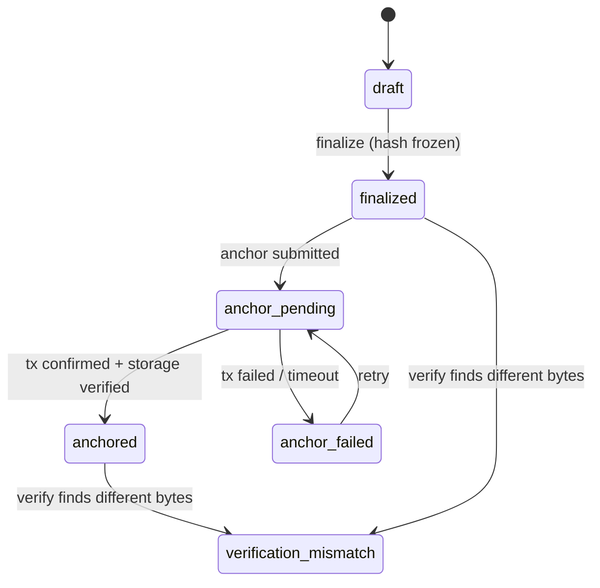

# 11 · Documents and On-Chain Anchoring

Optional module. Generates or accepts documents tied to support work, freezes
them, and optionally writes their SHA-256 hash to a blockchain so integrity can
be checked later without storing personal data on-chain.

## 1. Facts about the current implementation

| Item | Fact |
|---|---|
| Code | `app/api/v1/documents.py`, `app/services/document_integrity.py`, `app/services/blockchain.py`, `contracts/DishaDocumentRegistry.sol` |
| Chain | Base Sepolia test network, chain id 84532, RPC `https://sepolia.base.org` |
| Storage | Local disk under `DOCUMENTS_STORAGE_DIR` (`storage/documents`) (audit A4) |
| PDF generation | `reportlab` |
| Hash | SHA-256 of exact bytes, lowercase hex |
| Anchor flow | Client wallet broadcasts `anchorDocument`; API `/anchor` verifies receipt, calldata and on-chain storage, then records `anchored`. No simulated anchors are recorded |
| Blocking I/O | `web3.py` calls and file I/O run inside `async def` handlers (audit A6) |
| Contract key | `docRefHash` (hash of the document reference), first writer wins; any address can anchor any reference first (audit S8) |
| Contract behaviour | Re-anchoring with the same hash succeeds (idempotent); different hash reverts `AlreadyAnchored` |

## 2. Document lifecycle

Editing a finalized document creates a new document record (new version);
the original is never modified.

## 3. Requirements

| ID | Requirement | Audit |
|---|---|---|
| DOC-01 | Bytes stored in private object storage keyed by `storage_key`; downloads via short-lived signed URLs | A4 |
| DOC-02 | Upload limits: maximum size, MIME allowlist, content sniffing | — |
| DOC-03 | Hash computed while streaming; stored hash re-verified on every read used for anchoring or verification | — |
| DOC-04 | No personal data in `document_ref`, on-chain data or `metadata_payload` | — |
| DOC-05 | All chain and file I/O runs off the event loop (thread pool or worker) | A6 |
| DOC-06 | Anchor confirmation runs in the worker; the API returns 202 with `anchor_pending` | A6 |
| DOC-07 | Anchor key is bound to the institution: `key = keccak256(institutionAnchorAddress, docRef)` **or** the contract restricts `anchorDocument` to an allowlist of institution signer addresses managed by an owner | S8 front-running |
| DOC-08 | If the server signs anchor transactions, the signing key lives in a KMS/HSM or secret manager, never in `.env` on disk in production | — |
| DOC-09 | Verification response states which checks ran: DB hash vs bytes, chain hash vs bytes, chain record exists | — |
| DOC-10 | Contract tests cover: zero hash rejected, idempotent re-anchor, conflicting re-anchor reverts, unauthorised anchor reverts | — |

**Open decision:** whether anchoring is needed for the first release. The
integrity check (DB hash vs stored bytes, plus an append-only audit chain)
works without a blockchain.

## 4. Student identity collectible (optional)

### 4.1 Facts

| Item | Fact |
|---|---|
| Code | `app/api/v1/identity.py`, `app/services/identity_art.py`, `contracts/DishaStudentIdentityNFT.sol` |
| Public id | `disha_id`, random, format `DISHA-XXXX-XXXX-XXXX`, unique |
| Artwork | Generated from a private 256-bit `art_seed`, not from the avatar; PNG served publicly by `disha_id` |
| Metadata | Public JSON by `disha_id`; no PII |
| Pinning | Optional IPFS via Pinata |
| Contract | ERC-721 with a `locked` (soulbound-style) interface; one token per `disha_id` hash |
| Minting | Server relayer pays gas for any authenticated account; recipient wallet ownership is not proven (audit S8) |

### 4.2 Requirements

| ID | Requirement |
|---|---|
| NFT-01 | Wallet ownership proven by a signed challenge (for example EIP-4361 "Sign-In with Ethereum") before minting |
| NFT-02 | Only users with a verified student link can mint; one mint per identity; rate-limited |
| NFT-03 | Relayer key in a secret manager; spending limit monitored |
| NFT-04 | Mint transaction submitted and confirmed by the worker |
| NFT-05 | Public art and metadata endpoints reveal no PII and no link to institution records |

**Open decision:** whether issuing blockchain tokens to students (possibly
minors) is acceptable to partner institutions; this is a policy question, not
a technical one.
