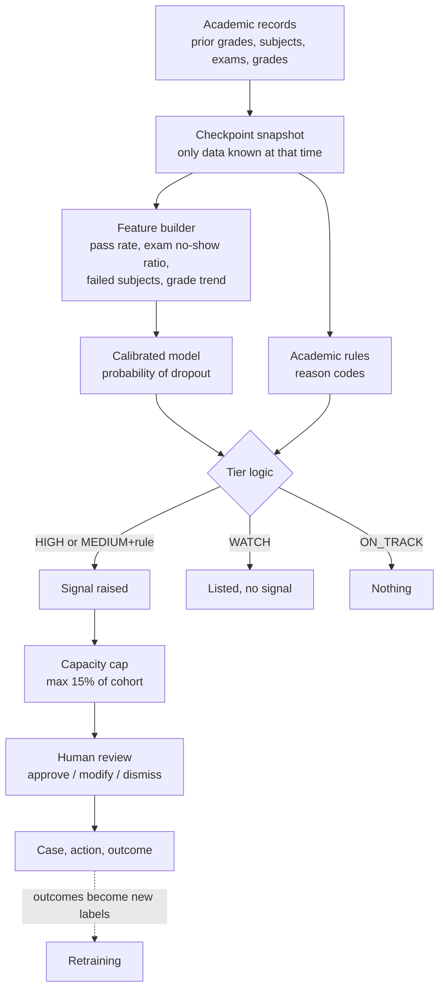

# 16 · Risk Signal Pipeline (how a student gets flagged)

This document explains, step by step, how the system decides that a student
needs attention, what data it uses, and what happens under the hood. It is
written for reviewers and judges as well as engineers. Code lives in
`ml/kagaz_ml/`; the training procedure is in
[17-model-training-guide.md](17-model-training-guide.md); data requirements
are in [18-dataset-requirements.md](18-dataset-requirements.md).

## 1. One-paragraph summary

At three points in a student's first year (admission, end of semester 1, end
of semester 2), the system looks only at **academic** data available at that
moment: prior grades, subjects enrolled, subjects passed, exams taken, average
grade and the change between semesters. A gradient-boosted model, calibrated so
its percentages match reality, estimates the probability that the student will
drop out. Separately, plain academic rules check concrete warning signs
("passed 2 of 6 subjects", "skipped 3 exams"). A **signal** is raised only when
the probability is above a cutoff chosen to reach a set precision (default
85%), or above a lower cutoff **and** at least one rule confirms it. The total
number of signals is capped at what advisors can handle (default 15% of a
cohort). Every signal carries plain-language reasons, and a human reviews it
before any action is taken.

## 2. Pipeline at a glance

## 3. Data used

Academic data only. Source for the first model: the public UCI dataset
"Predict Students' Dropout and Academic Success" (4,424 students; details in
[18](18-dataset-requirements.md)).

| Used as model input | Why |
|---|---|
| Previous qualification grade, admission grade | Preparation before university |
| Course | Pass rates and difficulty differ by course |
| Per semester: subjects enrolled, credited, evaluated, passed, without evaluation, average grade | Day-to-day academic behaviour |

| Kept aside, never a model input | Used for |
|---|---|
| Gender, age at enrolment, displaced, special educational needs | Fairness check only: does the system flag one group more often, or wrongly, than another? |

| Not used | Reason |
|---|---|
| Family background, marital status, nationality, macro-economic indicators | Not academic; product scope is academic data only |
| Fees up to date, debtor, scholarship | Not academic. Known to carry predictive signal in this dataset; excluding them is a deliberate scope choice |
| Names, roll numbers | Identify a student, say nothing about risk. Shown in the UI, never fed to the model |

## 4. Checkpoints: only what is known at the time

A model that uses end-of-year results to "predict" a problem in week 3 looks
accurate in testing and is useless in practice. Each checkpoint therefore has
its own model trained only on what exists at that point.

| Checkpoint | When | Inputs | Purpose |
|---|---|---|---|
| `cp0` | At admission | Prior grades, course | Earliest weak signal; usually only WATCH |
| `cp1` | End of semester 1 | + semester 1 results | **Main early warning** |
| `cp2` | End of semester 2 | + semester 2 results + change from semester 1 | Confirms, escalates or clears earlier flags |

Enforced in code: `tests/test_data_and_features.py` fails if a semester-2 field
reaches `cp0`/`cp1`, or if a protected field reaches any model.

## 5. Features (the "multiple factors")

Raw counts are turned into factors that mean the same thing across courses with
different subject loads:

| Feature | Formula | What it captures |
|---|---|---|
| Pass rate | passed ÷ enrolled | Keeping up with subjects |
| Attempt rate | evaluations ÷ enrolled | Sitting exams at all |
| Exam no-show ratio | subjects without evaluation ÷ enrolled | Disengagement |
| Failed subjects | enrolled − passed | Backlog building up |
| Average grade | as given, but **missing** if nothing passed | Quality of work |
| No-grade flag | 1 if nothing passed | Separates "no grade" from "low grade" |
| No-units flag | 1 if no subjects enrolled | Not registered for the semester |
| Grade change (cp2) | sem2 grade − sem1 grade | Getting better or worse |
| Pass-rate change (cp2) | sem2 pass rate − sem1 pass rate | Same, for passing |
| Total failed (cp2) | sem1 + sem2 failed subjects | Cumulative backlog |

Data quirk handled: the dataset records grade **0** when a student passed no
subject. Treating that as a real mark of zero would distort the model, so it
becomes "missing" plus the no-grade flag.

## 6. The model

| Choice | Value | Reason |
|---|---|---|
| Algorithm | Histogram gradient-boosted trees (scikit-learn) | Strong on small tabular data, handles missing values, trains in seconds on CPU |
| Comparison models | Rules-only score; logistic regression | The model must beat the rules; if logistic regression is as good, it is preferred for simplicity (the report says so) |
| Label (default) | Dropout = 1, Graduate or still Enrolled = 0 | Most serious outcome. Option `not_on_time`: Dropout or still Enrolled = 1 |
| Calibration | Isotonic, 5-fold | So "0.80" means about 80 out of 100 such students actually drop out. Required for a meaningful cutoff |

## 7. The cutoff: raising a signal only when it is likely to be real

This is the mechanism that prevents false alarms.

1. The training data (80% of students) is split into 5 parts. Each part is
   scored by a model trained on the other 4, so every training student gets an
   honest probability (out-of-fold).
2. Starting from the highest probability and moving down, the system checks:
   "of all students at or above this probability, what share really dropped
   out?" (precision).
3. The **HIGH cutoff** is the lowest probability at which that share stays at
   or above the target (default **85%**) for every cutoff above it, with at
   least 30 students flagged. The "every cutoff above it" condition prevents
   choosing a cutoff that only works because of a lucky narrow band.
4. The same method gives a **MEDIUM cutoff** (70%) and a **WATCH cutoff**
   (50%).
5. The cutoffs are then tested **once** on the 20% of students never used for
   training. If HIGH-tier precision on that test set falls more than 5 points
   below target, the release check fails and the model is not used.

If no cutoff can reach 85% (for example at admission, `cp0`), the HIGH tier
is switched off for that checkpoint rather than lowered.

### Tier logic

| Tier | Condition | Result |
|---|---|---|
| HIGH | probability ≥ HIGH cutoff | Signal |
| MEDIUM | MEDIUM cutoff ≤ probability < HIGH cutoff **and** ≥ 1 academic rule fires | Signal |
| WATCH | probability ≥ WATCH cutoff, or MEDIUM band with no rule | Visible in a list, no signal |
| ON_TRACK | below WATCH cutoff | Nothing |

### Capacity cap

If signals exceed 15% of the cohort (configurable to advisor capacity), only
the highest-probability ones remain signals; the rest move to WATCH and are
marked `capacity_capped`. This keeps the core rule — every alert gets an
action — achievable.

### Academic rules (reason codes)

| Code | Fires when | Default |
|---|---|---|
| `LOW_PASS_RATE` | passed ÷ enrolled below threshold | 50% |
| `EXAM_NO_SHOW` | subjects with no exam taken ≥ threshold | 1 |
| `FAILED_UNITS` | subjects not passed ≥ threshold | 2 |
| `LOW_GRADE` | semester average below threshold | 10 / 20 |
| `GRADE_DROP` | semester 2 average lower than semester 1 by ≥ threshold | 2 points |

## 8. Explanations attached to every signal

Two kinds, shown side by side:

- **Rule reasons:** exact facts, for example "passed 2 of 6 subjects in
  semester 1; no exam taken in 3 subject(s)".
- **Model factors:** for each factor group, the student's values are replaced
  with a typical student's values and the student is re-scored. The drop in
  probability is that factor's contribution, for example "exams taken in
  semester 1 (+18 pts)". The three largest are shown.

## 9. Worked example (illustrative, not a real student)

Student at `cp1`: enrolled in 6 subjects, sat exams in 3, passed 2, average
grade 10.8, admission grade 118.

1. Features: pass rate 0.33, attempt rate 0.50, no-show ratio 0.50, failed
   subjects 4.
2. Model: calibrated probability 0.81.
3. Cutoffs for this checkpoint (example values): HIGH 0.77, MEDIUM 0.45.
4. 0.81 ≥ 0.77 → **HIGH** → signal.
5. Rules fired: `LOW_PASS_RATE`, `EXAM_NO_SHOW`, `FAILED_UNITS`.
6. Shown to the mentor: "High risk (81%). Passed 2 of 6 subjects; no exam
   taken in 3 subjects; 4 subjects not passed. Main factors: exams taken in
   semester 1, subjects passed in semester 1."
7. Mentor approves → case created with an owner and due date (see
   [07](07-case-workflow-and-worker.md)).

## 10. What the numbers mean and do not mean

- All reported figures come from `artifacts/<checkpoint>/report.md`, generated
  by the training run on the held-out test split. No figure is written by hand.
- Precision 85% at HIGH means roughly 15 of every 100 HIGH signals are false
  alarms. That is why a human reviews every signal.
- A high precision cutoff catches only part of all at-risk students (recall).
  MEDIUM + rules and WATCH exist to widen coverage without flooding advisors.
- The dataset comes from one Portuguese higher-education institution. It
  proves the pipeline works end to end; it does not prove the same accuracy at
  an Indian campus. Accuracy there must be measured on that campus's own data
  ([17](17-model-training-guide.md) §9).
- Attendance is not in this dataset. In the product, attendance enters through
  the rules engine ([06](06-ingestion-and-rules-engine.md)) and becomes a model
  feature once campus data with outcomes exists.

## 11. How this fits the rest of the system

| Step | Where |
|---|---|
| Data arrives as observations | [06](06-ingestion-and-rules-engine.md) §1 |
| Rule-based signals (attendance and other campus rules) | [06](06-ingestion-and-rules-engine.md) §3–4 |
| ML risk tier attached as an evidence card | this document, [08](08-ml-subsystem.md) §6 |
| Human review, case, follow-up, outcome | [07](07-case-workflow-and-worker.md) |
| Outcomes used as future training labels | [17](17-model-training-guide.md) §9 |
