# DISHA — How the Whole System Works

A visual map of DISHA from start to finish: who uses it, how a college's data
gets in, how a student gets flagged, and what happens after. Every section has
one diagram and a short plain-language explanation.

> [!info] How to read the diagrams
> - Read **top to bottom** or **left to right**, following the arrows.
> - 🟩 **Green** = built and working today.
> - 🟨 **Yellow** = planned (designed in `blueprint/`, folder exists, logic not written yet).
> - 🟦 **Blue** = a person does this.
> - 🟥 **Red** = sensitive data with extra protection.

## Contents

1. [[#1. The big picture]]
2. [[#2. Who uses DISHA]]
3. [[#3. How a college's data gets in (ingestion)]]
4. [[#4. What data we take in]]
5. [[#5. Inside the import check]]
6. [[#6. How a student gets flagged (signals)]]
7. [[#7. The ML model up close]]
8. [[#8. How the ML model is trained and updated]]
9. [[#9. Review, cases and follow-up]]
10. [[#10. Deadlines, reminders and escalation]]
11. [[#11. Security on every request]]
12. [[#12. Reports and the learning loop]]
13. [[#13. Extra modules]]
14. [[#14. One student, start to finish]]
15. [[#15. What is built vs planned]]

---

## 1. The big picture

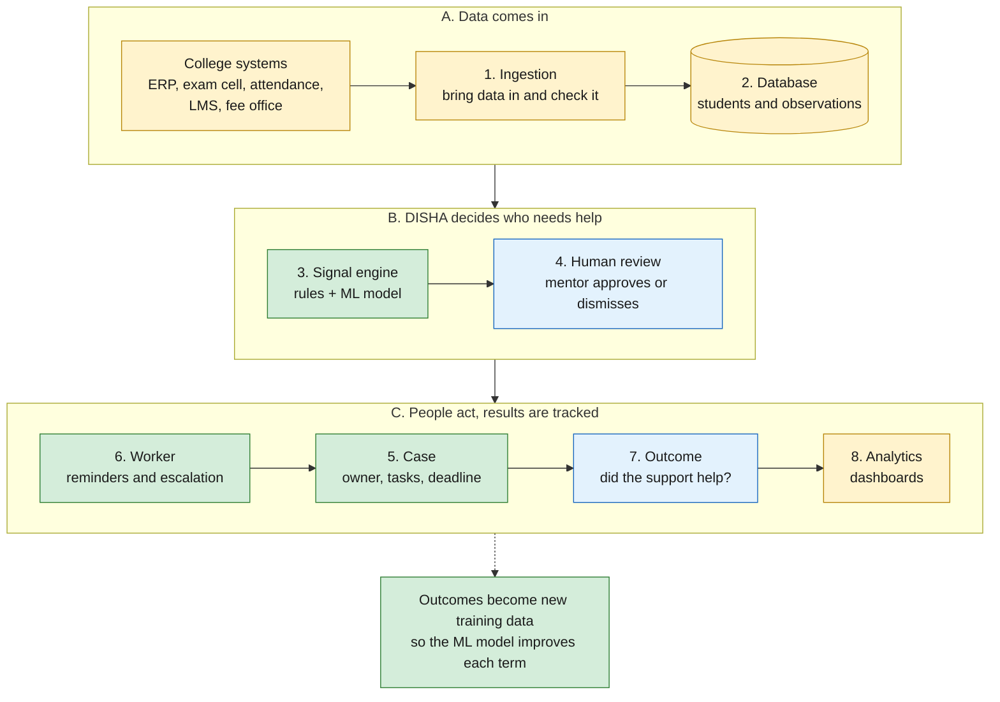

**In one sentence:** college data comes in, DISHA spots students who may be at
risk, a person decides what to do, the action is tracked until it is done, and
the result teaches the system for next time.

**Golden rule — "No Alert Without Action":** every alert must lead to a human
decision and, if accepted, to an owned task with a deadline.

---

## 2. Who uses DISHA

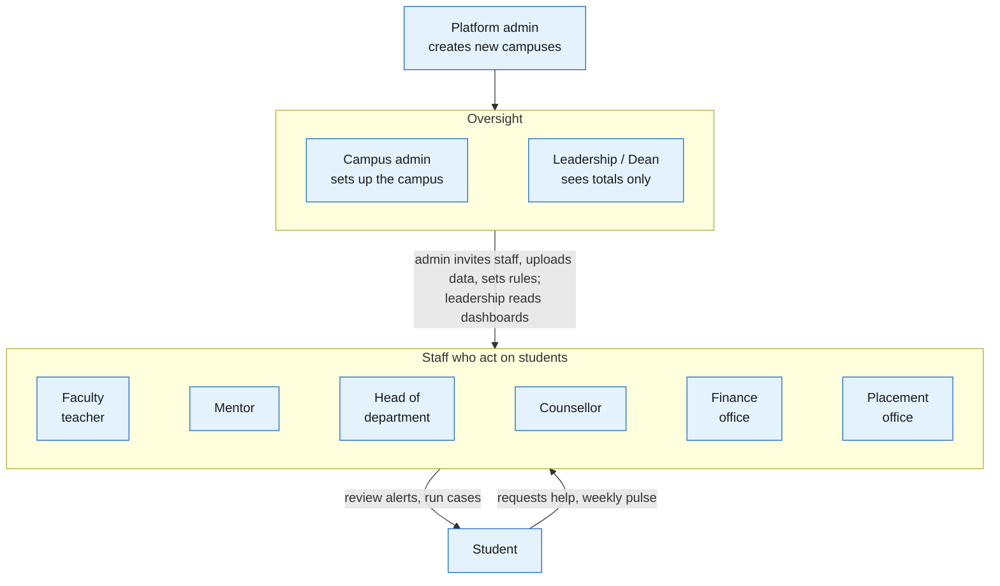

| Role | Main job in DISHA | Can see |
|---|---|---|
| Student | Ask for help, see own case status, weekly wellbeing pulse | Only their own records |
| Faculty | Raise concerns, review alerts for their students | Their students |
| Mentor | Work on cases of assigned mentees | Assigned students |
| Head of department (HOD) | Assign cases, override, oversee department | Whole department |
| Counsellor | Counselling tasks, call requests, escalations | Counselling details of their cases |
| Finance / Placement | Their own type of task only | Only their task details |
| Leadership | Department and campus trends | **Totals only, never individual students** |
| Campus admin | Invite users, upload data, manage rules and catalogue | Settings, not private student details |
| Platform admin | Create campuses | No student data by default |

> [!warning] Nobody gets access by just signing up
> A person only gets a role through an **invite** from the campus admin or a
> **verified roster**. A student account is linked to a student record only by
> an admin.

---

## 3. How a college's data gets in (ingestion)

Different colleges keep data in different ways, so DISHA accepts several
**ways in**. Every way ends up in the **same import check**, so the rest of the
system works the same whatever the college uses.

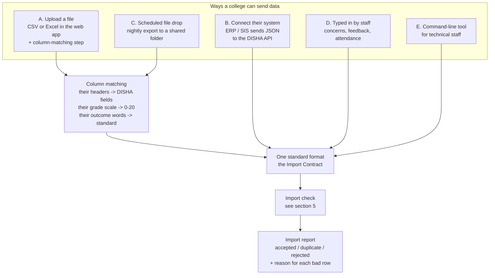

| Way in | Best for | What the college does | Status |
|---|---|---|---|
| **A. File upload** | Most colleges (data lives in Excel) | Download from their system, upload, match columns once | Planned. Column matching already works in the ML tool (`mapping.json`) |
| **B. API (JSON)** | Colleges with a modern ERP | Their IT connects to `POST /api/v1/imports` | Planned (designed in blueprint 05, 06) |
| **C. Scheduled drop** | Regular nightly or weekly updates | Their system saves a file to a shared folder every night | Planned (optional) |
| **D. Typed in** | Things not in any system: a teacher's concern, feedback | Staff fill a form in DISHA | Planned |
| **E. CLI** | Admins comfortable with a terminal | Run one command with the file | Planned (folder exists) |

**Accepted file formats:** CSV (comma or semicolon), Excel (`.xlsx`, converted
to CSV), JSON. Headers can be in any wording; the column-matching step maps
them once and remembers the mapping.

> [!tip] Column matching already exists
> The ML tool can already read any college's file with a small mapping file:
> their column names, their grade scale (SGPA 0–10, percent 0–100) and their
> outcome words ("Dropped out", "Passed out"). See `ml/README.md` §17. The
> planned upload screen reuses the same idea.

---

## 4. What data we take in

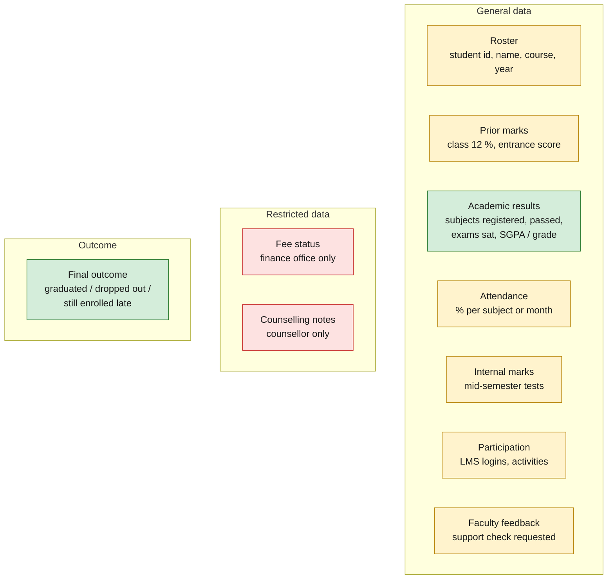

- **General data:** staff can see it (within their role), and the rules and ML model use it.
- **Restricted data:** only the right office sees it; it is never sent to AI or shown in reports.
- **Outcome:** used only to train and test the ML model.

| Data | Example fields | How often | Used by | Needed? |
|---|---|---|---|---|
| Roster | student id, name, course, year, status | Start of term | Everything | **Required** |
| Academic results | subjects registered, subjects passed, exams sat, absent, SGPA | Each semester | ML model + rules | **Required for ML** |
| Final outcome | graduated / dropped out / still enrolled | End of programme | Training only | **Required to train** |
| Prior marks | class 10/12 %, entrance score | Once | ML (admission check) | Recommended |
| Attendance | attendance % | Weekly or monthly | Rules today, ML later | Recommended |
| Internal marks | mid-sem test marks | Mid-semester | Rules, ML later (earlier warning) | Recommended |
| Faculty feedback | "needs support" yes/no | Any time | Rules | Optional |
| Participation | LMS logins, activities | Weekly | Rules, ML later | Optional |
| Fee status 🟥 | review requested / in progress / resolved | Any time | Finance tasks only | Optional |
| Gender, age, disability | as recorded | Once | **Fairness check only, never the model** | Optional |

**Every observation carries two dates:**

- **When it happened** (`event_at`), e.g. the exam date.
- **When staff could see it** (`available_at`), e.g. the result publication date.

DISHA only uses data that was **available** at the moment it makes a
decision. This stops the system from "cheating" with results nobody had yet.

---

## 5. Inside the import check

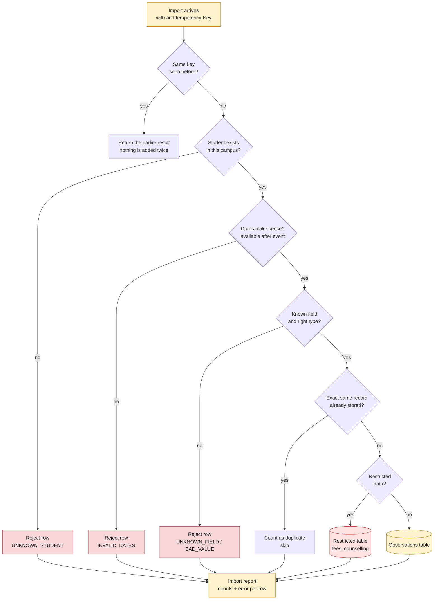

- A bad row never blocks the good rows; the college gets a clear list of what
  to fix.
- Sending the same file twice is safe: duplicates are detected, not doubled.
- Data cleaning already built in the ML tool: a semester with every field 0 is
  treated as **missing**, impossible counts are capped, and a grade of 0 with
  nothing passed is treated as "no grade".

---

## 6. How a student gets flagged (signals)

Two checkers look at every student. They work separately, then their results
are combined.

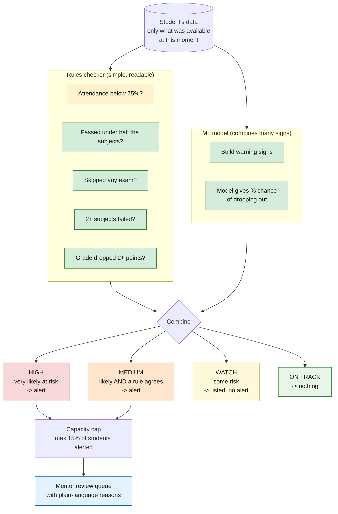

- **Rules** give exact, checkable reasons ("passed 2 of 6 subjects").
- **The ML model** weighs many signs at once and gives a percentage.
- An alert needs either a **very high** model score, or a **fairly high**
  score **plus** a rule agreeing. This keeps false alarms low.
- The **capacity cap** makes sure mentors can follow up on every alert.
- The picture shows the legacy semester models (15% cap). The primary rolling
  model uses the same tier logic with a 25% cap per course, term and day; see
  section 7.

---

## 7. The ML model up close

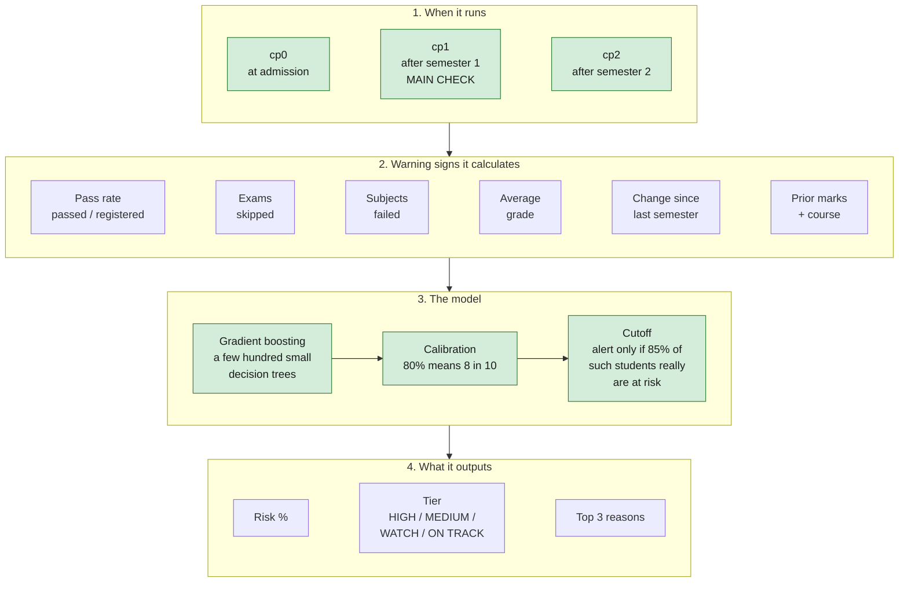

### 7a. The primary model: rolling risk (scores whenever marks arrive)

Instead of three fixed checkpoints, the rolling model scores a student at
**every assessment due date** ("whenever marks reach the ERP"), using only data
up to that day, and skips students who have already withdrawn.

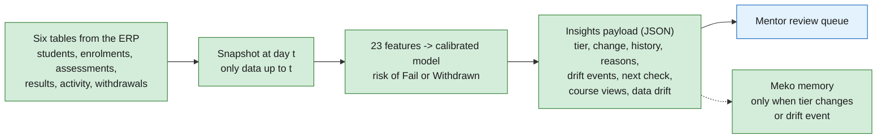

| Measured on the held-out 2014J term (OULAD) | Result |
|---|---|
| Ranking quality (ROC AUC) | 0.857 overall; 0.727 at 10% of the term, 0.809 at 25%, 0.881 at 50%, 0.933 at 75% |
| Accuracy over all snapshots | 79.0% (always predicting "fine" scores 64.6%) |
| Withdrawn students flagged before leaving | 70.5%, a median 54 days ahead |
| Overfit check (train / grouped CV / test AUC) | 0.894 / 0.883 / 0.857 |

What the backend receives per student: risk %, tier, change since last marks,
history, top reasons, what is going well, drift events and the next check date.
The full field list is in [INSIGHTS_SPEC.md](INSIGHTS_SPEC.md). **Not yet
implemented:** an API route or worker job that runs the scorer; today it is a
library call and a CLI (`python -m disha_ml.rolling.score`).

### 7b. Legacy semester models (secondary)

| Checkpoint | Sees | Alert precision* | Catches (recall) | Accuracy, all 851 students | Use? |
|---|---|---|---|---|---|
| cp0 — admission | Prior marks, course | 65% (only 20 alerts) | 5% | not computed | Not approved (too weak) |
| cp1 — after semester 1 | + semester 1 results | 94.5% | 46% | about 84% | ✅ Approved |
| cp2 — after semester 2 | + semester 2 + change | 97.6% | 47% | about 88% | ✅ Approved |

\* Precision = of the students who received an alert (after the capacity cap),
the share who really were at risk. It is **not** accuracy. Always predicting
"not at risk" would be right 69% of the time on this test group. Most cp2 alerts
were students who had already passed zero semester-2 subjects, so cp2 mostly
confirms students who have stopped; that is why the rolling model drops
withdrawn students and scores earlier.

> [!note] Never used as model inputs
> Gender, age, disability, family background and fees. Gender, age and
> disability are used only to **check fairness** after scoring.

Full explanation: `docs/DISHA_ML_Team_Brief.pdf` and `ml/README.md`.

---

## 8. How the ML model is trained and updated

Training happens **outside** the live platform (on Kaggle or a laptop), and
only a checked model is allowed in.

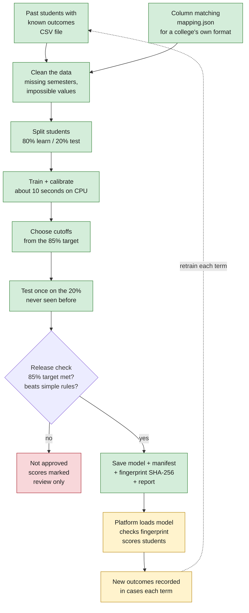

| Step | Command (in `ml/`) |
|---|---|
| Train everything (Kaggle or laptop) | `python kaggle_train.py` |
| Train on a college's own file | `python -m disha_ml.train --data file.csv --mapping mapping.json` |
| Make a mapping template | `python -m disha_ml.mapping --data file.csv` |
| Score students | `python -m disha_ml.score --model artifacts/cp1 --input students.csv` |

Legacy training data: UCI "Predict Students' Dropout and Academic Success",
4,424 real students from a Portuguese institution, in `ml/data/processed/data.csv`
(and a Spanish UPV file for a time-based check).

**Rolling model (primary):**

| Step | Command (in `ml/`) |
|---|---|
| Convert OULAD into the six tables | `python -m disha_ml.converters.oulad` |
| Train (about 107 s on CPU) | `python -m disha_ml.rolling.train --data data/raw/oulad` |
| Score one day | `python -m disha_ml.rolling.score --tables <dir> --as-of 120` |

Trained on terms 2013B, 2013J and 2014B, tested once on 2014J. OULAD source,
licence and checksum: `ml/data/raw/oulad/SOURCE.md`. The rolling trainer has no
automatic release check yet (**Not yet implemented**).

---

## 9. Review, cases and follow-up

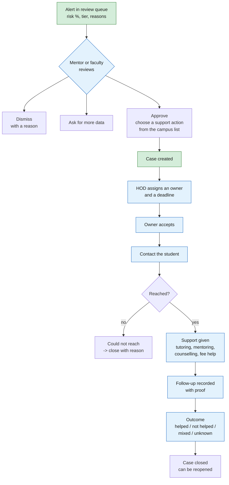

- Every step is written to an **audit trail** that cannot be edited or deleted.
- Sensitive parts of a task (fee details, counselling notes) are visible only
  to that office; others see a generic label like "finance support".
- If two people edit the same case at once, the second is told to reload, so
  nothing is silently overwritten.

---

## 10. Deadlines, reminders and escalation

A background **worker** runs all the time, separate from the website.

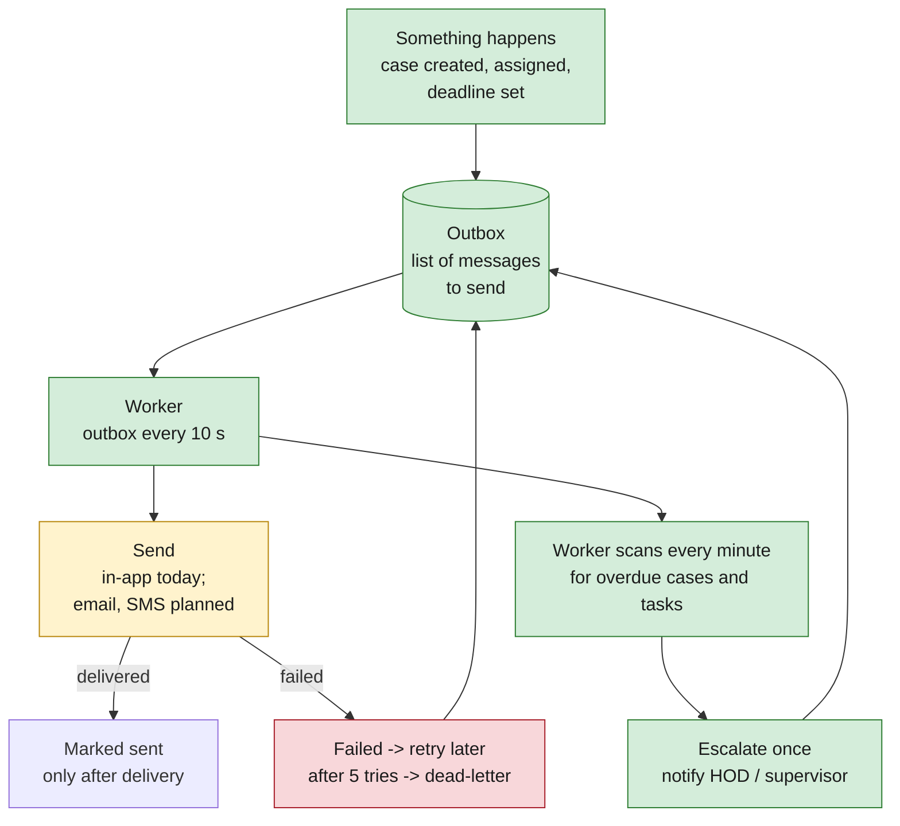

- Messages are saved **together with** the action, so a crash never loses one.
- An overdue case escalates **once** per deadline. If the deadline is changed,
  escalation can happen again for the new deadline.

---

## 11. Security on every request

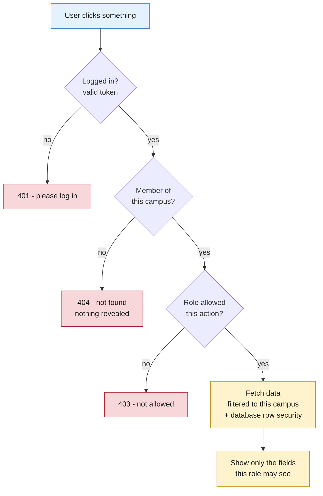

- One central permission list says which role can do which action.
- Error messages never reveal IDs, campuses or roles.
- Student data is never sent to outside services (translation, AI) without an
  agreement, and restricted data never at all.

---

## 12. Reports and the learning loop

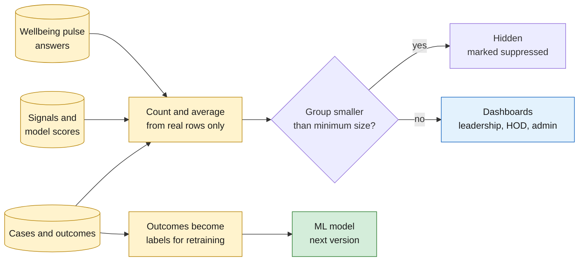

- No number on a dashboard is typed by hand; everything is counted from stored data.
- Small groups are hidden so no individual student can be identified.

---

## 13. Extra modules

These sit around the core flow. Each is optional for the first version.

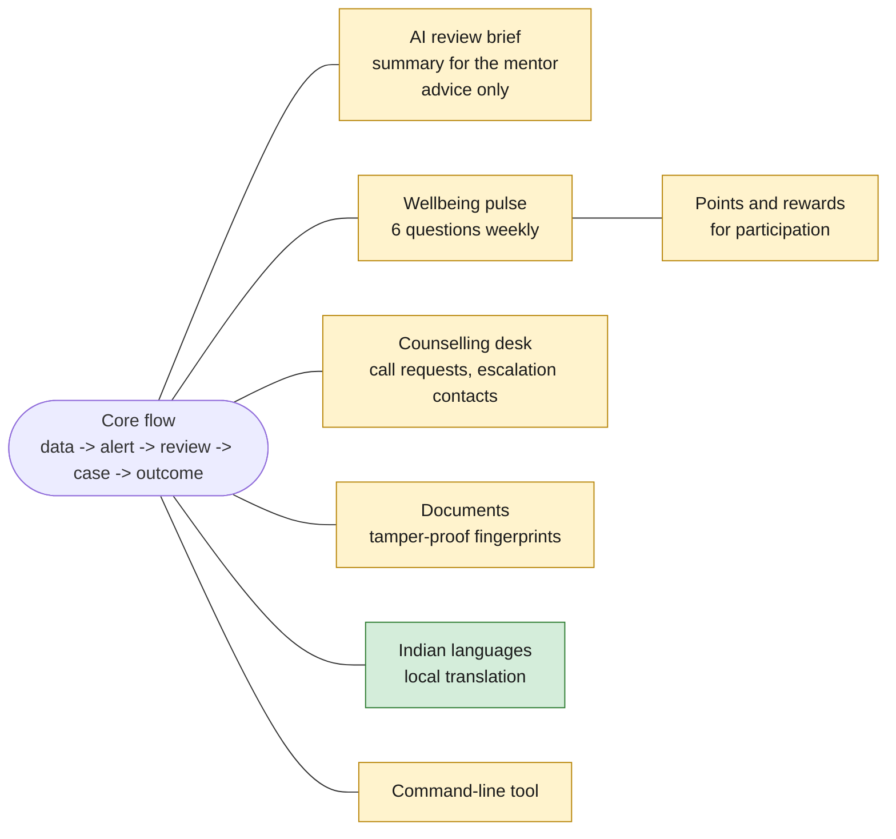

| Module | What it does | Safety rule |
|---|---|---|
| AI review brief | Summarises a student's evidence for the mentor | Advice only; never sees fee or counselling data; cannot change anything |
| Wellbeing pulse | Weekly 6-question check-in | Results shown only for groups of 10+; reflections are private |
| Points and rewards | Points for taking part | Points never depend on how a student answers |
| Counselling desk | Students request a call; counsellors escalate emergencies | Only counselling staff see the details |
| Documents | Support plans get a tamper-proof fingerprint | No personal data stored on the blockchain |
| Indian languages | Translates text locally with IndicTrans2 (`POST /api/v1/translate`, off by default). Built in the API | Runs on the campus machine; nothing is sent to an outside translator |

---

## 14. One student, start to finish

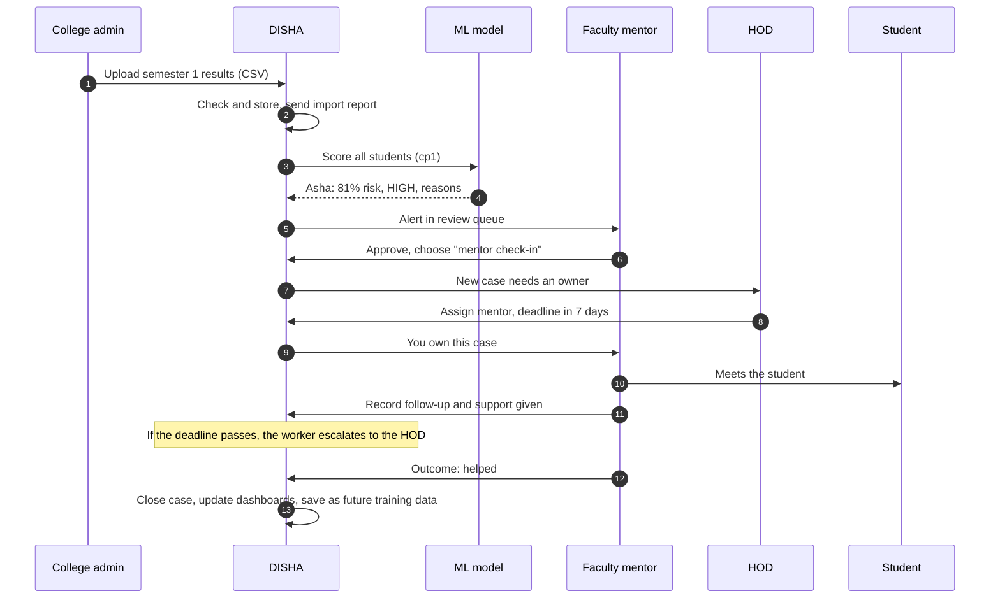

*(Asha is an example name, not a real student.)*

---

## 15. What is built vs planned

| Part | Status | Where |
|---|---|---|
| Rolling risk model: canonical tables, snapshots, features, calibrated model, tiers, reasons, drift, insights payload | ✅ Built and tested; results in `ml/artifacts_rolling/` | `ml/disha_ml/rolling/`, `ml/disha_ml/converters/oulad.py` |
| Legacy semester models (cleaning, features, cutoffs, tiers, reports) on UCI and UPV | ✅ Built and tested (secondary) | `ml/disha_ml/` |
| Training on Kaggle in one command (legacy models) | ✅ Built, run on Kaggle | `ml/kaggle_train.py` |
| Column matching for a college's own file format (legacy models) | ✅ Built (in the ML tool) | `ml/disha_ml/mapping.py` |
| Training datasets | ✅ In repo: UCI, UPV converted; OULAD raw files are git-ignored with a tracked source note | `ml/data/` |
| Design of every module | ✅ Written | `blueprint/` |
| Cases: state machine, `case_events`, tasks, outcomes, campus membership check | ✅ Built | `api/app/modules/cases/` |
| Outbox (retries, dead-letter) and deadline escalation | ✅ Built; only the in-app adapter exists | `api/app/modules/cases/outbox.py`, `worker/jobs/` |
| Database migration for cases, outbox, membership | ✅ Alembic `0001` | `api/migrations/versions/` |
| Translation (local IndicTrans2, flag) | ✅ Built | `api/app/modules/translate/` |
| Meko routes and memory hooks (optional) | ✅ Built | `api/app/modules/meko/`, `meko/`, `ml/disha_ml/meko_hooks.py` |
| Run the rolling scorer from the platform (route or job) | 🟨 Not yet implemented | `api/app/modules/ml/` is a stub |
| Backend ingestion, analytics, roster, wellbeing, identity | 🟨 Stubs (one `GET /` each) | `api/app/modules/` |
| Other worker jobs (anchor confirmation, retention purge, model drift report, Meko weekly outcomes) | 🟨 Log-only or no data source | `worker/jobs/` |
| Web app | 🟨 Started | `web/` |
| CLI, smart contracts, infra | 🟨 Skeletons | `cli/`, `contracts/`, `infra/` |

**Suggested build order:** login and campus setup → data upload and import
check → connect the ML model to stored data → review queue → cases and
deadlines → worker → dashboards → extra modules.
See `blueprint/15-build-sequence.md`.
