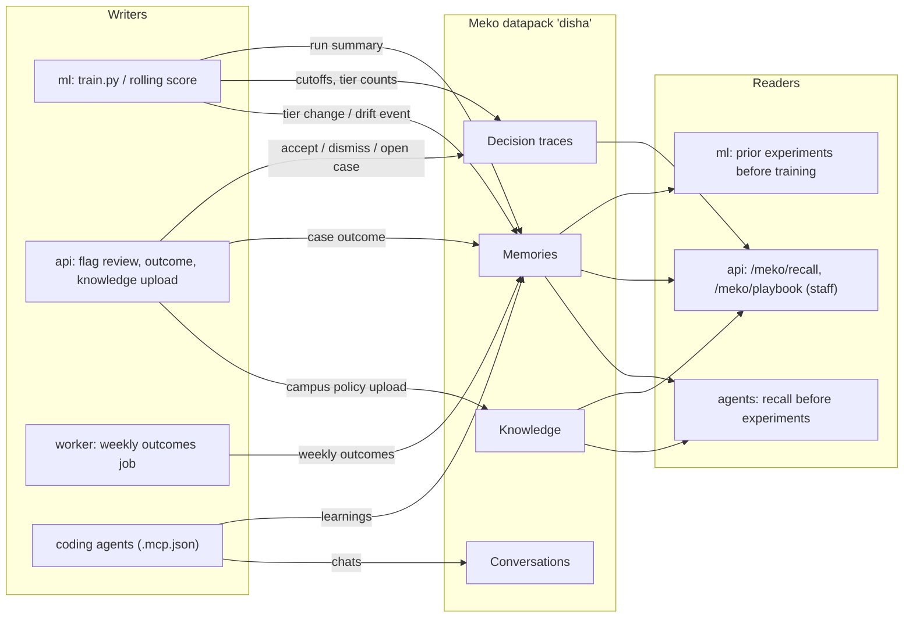

# Meko integration

[Meko](https://cloud.mekodata.ai) is Yugabyte's agent-native context engine (a remote MCP server on YugabyteDB). DISHA uses one **datapack** (default `disha`) as the shared memory of the team, the ML pipeline, the API and coding agents.

Fit with the core principle **No Alert Without Action**: Meko never opens cases or alerts. It stores *what was tried and what humans decided*, so the next experiment or the next mentor starts from evidence.

## What flows where



| Source | Written as | Content |
|---|---|---|
| `python -m disha_ml.train` | memory + decision trace + artifact | dataset, model, key metrics, cutoffs, fairness FPR ratios; each checkpoint's `manifest.json` stored as an artifact |
| `python -m disha_ml.score` (legacy) | decision trace | counts per tier, capacity cap; no student rows |
| `python -m disha_ml.rolling.score` | memory (academic story) | one short narrative per student whose tier changed or who had a drift event; hashed id, `journey:<hash>` tag, no raw marks (see below) |
| `POST /api/v1/cases/flags/review` | decision trace | actor role, action, reason codes, hashed IDs |
| `POST /api/v1/cases/{id}/outcome` | memory (+ promotion) | outcome, intervention id, reason codes, tier, hashed case id; recurring `improved` patterns are promoted |
| `POST /api/v1/meko/knowledge` | knowledge | campus policy and procedure files uploaded by admins or HoD, after the PII guard |
| `python -m disha_meko sync-catalog` | knowledge | one document per campus intervention |
| worker `meko_weekly_outcomes` (weekly) | memory | aggregate intervention outcomes; **not yet implemented**: `fetch_weekly_outcomes()` returns an empty list, so nothing is written |
| agents via `.mcp.json` | memory / conversation | learnings, see `CLAUDE.md` |

**Repo documentation is not synced to Meko.** The earlier nightly knowledge-sync worker job, its CLI command and `sync.py` were removed; blueprint and docs stay in git. Meko knowledge is operational content that campus staff upload, never repo files.

Reads: `train.py` prints "Prior experiments from Meko" before training; `POST /api/v1/meko/recall` answers staff questions such as "what interventions worked for similar risk profiles?"; `GET /api/v1/meko/playbook?reason_codes=...&tier=...` returns interventions that improved similar profiles, limited to the active campus catalogue; `GET /api/v1/meko/knowledge/search`, `GET /api/v1/meko/tools` and `/health` complete the routes. Endpoint details: `blueprint/05-api-specification.md` §4.3.

## Academic-story memories (rolling model)

`meko_hooks.record_assessment_updates(payload)` in `ml/disha_ml/meko_hooks.py` runs after `python -m disha_ml.rolling.score` (skip with `--no-meko`). It reads the insights payload ([INSIGHTS_SPEC.md](INSIGHTS_SPEC.md) §8) and writes **only** for students whose tier changed since the previous snapshot or who had a drift event; everyone else produces nothing.

Example text: "Assessment update (day 120, TMA3): mean 48% (class median 66%); risk MEDIUM→HIGH; Missed 2 of the last 3 assessments; ...".

* Tags: `ml`, `assessment-update`, the tier in lower case, and `journey:<hashed id>`; metadata carries the hashed student, course, term, day, tier, previous tier and drift codes.
* The student id is hashed (`s_<12 hex>`, salted by `MEKO_PII_SALT`). Without a salt the id becomes `student-unlinked` and the `journey:` tag is omitted.
* No raw marks are sent: only the headline mean and class median inside the sentence. Exact marks stay in the canonical tables.
* Meko has one conversation per client run, so a student's journey is a tag, not a separate conversation.
* Failures are swallowed; scoring never depends on Meko.

## Client modules (`meko/disha_meko`)

| Module | Role |
|---|---|
| `client.py` | `MekoClient` (async, fail-safe) and `MekoSync` (blocking wrapper for ML scripts) |
| `tools.py` | Logical operation to Meko tool map |
| `redact.py` | ID hashing, PII key dropping, text masking |
| `guard.py` | Deterministic PII guard for uploads: rejects emails, phone numbers and student-id patterns (`PiiFound`) |
| `catalog.py` | Campus intervention catalogue to one Meko document per intervention; the linking header `doc_type \| campus_id \| intervention_id \| reason_codes` |
| `playbook.py` | Outcome loop: closed case to memory; the same intervention and reason-code pattern improving `MEKO_PROMOTE_MIN` times (default 3) is promoted; playbook suggestions are filtered to the active catalogue (AI-07) |
| `cli.py` | `python -m disha_meko` subcommands: `doctor`, `tools`, `sync-catalog <file> [--campus ID]`, `recall "<query>" [-k N]` |

Exact relations (intervention, reason code, outcome counts) live in Postgres (`GET /api/v1/cases/outcomes/stats`); Meko holds the text memories and chunks, linked by the shared header keys.

## Design

- Package `meko/` (`disha_meko`) uses the official `mcp` SDK over Streamable HTTP, with `Authorization: Bearer <key>` and `User-Agent: meko-mcp-installer/1.0`.
- **Fail-safe**: no key, `MEKO_ENABLED=false`, timeout or outage means a logged warning and a no-op. After a failure the client skips Meko for 60 s so requests do not pay repeated timeouts.
- **Non-blocking**: API calls run as background tasks after the response. ML hooks are wrapped so they cannot raise. Use `--no-meko` on train/score to skip them.
- **Exact tool names**: a static map (`DEFAULT_TOOLS` in `disha_meko/tools.py`) names the real Meko tools. Keyword discovery over `list_tools` is only a fallback if a default is missing, and `MEKO_TOOL_MAP` overrides win. Arguments are fitted to each tool's input schema (structured values are JSON-encoded for string parameters such as `metadata`).
- **Datapack by name**: `datapack_list(query=name)` resolves `disha` to its `datapack_id`; `datapack_create` makes it if missing. The id is cached per process (`MEKO_DATAPACK_ID` skips the lookup). Every Meko tool needs a `conversation_id`, so lookups use a throwaway UUID.
- **Agent ids**: one stable `agent_id` per component: `disha-ml`, `disha-api`, `disha-worker` (`disha-cli` for the CLI). Pass it with `MekoClient(component=...)` / `MekoSync(component=...)`. `agent_id` is attribution only; reads span all agents.

## Privacy and redaction

Nothing that identifies a student leaves DISHA.

- Student/roll/user/case IDs are replaced with `s_<12 hex>` = HMAC-SHA256 with `MEKO_PII_SALT`. **Without a salt IDs become `student-unlinked`** (unsalted hashes of roll numbers are guessable). Set a long random salt and keep it secret.
- Keys such as `name`, `email`, `phone`, `address`, `dob` are replaced by `[redacted]`; emails and phone numbers inside free text are masked.
- ML run summaries and the legacy scoring trace send aggregates only. Rolling assessment updates are per student but hashed, with no raw marks.
- Uploads to `POST /api/v1/meko/knowledge` are rejected (422) if the PII guard finds an email, phone number or student-id pattern.
- Every payload passes through `scrub()` inside `MekoClient`, even if a caller forgets (tested in `meko/tests`).
- Free-text notes typed by staff are masked for emails/phones only; tell users not to type names into notes.

## Setup

1. Create an account and API key at <https://cloud.mekodata.ai>.
2. `cp .env.example .env`, then set `MEKO_API_KEY` and a random `MEKO_PII_SALT` (export them in your shell for agents and CLIs).
3. `pip install -e meko` (add `-e api`/`ml` as usual).
4. `make meko-doctor` (`python -m disha_meko doctor`): checks the connection, lists discovered tools and the operation mapping, creates the datapack if missing.
5. `python -m disha_meko recall "tier cutoffs"` to query; `python -m disha_meko sync-catalog meko/examples/catalog.sample.json` to upload an intervention catalogue (set `MEKO_CATALOG_PATH` for the API to filter by it).
6. Coding agents: `.mcp.json` is picked up automatically when `MEKO_API_KEY` is exported.

## Meko tools and how DISHA uses them

Verified live with `python -m disha_meko doctor`. Logical operation -> tool:

| Logical op | Meko tool | Notes |
|---|---|---|
| `list_datapacks` / `create_datapack` | `datapack_list`, `datapack_create` | resolve `disha` -> `datapack_id`, create if missing |
| `create_conversation` | `conversation_create` | once per client (one run / process); title `<component> <UTC time>` |
| `trace_decision`, `log_conversation` | `conversation_add_message` | one turn per decision, see below |
| `remember` | `memory_add` | tags go in `metadata.tags` and are appended to the text |
| `recall` | `context_search` | sends `query` (`prompt` is only a search-log field); returns memory, knowledge and past-turn buckets |
| `delete_memory` / `delete_conversation` | `memory_delete_by_id`, `conversation_delete` | cleanup, used by the smoke test |
| `upload_knowledge`, `upload_status` | `knowledgebase_upload_document`, `knowledgebase_document_status` | presigned S3 flow, below |
| `save_artifact` | `artifact_put` | JSON is scrubbed, then the returned `content_hash` is checked against the local SHA-256 |
| `token_usage` | `track_token_usage` | available; no caller yet because DISHA makes no LLM calls |

Also used by the playbook and knowledge routes: `memory_search`, `memory_promote`, `knowledgebase_search`, `knowledgebase_delete_document`. Present but unused: `memory_get_all`, `datapack_*` admin, `amp_*` (infrastructure, ignored).

### Traces are conversation turns

Each client lazily opens one Meko conversation per run (ML train/score process, API process, worker job). `trace_decision(decision, rationale, evidence, actor, outcome, plan)` appends a turn:

| Trace field | `conversation_add_message` argument |
|---|---|
| `decision` | `input` |
| `outcome` | `output` (defaults to "Decision recorded by <actor>.") |
| `rationale` | `reasoning` |
| `plan` | `plan` (list of steps) |
| `evidence`, `actor` | `metadata` JSON (`kind: decision_trace`, scrubbed) |

ML train and score record traces in their run's conversation; the API flag review records one per human decision in the API process's conversation.

### Knowledge upload

`upload_knowledge` computes the SHA-256 and exact size of the (scrubbed) bytes plus the first 3072 bytes as `content_head_base64`, calls `knowledgebase_upload_document`, then POSTs multipart to the returned S3 URL with every `fields` entry in order and the file last (`httpx`). `already_uploaded` skips the POST. `knowledgebase_document_status` is polled briefly. Uploads are visible to the whole datapack, so only campus-owned operational content is uploaded (never repo docs), after the PII guard. Filenames are built as `<campus>__<doc_type>__<name>`.

Override a mapping with `MEKO_TOOL_MAP` (JSON), optionally renaming arguments:

```bash
export MEKO_TOOL_MAP='{"recall": {"tool": "memory_search", "args": {"limit": "limit"}}}'
```

## Tests

`cd meko && pytest tests` (`test_meko.py`: fake MCP session, exact mapping, datapack/conversation bootstrap, traces, upload flow, artifacts, no-op, redaction; `test_loop.py`: guard, catalogue, outcome loop and promotion); `cd api && pytest tests/unit` (`test_meko_api.py`, `test_meko_knowledge.py`); `cd ml && pytest tests` (`test_meko_hooks.py`).
