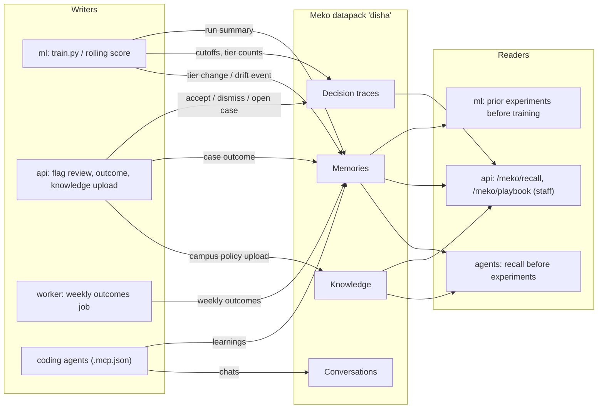
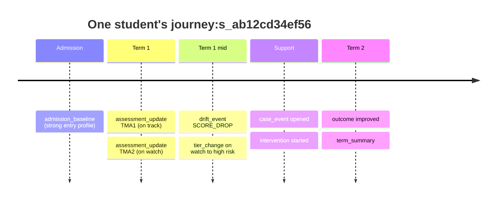

# Meko integration

[Meko](https://cloud.mekodata.ai) is Yugabyte's agent-native context engine (a remote MCP server on YugabyteDB). DISHA uses one **datapack** (default `disha`) as the shared memory of the team, the ML pipeline, the API and coding agents.

Fit with the core principle **No Alert Without Action**: Meko never opens cases or alerts. It stores *what was tried and what humans decided*, so the next experiment or the next mentor starts from evidence.

## What flows where



| Source | Written as | Content |
|---|---|---|
| `python -m disha_ml.train` | memory + decision trace + artifact | dataset, model, key metrics, cutoffs, fairness FPR ratios; each checkpoint's `manifest.json` stored as an artifact |
| `python -m disha_ml.score` (legacy) | decision trace | counts per tier, capacity cap; no student rows |
| `python -m disha_ml.rolling.score` | memory (academic story) | one short narrative per student whose tier changed or who had a drift event; hashed id, `journey:<hash>` tag, no raw marks (see below) |
| `POST /api/v1/meko/flags/review` | decision trace | actor role, action, reason codes, hashed IDs |
| `POST /api/v1/meko/outcomes` | memory (+ promotion) | outcome, intervention id, reason codes, tier, hashed case id; recurring `improved` patterns are promoted |
| `POST /api/v1/meko/knowledge` | knowledge | campus policy and procedure files uploaded by admins or HoD, after the PII guard |
| `python -m disha_meko sync-catalog` | knowledge | one document per campus intervention |
| worker `meko_weekly_outcomes` (weekly) | memory | aggregate intervention outcomes; **not yet implemented**: `fetch_weekly_outcomes()` returns an empty list, so nothing is written |
| agents via `.mcp.json` | memory / conversation | learnings, see `CLAUDE.md` |

**Repo documentation is not synced to Meko.** The earlier nightly knowledge-sync worker job, its CLI command and `sync.py` were removed; blueprint and docs stay in git. Meko knowledge is operational content that campus staff upload, never repo files.

Reads: `train.py` prints "Prior experiments from Meko" before training; `POST /api/v1/meko/recall` answers staff questions such as "what interventions worked for similar risk profiles?"; `GET /api/v1/meko/playbook?reason_codes=...&tier=...` returns interventions that improved similar profiles, limited to the active campus catalogue; `GET /api/v1/meko/knowledge/search`, `GET /api/v1/meko/tools` and `/health` complete the routes. Endpoint details: `blueprint/05-api-specification.md` §4.3.

## Academic-story memories (rolling model)

Superseded by [Student academic journey](#student-academic-journey): `record_assessment_updates` no longer writes tagged memories only for changed or drifted students; it writes turns into each student's own conversation for every scored assessment.

## Student academic journey

**Purpose.** A new mentor, or the next term, sees a student's whole history in one place: admission baseline, every assessment, tier moves, early-warning events, cases, interventions and outcomes, instead of starting cold. Code: `meko/disha_meko/journey.py` (turn builders) and `MekoClient.journey_*` in `client.py`. Tests: `meko/tests/test_journey.py`.

**One conversation per student.** Title and `session_id` are `journey:<hash>` (`hash` = salted `s_<12 hex>`), conversation metadata `{kind: journey, student: <hash>}`, agent id `disha-journey` (shared by API, ML and worker, because conversations are agent-owned). `journey_conversation()` gets or creates it; a deterministic `session_id` means a second create reconnects to the same conversation. Each academic event is one turn. Turn seeds are deterministic (`student|event|key`), so re-running the same snapshot does not duplicate a turn. Meko auto-extracts durable memories from the turns.

### Event types

Every turn has `input` (what happened), `output` (DISHA's record), `reasoning` (why it is kept) and `metadata` (always `event_type`, plus the fields listed; `kind` and `student` are added by the client).

| `event_type` | Written when | Metadata | Example sentence (from the templates) |
|---|---|---|---|
| `admission_baseline` | Student joins; 10th/12th/entrance percentages known | programme, level, year | "A new student joined B.Tech CSE, year 1. Entry percentages: 10th 82%, 12th 78%." Output: "Admission baseline recorded: strong entry profile (average 80% across 2 entry measures)." |
| `assessment_update` | Every scored student-assessment (rolling model run) | course, term, day, assessment_id, tier, risk, missed, late | "The student scored 48% on TMA3 in CS101 (2025A, day 120), 18 points below the class median of 66%, 22nd percentile in the class." Output: "DISHA risk 63% (high risk, moved from medium risk); top reasons: ..." Missed: "The student missed TMA3 in ..." |
| `tier_change` | Tier moved since the previous snapshot | as above plus previous_tier | "After TMA3 in CS101 (2025A, day 120) the student's risk tier worsened from medium risk to high risk." |
| `drift_event` | A drift/early-warning event fired | as above plus code | "Early-warning event in CS101 (2025A, day 120): online activity down 60%." Output: "Drift event ACTIVITY_DROP; the student is currently on watch." |
| `term_summary` | End of term | term, tier, n_courses | "End of term 2025A. Per course: CS101 mean 52%, declining; weak outcomes: CO2 ... at 41%." |
| `case_event` | Case lifecycle step | course, term, day, tier, case, status | "Support case opened for CS101 (reasons: LOW_ENGAGEMENT, SCORE_DROP)." |
| `intervention` | Intervention started | case, intervention_id | "Intervention <id> started in CS101 (reasons: ...)." |
| `outcome` | Staff-reviewed result | case, intervention_id, outcome | "Outcome of intervention <id>: improved (reasons: ...)." |
| `mentor_note` | Mentor writes a note | course, term, day | "Mentor note on CS101: <text>" (PII-stripped, capped at 400 chars) |

Only `assessment_update`, `tier_change` and `drift_event` are produced automatically today (`turns_from_insights`); the other builders have async posting functions but no caller wired in yet.

### What lives where

* **ERP / Postgres canonical tables** (`ml/disha_ml/rolling/schema.py`: `students`, `enrolments`, `assessments`, `results`, `activity`, `withdrawals`): exact marks, dates, the source of truth.
* **Meko**: only the readable narrative (score vs class median, standing, tier, reasons). Meko extracts memories like "scored 48% on TMA3, below the class median, risk rose to high".
* Writing path: `record_assessment_updates(payload)` in `ml/disha_ml/meko_hooks.py` runs after `rolling.score` (skip with `--no-meko`). It builds an `assessment_update` for every student with a scored assessment, plus `tier_change` and `drift_event` turns, and posts them from a background non-daemon thread (batches of 40, `MEKO_JOURNEY_DELAY` seconds apart, 3 attempts). It returns the number of turns queued and swallows failures.

### Read functions

| Function | Returns |
|---|---|
| `journey_timeline(student, limit=100)` | The conversation's turns in order, as Meko returned them, metadata parsed to a dict; `[]` if off or unknown |
| `journey_briefing(student, question=None, k=10, meko_enabled=True)` | `{enabled, student, question, items:[{id, source: "memory"\|"conversation", text}]}`; items are verbatim from `recall` and `search_memory` (scoped by the student's conversation id, so another student's memories are dropped). `meko_enabled=False` returns empty items |
| `correct_memory(memory_id, text)` | `bool`; replaces a memory's text (`update_memory`); the new text passes the PII guard first |
| `forget_memory(memory_id)` | `bool`; deletes a memory (`delete_memory`) |
| `delete_journey(student)` | `bool`; deletes the whole conversation (not its extracted memories) |

HTTP routes for these are specified in `blueprint/05-api-specification.md` §4.7 (not yet implemented).

**Correct / forget and Meko on/off (hackathon rules A1 and A4).** Staff can correct or delete a wrong or stale memory. The briefing can be fetched with Meko on or off (`meko=on|off`) to show the same student with and without the recalled history side by side.

### Privacy

* Student ids are hashed with `MEKO_PII_SALT`. **The salt is required**: without it `journey_ready` is false, a warning is logged, and nothing is written (an unsalted hash of a roll number is guessable). `journey_hash` accepts an already hashed `s_<12 hex>`.
* PII guard: every turn text passes `journey_clean` (raw id replaced by the hash, emails, phone numbers and id-like tokens removed). Mentor notes are also stripped in `mentor_note_turn`, keeping the course code.
* No tables: `looks_like_table` rejects text with 3+ numeric-heavy lines or many `|`/tabs (mentor notes return `None`). Counselling notes never go to Meko; they stay in the ERP.

### Quota

The free Meko tier allows about 1,000 conversations a month. One student = one conversation, so `MEKO_JOURNEY_MAX_STUDENTS` (default 200) caps the students touched per client/run; when over the cap, students with a tier change or drift event come first, then highest risk. Already-open journeys can still be appended to. Production needs a paid tier or the upcoming local open-source Meko.

### Timeline



**Live extraction check (2026-11-01, real Meko `disha` datapack, one synthetic student):**
- 4 turns posted (admission baseline, two assessment updates, a mentor note) in 17 s; the timeline returned all 4.
- Meko extracted memories from the turns within about 2 minutes, e.g. *"the CS201 student now commutes 2 hours each way and has been missing the 9:00 AM CS201 lab"* and *"prefers to be contacted via WhatsApp rather than email"*.
- `journey_briefing` returned those memories verbatim with their Meko ids; with `meko_enabled=False` it returned nothing (the on/off comparison).
- Scoping held: other synthetic students' memories were in the datapack at the time and none appeared in this student's briefing.
- Note for cleanup and tooling: extracted memories carry `agent_id="disha-journey"` and `run_id=<journey conversation id>` (not `conversation_id`). `memory_get_all` did not list them; `memory_search` (and `context_search`) did. Deleting a journey conversation does **not** delete its extracted memories, so `erase_student(student)` (and `delete_journey`, which now calls it) finds them with `memory_search` scoped by `run_id`, deletes them by id, repeats until none are left, and only then deletes the conversation. This is the right-to-erasure path (India's DPDP Act).

## Course memories (CLO insights)

`meko_hooks.record_course_learnings(payload)` runs after `python -m disha_ml.clo.analyze` (skip with `--no-meko`; a missing key makes it a no-op). It writes **aggregate-only** memories, never student ids or marks: one per course-term and one per section, for example "CS201 2026-odd: CO3 Recursion attainment level 0; teaching gap on Q4; misconception Q7 option B 58%.", plus a learning when a recorded teaching action raised a CO level ("... CO3 Recursion improved from level 0 to 3 after re-teach with worked examples ..."). Tags: `course-summary` or `course-learning`, `course:<id>`, `term:<id>`, `sec:<s>`, and for learnings `co:<id>`, `action:<slug>`, `outcome:improved`.

* **Promotion:** when the same course + CO + action improved in at least 2 distinct terms or sections, the matching memories are promoted with `memory_promote` (same mechanism as the outcome loop; owner/maintainer only).
* **Recall:** `recall_course_history(course_id)` runs before recommendations are built and returns `[{id, source, text}]` (memory search plus knowledge search, so promoted learnings appear), exactly as Meko returned them. They are shown in the payload as `context.recalled`, so the UI can display what Meko recalled and nothing is displayed that Meko did not return. A CO weak now and also at level 0-1 in a recalled past term yields a `RECURRING` recommendation. Payload and UI: [CLO_SPEC.md](CLO_SPEC.md) §6.

## Client modules (`meko/disha_meko`)

| Module | Role |
|---|---|
| `client.py` | `MekoClient` (async, fail-safe) and `MekoSync` (blocking wrapper for ML scripts) |
| `tools.py` | Logical operation to Meko tool map |
| `redact.py` | ID hashing, PII key dropping, text masking |
| `guard.py` | Deterministic PII guard for uploads: rejects emails, phone numbers and student-id patterns (`PiiFound`) |
| `catalog.py` | Campus intervention catalogue to one Meko document per intervention; the linking header `doc_type \| campus_id \| intervention_id \| reason_codes` |
| `playbook.py` | Outcome loop: closed case to memory; the same intervention and reason-code pattern improving `MEKO_PROMOTE_MIN` times (default 3) is promoted; playbook suggestions are filtered to the active catalogue (AI-07) |
| `cli.py` | `python -m disha_meko` subcommands: `doctor`, `tools`, `sync-catalog <file> [--campus ID]`, `recall "<query>" [-k N]` |

Exact relations (intervention, reason code, outcome rows) live in Postgres (`disha_intervention_outcomes`, `api/app/modules/cases/models.py`); the cases module is the source of truth; Meko holds the text memories and chunks, linked by the shared header keys.

## Design

- Package `meko/` (`disha_meko`) uses the official `mcp` SDK over Streamable HTTP, with `Authorization: Bearer <key>` and `User-Agent: meko-mcp-installer/1.0`.
- **Fail-safe**: no key, `MEKO_ENABLED=false`, timeout or outage means a logged warning and a no-op. After a failure the client skips Meko for 60 s so requests do not pay repeated timeouts.
- **Non-blocking**: API calls run as background tasks after the response. ML hooks are wrapped so they cannot raise. Use `--no-meko` on train/score to skip them.
- **Exact tool names**: a static map (`DEFAULT_TOOLS` in `disha_meko/tools.py`) names the real Meko tools. Keyword discovery over `list_tools` is only a fallback if a default is missing, and `MEKO_TOOL_MAP` overrides win. Arguments are fitted to each tool's input schema (structured values are JSON-encoded for string parameters such as `metadata`).
- **Datapack by name**: `datapack_list(query=name)` resolves `disha` to its `datapack_id`; `datapack_create` makes it if missing. The id is cached per process (`MEKO_DATAPACK_ID` skips the lookup). Every Meko tool needs a `conversation_id`, so lookups use a throwaway UUID.
- **Agent ids**: one stable `agent_id` per component: `disha-ml`, `disha-api`, `disha-worker` (`disha-cli` for the CLI). Pass it with `MekoClient(component=...)` / `MekoSync(component=...)`. `agent_id` is attribution only; reads span all agents.

## Privacy and redaction

Nothing that identifies a student leaves DISHA.

- Student/roll/user/case IDs are replaced with `s_<12 hex>` = HMAC-SHA256 with `MEKO_PII_SALT`. **Without a salt IDs become `student-unlinked`** (unsalted hashes of roll numbers are guessable). Set a long random salt and keep it secret.
- Keys such as `name`, `email`, `phone`, `address`, `dob` are replaced by `[redacted]`; emails and phone numbers inside free text are masked.
- ML run summaries and the legacy scoring trace send aggregates only. Rolling assessment updates are per student but hashed, with no raw marks.
- Uploads to `POST /api/v1/meko/knowledge` are rejected (422) if the PII guard finds an email, phone number or student-id pattern.
- Every payload passes through `scrub()` inside `MekoClient`, even if a caller forgets (tested in `meko/tests`).
- Free-text notes typed by staff are masked for emails/phones only; tell users not to type names into notes.

## Setup

1. Create an account and API key at <https://cloud.mekodata.ai>.
2. `cp .env.example .env`, then set `MEKO_API_KEY` and a random `MEKO_PII_SALT` (export them in your shell for agents and CLIs).
3. `pip install -e meko` (add `-e api`/`ml` as usual).
4. `make meko-doctor` (`python -m disha_meko doctor`): checks the connection, lists discovered tools and the operation mapping, creates the datapack if missing.
5. `python -m disha_meko recall "tier cutoffs"` to query; `python -m disha_meko sync-catalog meko/examples/catalog.sample.json` to upload an intervention catalogue (set `MEKO_CATALOG_PATH` for the API to filter by it).
6. Coding agents: `.mcp.json` is picked up automatically when `MEKO_API_KEY` is exported.

## Meko tools and how DISHA uses them

Verified live with `python -m disha_meko doctor`. Logical operation -> tool:

| Logical op | Meko tool | Notes |
|---|---|---|
| `list_datapacks` / `create_datapack` | `datapack_list`, `datapack_create` | resolve `disha` -> `datapack_id`, create if missing |
| `create_conversation` | `conversation_create` | once per client (one run / process); title `<component> <UTC time>` |
| `trace_decision`, `log_conversation` | `conversation_add_message` | one turn per decision, see below |
| `remember` | `memory_add` | tags go in `metadata.tags` and are appended to the text |
| `recall` | `context_search` | sends `query` (`prompt` is only a search-log field); returns memory, knowledge and past-turn buckets |
| `delete_memory` / `delete_conversation` | `memory_delete_by_id`, `conversation_delete` | cleanup, used by the smoke test |
| `upload_knowledge`, `upload_status` | `knowledgebase_upload_document`, `knowledgebase_document_status` | presigned S3 flow, below |
| `save_artifact` | `artifact_put` | JSON is scrubbed, then the returned `content_hash` is checked against the local SHA-256 |
| `token_usage` | `track_token_usage` | available; no caller yet because DISHA makes no LLM calls |

Also used by the playbook and knowledge routes: `memory_search`, `memory_promote`, `knowledgebase_search`, `knowledgebase_delete_document`. Present but unused: `memory_get_all`, `datapack_*` admin, `amp_*` (infrastructure, ignored).

### Traces are conversation turns

Each client lazily opens one Meko conversation per run (ML train/score process, API process, worker job). `trace_decision(decision, rationale, evidence, actor, outcome, plan)` appends a turn:

| Trace field | `conversation_add_message` argument |
|---|---|
| `decision` | `input` |
| `outcome` | `output` (defaults to "Decision recorded by <actor>.") |
| `rationale` | `reasoning` |
| `plan` | `plan` (list of steps) |
| `evidence`, `actor` | `metadata` JSON (`kind: decision_trace`, scrubbed) |

ML train and score record traces in their run's conversation; the API flag review records one per human decision in the API process's conversation.

### Knowledge upload

`upload_knowledge` computes the SHA-256 and exact size of the (scrubbed) bytes plus the first 3072 bytes as `content_head_base64`, calls `knowledgebase_upload_document`, then POSTs multipart to the returned S3 URL with every `fields` entry in order and the file last (`httpx`). `already_uploaded` skips the POST. `knowledgebase_document_status` is polled briefly. Uploads are visible to the whole datapack, so only campus-owned operational content is uploaded (never repo docs), after the PII guard. Filenames are built as `<campus>__<doc_type>__<name>`.

Override a mapping with `MEKO_TOOL_MAP` (JSON), optionally renaming arguments:

```bash
export MEKO_TOOL_MAP='{"recall": {"tool": "memory_search", "args": {"limit": "limit"}}}'
```

## Tests

`cd meko && pytest tests` (`test_meko.py`: fake MCP session, exact mapping, datapack/conversation bootstrap, traces, upload flow, artifacts, no-op, redaction; `test_loop.py`: guard, catalogue, outcome loop and promotion); `cd api && pytest tests/unit` (`test_meko_api.py`, `test_meko_knowledge.py`); `cd ml && pytest tests` (`test_meko_hooks.py`).
