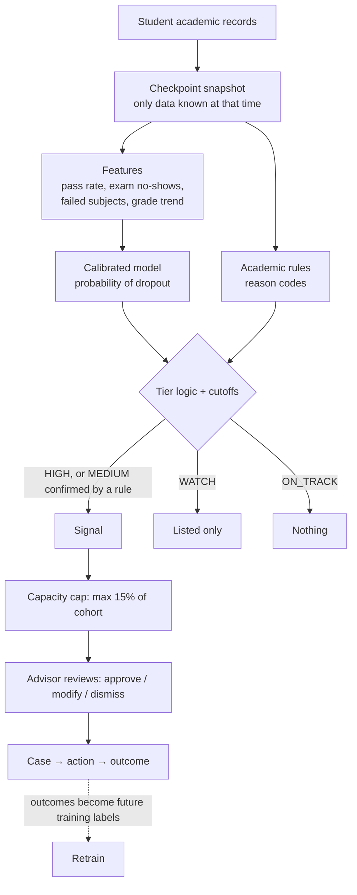
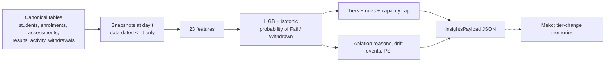

# DISHA ML — Early Academic Risk Signals

Isolated machine-learning pipeline for predicting student dropout and raising
early academic risk signals. Ground rules:
* Strict temporal separation: no data leakage between checkpoints.
* Auditable feature contracts.
* Human in the loop: ML predictions attach as evidence; they never open cases
  by themselves.

The Python package is `disha_ml`.

> **Status (2026-11-01).** DISHA now has two model families.
> * **Rolling risk model (primary):** scores every student at every assessment
>   due date, on OULAD, through a level-agnostic input schema. Code in
>   `disha_ml/rolling/`. See sections 27 to 34. Output contract:
>   [`../docs/architecture/INSIGHTS_SPEC.md`](../docs/architecture/INSIGHTS_SPEC.md).
> * **Legacy semester models (`cp0`/`cp1`/`cp2`):** the first-year checkpoint
>   pipeline on the Portugal (UCI) and Spain (UPV) datasets, described in
>   sections 1 to 26. Artifacts are kept in `artifacts/` and `artifacts_upv/`.
>   They are secondary and are not what the backend should call.

This folder trains and runs the machine-learning part of DISHA: it looks at a
student's academic record and decides whether to raise an **early risk
signal** for an advisor to review. This README explains everything: what data
is used, how the model works, how false alarms are kept down, how to train it
(including on your own dataset), how to read the results, and what the limits
are.

Deeper design documents: [`../blueprint/16-risk-signal-pipeline.md`](../blueprint/16-risk-signal-pipeline.md)
(how it works), [`17-model-training-guide.md`](../blueprint/17-model-training-guide.md)
(training procedure), [`18-dataset-requirements.md`](../blueprint/18-dataset-requirements.md)
(data).

---

## Contents

1. [What it does, in one paragraph](#1-what-it-does-in-one-paragraph)
2. [Key terms](#2-key-terms)
3. [The pipeline step by step](#3-the-pipeline-step-by-step)
4. [Data used](#4-data-used)
5. [Checkpoints: only what is known at the time](#5-checkpoints-only-what-is-known-at-the-time)
6. [Features](#6-features)
7. [What the model predicts (label)](#7-what-the-model-predicts-label)
8. [The model and calibration](#8-the-model-and-calibration)
9. [The cutoff: how false alarms are kept down](#9-the-cutoff-how-false-alarms-are-kept-down)
10. [Risk tiers and the capacity cap](#10-risk-tiers-and-the-capacity-cap)
11. [Academic rules (reason codes)](#11-academic-rules-reason-codes)
12. [Explanations for each student](#12-explanations-for-each-student)
13. [Release check](#13-release-check)
14. [Fairness check](#14-fairness-check)
15. [Quick start](#15-quick-start)
16. [Training on Kaggle](#16-training-on-kaggle)
17. [Using your own dataset](#17-using-your-own-dataset)
18. [Reading the results](#18-reading-the-results)
19. [Scoring students for the demo](#19-scoring-students-for-the-demo)
20. [Configuration](#20-configuration)
21. [If results are weak: tuning order](#21-if-results-are-weak-tuning-order)
22. [Code layout](#22-code-layout)
23. [Tests](#23-tests)
24. [Limits and honest caveats](#24-limits-and-honest-caveats)
25. [Questions judges may ask](#25-questions-judges-may-ask)
26. [Second dataset: UPV Spain and a time-based test](#26-second-dataset-upv-spain-and-a-time-based-test)
27. [Rolling risk model (primary): overview](#27-rolling-risk-model-primary-overview)
28. [Rolling model: data (OULAD) and converter](#28-rolling-model-data-oulad-and-converter)
29. [Rolling model: canonical input schema](#29-rolling-model-canonical-input-schema)
30. [Rolling model: snapshots and features](#30-rolling-model-snapshots-and-features)
31. [Rolling model: training](#31-rolling-model-training)
32. [Rolling model: scoring and the insights payload](#32-rolling-model-scoring-and-the-insights-payload)
33. [Rolling model: results](#33-rolling-model-results)
34. [Rolling model: Meko memories, limits and gaps](#34-rolling-model-meko-memories-limits-and-gaps)
35. [CLO (course outcome) insights](#35-clo-course-outcome-insights)

---

## 1. What it does, in one paragraph

*(Legacy semester models. The primary rolling model is described in section 27.)*

At three points in a student's first year — at admission, after semester 1,
after semester 2 — the system looks only at **academic data known at that
moment** (prior grades, subjects registered, subjects passed, exams taken,
average grade, change between semesters). A gradient-boosted model estimates
the probability that the student will drop out, and that probability is
**calibrated** so 80% really means about 8 in 10. Simple academic rules check
concrete warning signs ("passed 2 of 6 subjects"). A **signal** is raised only
if the probability is above a cutoff chosen so that at least **85%** of flagged
students really are at risk, or above a lower cutoff **and** confirmed by a
rule. Signals are capped at **15%** of a cohort so advisors can act on every one.
Each signal comes with plain-language reasons, and a person reviews it before
anything happens.

## 2. Key terms

| Term | Plain meaning |
|---|---|
| **Probability / risk score** | The model's estimate (0 to 1) that a student will drop out |
| **Calibration** | Adjusting scores so they match reality: of students scored 0.7, about 70% actually drop out |
| **Cutoff (threshold)** | Score above which a student is flagged |
| **Precision** | Of the students flagged, the share who really were at risk. High precision = few false alarms |
| **Recall** | Of all students who were at risk, the share that got flagged. High recall = few missed students |
| **False positive** | Flagged, but turned out fine (a false alarm) |
| **ROC AUC** | How well scores rank at-risk students above others. 0.5 = random, 1.0 = perfect |
| **PR AUC** | Like ROC AUC but focused on the at-risk group; more informative when at-risk students are a minority |
| **Brier score** | Average squared error of the probabilities. Lower is better |
| **Train / test split** | 80% of students used to build the model; 20% kept aside and used once to check it |
| **Out-of-fold (OOF)** | Each training student scored by a model that did not see them (5-fold). Used to pick cutoffs honestly |
| **Leakage** | Accidentally using information from the future (e.g. final results) to "predict" it. Makes a model look good in testing and fail in use |
| **Checkpoint** | A point in time with its own model, using only data available then |
| **Tier** | HIGH / MEDIUM / WATCH / ON_TRACK, decided from score + rules |
| **Capacity cap** | Maximum share of a cohort that can receive a signal |

## 3. The pipeline step by step



| Step | What happens | Code |
|---|---|---|
| 1. Load | Read CSV, map column names, clean values | `data.py` |
| 2. Label | Turn the outcome into 1 (at risk) / 0 | `labels.py` |
| 3. Features | Build checkpoint-specific factors | `features.py` |
| 4. Split | 80% train / 20% test, stratified | `train.py` |
| 5. Out-of-fold scores | 5-fold calibrated scores on train | `train.py`, `models.py` |
| 6. Cutoffs | Choose HIGH / MEDIUM / WATCH cutoffs from precision targets | `thresholds.py` |
| 7. Final model | Fit calibrated model on all of train | `train.py` |
| 8. Test | Score the untouched 20% once; tiers, baselines, fairness | `evaluate.py` |
| 9. Release check | Approve or reject | `train.py` |
| 10. Save | Model, manifest (with SHA-256), report | `train.py` |
| 11. Score | New students → probability, tier, signal, reasons | `score.py`, `signal.py`, `rules.py`, `explain.py` |

## 4. Data used

**Academic data only.** First dataset: UCI *Predict Students' Dropout and
Academic Success* (4,424 students, one higher-education institution in
Portugal; outcomes Graduate 2,209 / Dropout 1,421 / Enrolled 794). Of its 37
columns, 15 are model inputs, 4 are kept for the fairness check only, and 1 is
the outcome.

| File | Contents |
|---|---|
| `ml/data/raw/data_raw.csv` | As downloaded (semicolon-separated; header issues) — never edited |
| `ml/data/processed/data.csv` | Header-corrected copy; **the training default** |
| `data.csv`, `data_raw_backup.csv` (repo root) | Identical copies of the two files above, used by `tests/test_dataset.py` |

| Model inputs | |
|---|---|
| Prior grades | Previous qualification grade, admission grade |
| Course | Programme (difficulty differs by course) |
| Per semester (1 and 2) | Subjects enrolled, credited, evaluated (exams taken), approved (passed), without evaluation (no exam), average grade |

| Never model inputs | Used for |
|---|---|
| Gender, age at enrolment, displaced, special educational needs | Fairness check only |
| Names, roll numbers | Display only. Passed through to output, never seen by the model |

| Dropped entirely | Why |
|---|---|
| Family background, marital status, nationality, unemployment / inflation / GDP | Not academic |
| Tuition fees up to date, debtor, scholarship | Not academic. These do carry predictive signal in this dataset; leaving them out is a deliberate scope choice |

## 5. Checkpoints: only what is known at the time

| Checkpoint | When | Uses | Role |
|---|---|---|---|
| `cp0` | Admission | Prior grades, course | Earliest, weakest signal; often only WATCH |
| `cp1` | After semester 1 | + semester 1 results | **Main early warning** |
| `cp2` | After semester 2 | + semester 2 results + change | Confirms, escalates or clears |

A test fails the build if semester-2 data reaches `cp0`/`cp1`, or if any
protected column reaches any model. If your dataset has no semester-2 columns,
`cp2` is skipped automatically.

## 6. Features

| Feature | Formula | Captures |
|---|---|---|
| Pass rate | passed ÷ enrolled | Keeping up |
| Attempt rate | exams taken ÷ enrolled | Showing up to exams |
| Exam no-show ratio | subjects with no exam ÷ enrolled | Disengagement |
| Failed subjects | enrolled − passed | Backlog |
| Average grade | as given; **missing** if nothing passed | Quality of work |
| No-grade flag | 1 if nothing passed | Separates "no grade" from "low grade" |
| No-units flag | 1 if no subjects registered | Not registered |
| Grade change (`cp2`) | sem 2 grade − sem 1 grade | Improving or slipping |
| Pass-rate change (`cp2`) | sem 2 − sem 1 pass rate | Same, for passing |
| Total failed (`cp2`) | sem 1 + sem 2 failed | Cumulative backlog |
| Raw counts, prior grades, course | as given | Context |

### Data cleaning applied at load time

| Issue | In this dataset | Handling |
|---|---|---|
| Grade **0** when no subject was passed | Every student with 0 subjects passed | Not a real mark: grade becomes missing, plus the no-grade flag |
| A semester with **every field 0** | 180 students, all in course 171, in both semesters — 75 of them graduated | A gap in the records, not a student who registered for nothing. Those semester fields become missing; these students are assessed only by `cp0` and get tier `NO_DATA` from `cp1`/`cp2` |
| Subjects without exam **more than** subjects enrolled | 3 students, semester 2 | Capped at subjects enrolled |
| Header problems (byte-order mark, stray tab, `Nacionality` spelling) | Raw file `data/raw/data_raw.csv` | Fixed in `data/processed/data.csv` (see `docs/audit/anomaly_report.md`); the loader also tolerates them |
| Whole feature absent (e.g. no admission grade in your dataset) | — | Left out of the model; the training log says so |

The training log and each `report.md` print how many rows each fix changed.
No rows are deleted and no values are invented.

## 7. What the model predicts (label)

| `--label` | At risk (1) | Not at risk (0) | Use |
|---|---|---|---|
| `dropout` (default) | Dropout | Graduate, Enrolled | Most serious outcome |
| `not_on_time` | Dropout, Enrolled (still studying past normal length) | Graduate | Wider net; also catches students falling behind |

## 8. The model and calibration

| Choice | Value | Why |
|---|---|---|
| Main model | Histogram gradient-boosted trees (`scikit-learn`) | Strong on small tables, handles missing values, seconds on CPU |
| Comparison | Rules-only score; logistic regression | The model must beat rules; if logistic regression is as good, the report recommends it (simpler) |
| Calibration | Isotonic, 5-fold (`--calibration sigmoid` available) | Makes the cutoff meaningful |
| Hardware | CPU only | Full run ≈ 15–20 s for 4,424 rows |

## 9. The cutoff: how false alarms are kept down

1. Each training student gets an honest out-of-fold probability.
2. Sort students by probability, highest first. Moving the cutoff down one
   step at a time, compute precision of everyone at or above it.
3. **HIGH cutoff** = the lowest cutoff where precision is still ≥ **85%** for
   it *and every cutoff above it*, with at least **30** students flagged. The
   "every cutoff above" rule stops a lucky narrow band from being picked.
4. Same method for **MEDIUM** (≥ 70%) and **WATCH** (≥ 50%).
5. Checked **once** on the 20% test students. If HIGH precision there is more
   than 5 points below target, the model is **not approved**.
6. If no cutoff reaches 85% (common at admission), HIGH is switched **off** for
   that checkpoint — the target is never quietly lowered.

## 10. Risk tiers and the capacity cap

| Tier | Condition | Signal? |
|---|---|---|
| **HIGH** | probability ≥ HIGH cutoff | Yes |
| **MEDIUM** | MEDIUM cutoff ≤ probability < HIGH cutoff **and** ≥ 1 academic rule fires | Yes |
| **WATCH** | probability ≥ WATCH cutoff, or MEDIUM band with no rule | No — listed for staff |
| **ON_TRACK** | below WATCH cutoff | No |
| **NO_DATA** | no record for a semester this checkpoint needs | No — assess with `cp0` |

If the HIGH tier alone exceeds the capacity cap, the cap fills before MEDIUM is
reached and MEDIUM shows no students; raise `--capacity-share` if advisors can
handle more.

**Capacity cap:** if signals exceed 15% of the scored cohort, only the
highest-probability ones keep their signal; the rest become WATCH with
`capacity_capped = True`. Size this to how many students your advisors can
actually contact.

## 11. Academic rules (reason codes)

| Code | Fires when | Default |
|---|---|---|
| `LOW_PASS_RATE` | passed ÷ enrolled < threshold | 0.50 |
| `EXAM_NO_SHOW` | subjects with no exam ≥ threshold | 1 |
| `FAILED_UNITS` | subjects not passed ≥ threshold | 2 |
| `LOW_GRADE` | semester average < threshold (on a 0–20 scale) | 10 |
| `GRADE_DROP` (`cp2`) | semester 2 average lower than semester 1 by ≥ threshold | 2 |

Rules confirm MEDIUM scores and give staff checkable facts. Thresholds are in
`disha_ml/config.py`.

## 12. Explanations for each student

Every scored student gets:
- **Rule reasons** — e.g. "passed 2 of 6 subjects in semester 1; no exam taken
  in 3 subject(s) in semester 1".
- **Model factors** — for each factor group, the student's values are replaced
  with a typical student's and the student is re-scored; the difference is that
  group's contribution, e.g. "exams taken in semester 1 (+18 pts)". The top
  three are shown. Works with any model; no extra library needed.

## 13. Release check

A checkpoint model is **APPROVED** only if:
- a HIGH cutoff exists at the precision target on training data;
- HIGH-tier precision on the test split ≥ target − 0.05;
- model PR AUC on test > rules-only PR AUC (`cp1`, `cp2`).

A non-blocking **note** appears if logistic regression is as good as or better
than the main model. If a model is not approved, the scorer still works but
marks every row "model not approved by release check; show for review only".

## 14. Fairness check

Gender, age band, displaced and special needs are **never inputs**. After
scoring the test split, the report shows for each group: signal rate,
false-positive rate (flagged but fine) and miss rate (at risk but not
flagged), plus the max/min false-positive-rate ratio. Large gaps mean the
system wrongly flags one group more often and must be reviewed. (A blocking
limit for this ratio is still an open decision.)

## 15. Quick start

```bash
cd ml
python -m venv .venv && source .venv/bin/activate
pip install -r requirements.txt
python -m pytest tests -q                                   # ~10 s
python -m disha_ml.train --data data/dataset.csv --out artifacts
python -m disha_ml.score --model artifacts/cp1 --input students.csv --output scored.csv
```

`data/` and `artifacts/` are git-ignored; real student data is never committed.

## 16. Training on Kaggle

The dataset is committed in this repository (`ml/data/processed/data.csv`), so
cloning is enough — no Kaggle dataset needs to be attached.

1. New notebook. Settings: accelerator **None** (CPU), **Internet on** (needed
   to clone; if the repository is private, use a GitHub token or upload the
   folder as a Kaggle dataset instead).
2. In a cell:
   ```bash
   !git clone https://github.com/yash-144/disha.git
   %cd disha/ml
   !python -m pytest tests -q          # optional, ~10 s
   !python kaggle_train.py             # trains cp0, cp1, cp2 on the repo dataset
   ```
3. Other runs:
   ```bash
   !python kaggle_train.py --label not_on_time
   !python kaggle_train.py --model logreg
   !python kaggle_train.py /kaggle/input/<folder>/<file>.csv --mapping mapping.json
   ```
4. Read `/kaggle/working/artifacts/cp1/report.md` (`!cat` it in a cell), then
   download from the Output panel: `artifacts/` (models, manifests, reports) and
   `demo_scored_cp1.csv`.

The run prints the scikit-learn version. Load the saved models with the same
version (Kaggle's version may differ from your laptop's; see §24).

Time: a full run takes under a minute on CPU (about 18 s on a laptop for this
dataset). Plan 1–2 hours to run, read reports and try settings; the rest of the
time can go to the demo.

## 17. Using your own dataset

Your file can use any column names, any grade scale and any outcome labels.
You only need, at minimum: **subjects registered** and **subjects passed** in
semester 1, and a **final outcome** for training.

**Step 1 — create a mapping template**
```bash
python -m disha_ml.mapping --data my_students.csv --out mapping.json
```
It lists every header in your file, fills in the ones it recognises, and
guesses your outcome values.

**Step 2 — complete `mapping.json`**
```json
{
  "columns": {
    "prev_qual_grade": "Class 12 %",
    "admission_grade": null,
    "course": "Branch",
    "s1_enrolled": "Sem1 Subjects Registered",
    "s1_approved": "Sem1 Subjects Cleared",
    "s1_evaluations": "Sem1 Exams Appeared",
    "s1_without_eval": "Sem1 Exams Absent",
    "s1_grade": "Sem1 SGPA",
    "s1_credited": null,
    "s2_enrolled": null, "s2_approved": null, "s2_evaluations": null,
    "s2_without_eval": null, "s2_grade": null, "s2_credited": null,
    "gender": "Sex",
    "target": "Status"
  },
  "target_values": {"Dropped out": "Dropout", "Passed out": "Graduate", "Continuing": "Enrolled"},
  "grade_scale": 10
}
```

| Key | Meaning |
|---|---|
| `columns` | Pipeline name → your header. `null` = you don't have it (filled as missing, or left out of the model) |
| `target_values` | Each of your outcome values → `Dropout`, `Graduate` or `Enrolled`. Map your at-risk outcome (dropped / detained / discontinued) to `Dropout`, the good outcome to `Graduate`, still-studying-late to `Enrolled` |
| `grade_scale` | Maximum of your semester grade: `10` for SGPA, `100` for percentage, `20` for UCI. Grades are rescaled to 0–20 so rule thresholds keep their meaning |

Pipeline column names you can map:

| Name | Meaning | Required |
|---|---|---|
| `s1_enrolled` | Semester 1 subjects registered | **Yes** |
| `s1_approved` | Semester 1 subjects passed | **Yes** |
| `target` | Final outcome | **Yes** for training |
| `s1_evaluations` | Semester 1 exams appeared | Recommended |
| `s1_without_eval` | Semester 1 subjects with no exam / absent | Recommended |
| `s1_grade` | Semester 1 average grade / SGPA | Recommended |
| `s1_credited` | Semester 1 subjects credited by exemption | Optional |
| `s2_*` (same six) | Semester 2 | Optional — enables `cp2` |
| `prev_qual_grade` | Grade before university (e.g. class 12 %) | Optional |
| `admission_grade` | Entrance / admission score | Optional |
| `course` | Programme / branch | Optional |
| `gender`, `age_at_enrollment`, `displaced`, `special_needs` | Fairness check only | Optional |

**Step 3 — train**
```bash
python -m disha_ml.train --data my_students.csv --mapping mapping.json --out artifacts
```
The mapping is saved inside the model, so scoring uses it automatically.

What happens automatically:
- Checkpoints your data cannot support (e.g. no semester 2) are skipped.
- Features your data does not have at all are left out and listed in the log.
- Unknown outcome values stop the run with a list of the values to map.
- A mapped header that is not in the file stops the run with its name.

**Privacy with real data:** remove phone numbers and emails before training.
Names and roll numbers may stay in the file — columns named `name`,
`student_id` or `roll_no` are only copied to the output for display — but
prefer a pseudonymous id for training files. Real student data needs the
institution's permission and a review under India's DPDP Act 2023.

## 18. Reading the results

Each checkpoint writes three files to `artifacts/<cp>/`:

| File | Contents |
|---|---|
| `model.joblib` | Model, features, cutoffs, rules, mapping |
| `manifest.json` | SHA-256 of model and data, library versions, config, every metric, release result |
| `report.md` | Human-readable report |

Read `report.md` in this order:

| Section | Check |
|---|---|
| Release check | APPROVED, or reasons it was not; any note recommending logistic regression |
| Test split | ROC AUC, PR AUC (compare with at-risk rate), Brier |
| Cutoffs | Which tiers are enabled; train precision and recall per tier |
| Signals on test | Precision near or above target; signal rate ≤ capacity; how many capped |
| Tiers table | "Actually at risk" should fall HIGH → MEDIUM → WATCH → ON_TRACK |
| Baselines | Model must beat rules-only |
| Fairness | Gaps in false-positive rate between groups |
| Calibration | Predicted ≈ observed per bin |

All numbers come from the run; none are written by hand.

### Alert precision is not accuracy (legacy `cp1` / `cp2`)

The legacy reports show **signal precision**: of the students who received an
alert after the capacity cap, the share who really were at risk. On the
Portuguese held-out split (851 students, 30.9% at risk):

| Checkpoint | Alerts | Alert precision | Recall of at-risk students | ROC AUC | Accuracy (probability >= 0.5) | Majority-class baseline |
|---|---|---|---|---|---|---|
| `cp1` | 127 (14.9%), 147 more removed by the cap | 94.5% | 45.6% | 0.896 | 84.1% | 69.1% |
| `cp2` | 127 (14.9%), 170 more removed by the cap | 97.6% | 47.1% | 0.932 | 88.4% | 69.1% |

Do **not** call 94.5% or 97.6% "accuracy". They are precision on a small,
capped, hand-picked-by-cutoff group. Accuracy over all students is about 84%
(`cp1`) and 88% (`cp2`) against 69% for always predicting "not at risk". The
precision, recall and AUC figures are in `artifacts/<cp>/manifest.json`;
accuracy is not stored there, so it was computed by scoring the same held-out
split with the saved bundles (threshold 0.5).

Why `cp2` looks so good: 124 of its 127 alerts (97.6%) were students who had
passed **zero** semester-2 subjects (at `cp1`, 74% had passed zero in semester 1),
so `cp2` mostly confirms students who have already stopped, i.e. it is late.
That is the reason the rolling model drops enrolments that are already
withdrawn and scores at every assessment, long before the end of a year.

## 19. Scoring students for the demo

```bash
python -m disha_ml.score --model artifacts/cp1 --input students.csv --output scored.csv
```

| Output column | Meaning |
|---|---|
| `student_id` / `roll_no` / `name` | Copied from input if present (display only) |
| `checkpoint` | Model used |
| `risk_probability` | Calibrated probability |
| `tier` | HIGH / MEDIUM / WATCH / ON_TRACK |
| `signal` | True if a signal is raised |
| `capacity_capped` | True if moved to WATCH by the cap |
| `rule_reasons`, `rule_codes` | Academic rules that fired |
| `model_factors` | Top three factor contributions |
| `note` | Why a row is `NO_DATA`, or that the model was not approved |

Tier `NO_DATA` means the student has no record for a semester this checkpoint
needs; score that student with `cp0`. `kaggle_train.py` does this
automatically in the demo file.

- The scorer checks the model file's SHA-256 against the manifest and refuses a
  modified file.
- The capacity cap applies to each scored file, so score one cohort per file.
- `kaggle_train.py` also writes `demo_scored_cp1.csv` (all rows, with the real
  outcome). It includes training rows: use it for display, not as accuracy.

## 20. Configuration

All in `disha_ml/config.py`; recorded in every manifest.

| Setting | Default | Meaning | CLI flag |
|---|---|---|---|
| `label` | `dropout` | What counts as at risk | `--label` |
| `model` | `hgb` | `hgb` or `logreg` | `--model` |
| `calibration` | `isotonic` | or `sigmoid` | `--calibration` |
| `test_size` | 0.20 | Share kept aside for testing | |
| `cv_folds` | 5 | Folds for out-of-fold scores and calibration | |
| `seed` | 42 | Reproducibility | |
| `high_precision` | 0.85 | HIGH tier precision target | `--high-precision` |
| `medium_precision` | 0.70 | MEDIUM tier target (+ rule) | |
| `watch_precision` | 0.50 | WATCH list target | |
| `min_alerts` | 30 | Minimum students above a cutoff | |
| `capacity_share` | 0.15 | Max share of cohort with a signal | `--capacity-share` |
| `precision_tolerance` | 0.05 | Allowed shortfall on test | |
| `RULES` | see §11 | Rule thresholds | |

## 21. If results are weak: tuning order

Change one thing at a time; judge by the out-of-fold numbers; read the test
split once at the end.

1. `--model logreg` vs `hgb`.
2. `--calibration sigmoid` when there are few at-risk students.
3. `--label not_on_time` if dropout alone is too rare for a HIGH cutoff.
4. Lower `--high-precision` (e.g. 0.80) only with a stated reason — never just
   to show more alerts in the demo.
5. Adjust rule thresholds in `config.py`.

## 22. Code layout

```
ml/
├── kaggle_train.py          one-command runner for Kaggle
├── requirements.txt
├── disha_ml/
│   ├── config.py            all settings, cutoff targets, rule thresholds
│   ├── data.py              load CSV, map columns (UCI or your mapping), clean
│   ├── mapping.py           mapping-template generator for your dataset
│   ├── labels.py            dropout / not_on_time
│   ├── features.py          checkpoint features, explanation groups
│   ├── rules.py             academic rules → reason codes
│   ├── models.py            gradient boosting / logistic regression + calibration
│   ├── thresholds.py        precision-based cutoff selection
│   ├── signal.py            tiers + capacity cap
│   ├── explain.py           per-student factor contributions
│   ├── evaluate.py          metrics, calibration table, fairness
│   ├── train.py             training CLI, release check, reports
│   ├── score.py             scoring CLI with model hash check
│   ├── synthetic.py         invented data for tests only
│   ├── meko_hooks.py        optional Meko hooks (train summary, scoring trace, assessment updates)
│   ├── converters/          oulad.py (rolling model), upv.py (legacy UPV file)
│   └── rolling/             primary model: schema, config, features, insights, evaluate, train, score
├── artifacts/               legacy UCI cp0/cp1/cp2 (model.joblib, manifest.json, report.md)
├── artifacts_upv/           legacy UPV cp0/cp1/cp2
├── artifacts_rolling/       rolling model: model.joblib, manifest.json, report.md
├── data/
│   ├── raw/                 immutable source datasets (UCI dataset as downloaded)
│   ├── processed/           normalised, validated datasets ready for training
│   ├── interim/             intermediate files
│   └── external/            third-party reference data
├── tests/                   pipeline tests
└── evaluation/ features/ registry/ scripts/ simulation/ training/ notebooks/
                             monorepo placeholders (not used by disha_ml yet)
```

## 23. Tests

```bash
python -m pytest tests -q
```

| Test file | Checks |
|---|---|
| `test_data_and_features.py` | Both CSV formats load; missing columns error; grade-0 handling; all-zero semester treated as no record; no-exam count capped; **no future data in earlier checkpoints**; **protected columns never inputs**; labels |
| `test_cutoffs_and_tiers.py` | Cutoffs meet the precision target and stop before a weak band; no cutoff when unreachable; ties; tier logic; rule corroboration; capacity cap |
| `test_train_and_score.py` | Full training on all checkpoints; artifacts and hashes; later checkpoints rank better; capacity respected; tampered model refused; scoring output; `NO_DATA` for students without a semester record |
| `test_own_dataset.py` | Custom headers, SGPA 0–10 scale, custom outcome labels, missing semester 2; template generator; bad mappings rejected; train + score with saved mapping |
| `test_rolling.py` | Snapshots use no data after day t; withdrawn enrolments get no row; student-grouped folds never share a student; hand-built features at day 30; exam rows trigger no snapshot; demographics are not inputs; schema validation; reason texts; drift events; PSI; ECE; per-snapshot capacity cap; lead time; end-to-end training and `score_snapshot` payload |
| `test_meko_hooks.py` | Hooks are no-ops without a key; `--no-meko`; assessment-update memories only on a tier change or drift event, hashed ids, no raw marks |
| `test_upv_and_time_split.py` | UPV converter mapping and filtering; Retained outcome; attendance never taken from a later semester; time-based split; end-to-end training with a time split |

Tests run on **synthetic** data from `synthetic.py`. Synthetic numbers are
never presented as results.

## 24. Limits and honest caveats

- **No model catches every at-risk student.** At 85% precision, about 15 of
  every 100 HIGH signals are false alarms, and some at-risk students fall below
  the cutoff. That is why a person reviews every signal and WATCH exists.
- **The UCI data is from one Portuguese institution.** It proves the pipeline
  works end to end; it does not prove the same accuracy at an Indian campus.
  That must be measured on the campus's own data.
- **No year column in UCI**, so the test split is random-stratified. With
  campus data covering several years, train on older cohorts and test on the
  newest.
- **No attendance or internal marks in UCI.** In the product, attendance enters
  through the rules engine; with campus data it becomes a model feature and
  allows a mid-semester checkpoint (earlier warning).
- **Fees are excluded by choice** although they are predictive in this dataset.
- A saved model must be loaded with the **same scikit-learn version** it was
  trained with (recorded in the manifest).
- **Legacy figures are precision, not accuracy.** See §18. The semester models
  alert late (mostly after a student has passed nothing in semester 2); the
  rolling model (§27) exists to fix that.

## 25. Questions judges may ask

**Is this just a rule like "attendance below 75%"?**
No. Rules give readable reasons and confirm medium-risk scores, but the main
score is a model that combines many factors (pass rate, exam no-shows, grade
level and trend, prior grades, course) and is calibrated to real outcomes. The
report shows it beating the rules-only baseline.

**How do you avoid flooding staff with false alarms?**
The HIGH cutoff is chosen so at least 85% of flagged students really were at
risk, verified on students the model never saw; MEDIUM needs a rule to agree;
and a capacity cap limits signals to what advisors can handle.

**Can it cheat by using end-of-year results?**
No. Each checkpoint only sees data available at that time, and a test fails if
later data leaks into an earlier checkpoint.

**Does it discriminate?**
Gender, age, disability and similar fields are never inputs. They are used
only to measure whether false alarms are spread evenly across groups, and the
report shows that measurement.

**Why should a mentor trust a flag?**
Every flag shows the exact facts (e.g. "passed 2 of 6 subjects") and the
factors that pushed the score up, and nothing happens without a person
approving it.

**Will it work at our university?**
The same code trains on your data through a mapping file. Whether it is
accurate enough there is measured by the same release check on your students
before it is used.

## 26. Second dataset: UPV Spain and a time-based test

A second, larger, real dataset is supported to check that the pipeline holds up
beyond the Portuguese data, and to test it the way it would be used: train on
past intakes, predict a **later** intake.

**Source:** *StudentDropoutDataset*, Universitat Politècnica de València
(Spain), Igualde-Sáez et al., Zenodo 2025,
<https://doi.org/10.5281/zenodo.17239943>, licence **CC BY 4.0**. Descriptor:
<https://doi.org/10.3390/data10100162>. Converted file:
`data/processed/upv_first_year.csv` (see `data/processed/UPV_SOURCE.md`).

**What we use:** first-year bachelor's students from three intakes, one row each.

| Intake | Students | Dropped out | Attendance (Wi-Fi) data |
|---|---|---|---|
| 2018 | 3,075 | 437 (14.2%) | none |
| 2021 | 2,828 | 313 (11.1%) | for 82% of students |
| 2022 | 3,096 | 394 (12.7%) | for 82% of students |

**How it is converted** (`disha_ml/converters/upv.py`):

| Pipeline field | UPV source | Note |
|---|---|---|
| Subjects registered / passed | credits ÷ 6 | UPV records credits; 6 credits ≈ one subject (approximation) |
| Semester 2 | semester-B + year-long subjects | year-long subjects finish with semester 2 |
| Average grade | yearly course average × 2 (0–20) | yearly only, so used from `cp2`; no semester-1 grade |
| Attendance | average campus Wi-Fi days per month (Sep–Jan, Feb–Jun) | a stand-in for class attendance |
| Prior grades, course | entry grades, degree | |
| Outcome | `abandono`: A → Dropout, B → Retained | Retained = did not drop out; `not_on_time` is unavailable |
| Leaky fields dropped | `matricula_activa`, `baja_fecha` | they describe what happened after the year |

**Run it (locally or on Kaggle):**
```bash
python kaggle_train.py --dataset upv
```
This uses logistic regression and trains on the 2018 and 2021 intakes, then
tests once on the 2022 intake. Output goes to `artifacts_upv/` and
`demo_scored_cp1_upv.csv`. If the converted file is missing, it downloads the
three Zenodo files (~41 MB, needs Internet) into `data/raw/upv/` (git-ignored)
and converts them. To rebuild by hand:
`python -m disha_ml.converters.upv --download`.

**Time-based test for any dataset:** add a `cohort_year` column, then
`python -m disha_ml.train --data file.csv --test-cohort 2022`.

**What the UPV results showed** (each report's numbers are in
`artifacts_upv/<cp>/report.md` after a run):

- UPV is **harder** than the Portuguese data: dropout is rarer (about 12%), there
  is no semester-1 grade and no exam-attendance count, and the test is on a
  later year rather than a random sample.
- `cp1` (after semester 1) is **not approved** on UPV: no cutoff reaches 85%
  precision. Its signals are about two-thirds correct, still better than
  rules alone.
- `cp2` (after semester 2) is **approved**: the HIGH tier was about 87%
  correct on the 2022 intake, while MEDIUM was about 50% — lower than on training
  data, which is year-to-year drift.
- A **random split overstates** results on this data (a noticeably higher ROC
  AUC than the 2022 test). This is why the time-based test matters before using a
  model on a new intake.
- **Logistic regression did at least as well as gradient boosting** here, so it
  is the UPV default.
- **Attendance helped a little** (a small gain in ranking at both checkpoints),
  and at `cp1` it is what made any signals possible.

**What this means for DISHA:** the strong Portuguese results are not
automatically transferable. Each campus model must be tested on a later intake
of that campus before use — the release check already enforces the precision
target, and the time-based split makes that check realistic.

## 27. Rolling risk model (primary): overview

The rolling model answers "who is likely to fail or withdraw, and why, *right now*" every time marks reach the
ERP, instead of once per semester.

| Item | Value (from `artifacts_rolling/manifest.json`) |
|---|---|
| Code | `disha_ml/rolling/` (`schema.py`, `config.py`, `features.py`, `insights.py`, `evaluate.py`, `train.py`, `score.py`), converter `disha_ml/converters/oulad.py` |
| Data | OULAD, 22 course presentations across 4 terms (2013B, 2013J, 2014B, 2014J); source, licence and SHA in `data/raw/oulad/SOURCE.md` |
| Unit of prediction | one student in one course-term at one snapshot day |
| When it scores | at every non-exam assessment due date ("whenever marks reach the ERP"), plus fixed points at 10%, 25%, 50%, 75% of the term, plus the `as_of` day when scoring |
| Who is scored | enrolments still active at that day; enrolments already withdrawn get no row |
| Label | `at_risk` = final result Fail or Withdrawn |
| Split | temporal: train 2013B, 2013J, 2014B; test 2014J. Cross-validation is `GroupKFold` by student (5 folds) |
| Model | histogram gradient boosting with isotonic calibration, 23 features, 44,340 parameters, 4.09 MB, trained in about 107 s on CPU |
| Tiers | same HIGH / MEDIUM / WATCH / ON_TRACK logic as the legacy models (`thresholds.py`, `signal.py`), capacity cap 25% per (course, term, day) |
| Output | `InsightsPayload` JSON, specified in [`../docs/architecture/INSIGHTS_SPEC.md`](../docs/architecture/INSIGHTS_SPEC.md) |



## 28. Rolling model: data (OULAD) and converter

OULAD (Open University Learning Analytics Dataset): about 32,600 enrolments, 22 course presentations, 10.6M LMS click
rows, licence CC BY 4.0 (Kuzilek, Hlosta, Zdrahal, *Scientific Data* 4, 170171, 2017). The official download link no
longer serves the zip; the copy used is the Internet Archive capture of that link (taken 2025-04-30). URL, byte size
and SHA-256 are in `data/raw/oulad/SOURCE.md`; the manifest also records the SHA-256 of `studentInfo.csv`. The raw
CSVs are git-ignored; only the note is tracked.

```bash
python -m disha_ml.converters.oulad --raw data/raw/oulad --out data/processed/oulad
```

| Canonical | OULAD |
|---|---|
| `students.student_id`, audit columns | `id_student`; `gender`, `region`, `imd_band`, `disability`, `age_band` |
| `students.program_level` | `ug` for every student |
| `students.prior_education_ord` | `highest_education` mapped to 0 to 4 (stands in for 10th/12th/entrance marks, which OULAD lacks) |
| `enrolments` | `code_module` as `course_id`, `code_presentation` as `term_id`, `module_presentation_length` as `term_length_days`, `final_result` as `outcome`, `num_of_prev_attempts`, `studied_credits` |
| `assessments` | `date` as `due_day` (exam without a date: end of term), `weight`, `assessment_type` as `type` (TMA, CMA, Exam) |
| `results` | `date_submitted`, `score` |
| `activity` | `studentVle.sum_click` summed per student per day |
| `withdrawals` | `studentRegistration.date_unregistration` |

## 29. Rolling model: canonical input schema

Level-agnostic: the same six tables serve school, UG year 1 to 4 and PG. Marks are percentages 0 to 100; every `day`
is relative to term start. Validation lives in `rolling/schema.py` (`validate`, `load_tables`, `save_tables`).

| Table | Required columns | Optional columns |
|---|---|---|
| `students` (table optional) | `student_id` | `program_level` (school/ug/pg), `year_of_study`, `tenth_pct`, `twelfth_pct`, `entrance_pct`, `prior_education_ord`; audit-only `gender`, `region`, `imd_band`, `disability`, `age_band` |
| `enrolments` | `student_id`, `term_id`, `course_id`, `term_length_days` | `term_start`, `outcome` (training only), `prev_attempts`, `credit_load` |
| `assessments` | `assessment_id`, `course_id`, `term_id`, `due_day` | `weight`, `type` |
| `results` (optional) | `student_id`, `assessment_id`, `submitted_day` | `score_pct` |
| `activity` (optional) | `student_id`, `course_id`, `term_id`, `day`, `count` | |
| `withdrawals` (optional) | `student_id`, `course_id`, `term_id`, `day` | |

Rules enforced: marks outside 0 to 100 are rejected; `program_level` must be school, ug or pg; `(student_id, course_id,
term_id)` must be unique in `enrolments`; `term_length_days` is required. Full column semantics: INSIGHTS_SPEC §2.

## 30. Rolling model: snapshots and features

A snapshot at day t uses only rows dated at or before t (`rolling/features.py` truncates its inputs first; a test
checks it). Cohort-relative values are computed within the same course and term, over students still active at t.

| Group | Features |
|---|---|
| Score level | `mean_score`, `weighted_score`, `last_score`, `standing_pct`, `gap_to_median` |
| Score trend | `score_change`, `score_slope` |
| Submissions | `share_submitted`, `n_missed`, `n_late`, `consecutive_misses`, `missed_last3` |
| Engagement | `activity_vs_median`, `engagement_ratio`, `days_since_activity` |
| Baseline | `baseline_rank`, `baseline_gap` |
| Load and history | `prev_attempts`, `credit_load`, `program_level_code`, `year_of_study` |
| Progress (never a reason) | `term_frac`, `assessment_idx` |

That is 23 features. `gender`, `region`, `imd_band`, `disability` and `age_band` are never inputs; they feed only the
fairness slices. Academic rules (`rolling/config.py`, `RULES`): missed 2 of the last 3, mean 15 points below the class
median, last-14-day activity at most half the student's own earlier rate, last score 10 points below the previous,
percentile gap to baseline of -25, 2 consecutive misses. MEDIUM needs at least one to fire.

## 31. Rolling model: training

```bash
python -m disha_ml.rolling.train --data data/raw/oulad --out artifacts_rolling [--no-meko]
```

`--data` is a folder of raw OULAD CSVs (converted once and cached under `data/processed/oulad`) or a folder of
canonical tables. Steps in `rolling/train.py`:

1. Build snapshots for all terms; train on 2013B, 2013J, 2014B; hold out 2014J.
2. Out-of-fold probabilities on train with `GroupKFold` by student (5 folds, seed 42), each fold calibrated inside
   its own training part (3 inner calibration folds).
3. Tier cutoffs from the out-of-fold probabilities at precision targets 0.85 / 0.70 / 0.50 (`thresholds.py`).
4. Final HGB with isotonic calibration (5 student-grouped calibration folds) on all of train.
5. Evaluate once on 2014J: metrics, AUC by term fraction, tiers with the capacity cap, lead time, fairness slices,
   train/CV/test gap, repeaters check.
6. Write `model.joblib` (model, feature list, groups, cutoffs, PSI reference sample), `manifest.json` (config,
   rules, every metric, parameter count, dataset SHA) and `report.md`.

All tunables are in `rolling/config.py` (`RollingConfig`, `RULES`, `DRIFT`) and recorded in the manifest.

## 32. Rolling model: scoring and the insights payload

```python
from disha_ml.rolling.score import score_snapshot
payload = score_snapshot(tables, as_of=120)    # tables: dict of DataFrames or a folder path
payload.to_dict()                              # JSON-ready
```

```bash
python -m disha_ml.rolling.score --tables <dir> --as-of 120 [--model artifacts_rolling] [--out f.json] [--no-meko]
```

Call it once per assessment due date (marks reached the ERP), and optionally weekly for engagement. Top level of the
payload: `schema_version`, `as_of_day`, `model`, `n_students`, `students[]`, `cohorts[]`, `data_drift`. Per student:
calibrated probability and tier, change since the previous snapshot, risk history, up to 3 reasons and 2 on-track
factors (ablation by feature group), drift events (`SCORE_DROP`, `ENGAGEMENT_COLLAPSE`, `FIRST_MISSED_SUBMISSION`),
next check date and headline numbers. Per course-term: tier distribution, at-risk share, early-warning hotspot,
time-to-risk curve. `data_drift` reports PSI per feature against the training cohorts and a retrain flag. The exact
fields, definitions, JSON paths and visuals are in
[`../docs/architecture/INSIGHTS_SPEC.md`](../docs/architecture/INSIGHTS_SPEC.md), which is the source of truth; it is
not repeated here. Students in the payload carry the caller's own `student_id`.

## 33. Rolling model: results

All figures below come from `artifacts_rolling/manifest.json` and `report.md` (held-out term 2014J; 80,411 snapshot
rows, 8,931 students, 35.4% at risk).

| ROC AUC | PR AUC | Brier | ECE | Accuracy | Majority baseline | Rules-only AUC |
|---|---|---|---|---|---|---|
| 0.857 | 0.794 | 0.145 | 0.037 | 79.0% | 64.6% | 0.689 |

**How early (AUC at a fraction of the term):**

| Term elapsed | 10% | 25% | 50% | 75% |
|---|---|---|---|---|
| ROC AUC | 0.727 | 0.809 | 0.881 | 0.933 |

**Tiers on test (capacity cap applied):** HIGH 23.7% of rows at 81.7% precision; MEDIUM 1.2% at 45.6%; WATCH 54.8%
at 26.9%; ON_TRACK 20.2% at 3.7%. HIGH+MEDIUM ("signal") is 24.9% of rows at 79.9% precision and 56.2% recall. Per
student, 48.6% are signalled at some point (67.5% precision, 79.6% recall). Cutoffs: HIGH 0.554, MEDIUM 0.333, WATCH
0.089. HIGH precision on test (81.7%) is below its 85% training target; there is no automated release check for this
model yet (see section 34).

**Lead time:** 1,246 of 1,768 withdrawn students with a snapshot (70.5%) were signalled before they withdrew; median
54 days ahead (interquartile range 25 to 112).

**Overfitting check:** train AUC 0.894, grouped CV AUC 0.883, test AUC 0.857 (gaps +0.011 and +0.026). 14.3% of test
rows are repeaters seen in training; on unseen students only, test AUC is 0.854.

**Fairness (false-positive-rate ratio, largest group over smallest):** gender 1.20, disability 1.21, region 1.87, age
band 1.94, IMD band 2.02. Demographics are not inputs; the slices are in `report.md`. No bound is enforced.

## 34. Rolling model: Meko memories, limits and gaps

* **Meko.** After a scoring run the CLI calls `meko_hooks.record_assessment_updates(payload)`. It writes one short
  academic-story memory per student **only** when the tier changed since the previous snapshot or a drift event
  fired, never otherwise. Student ids are hashed (`MEKO_PII_SALT`), tags include `journey:<hash>` so one student's
  updates can be recalled together, and no raw marks are sent: only the headline mean and class median in words; exact
  marks stay in the canonical tables. `--no-meko` disables it and a missing key makes it a no-op. See
  [`../docs/architecture/MEKO_INTEGRATION.md`](../docs/architecture/MEKO_INTEGRATION.md). `rolling/train.py` only
  honours `--no-meko`; it records no Meko run summary (the legacy `train.py` still does).
* **OULAD is a UK distance-learning dataset.** It proves the pipeline end to end, not accuracy at an Indian campus.
  Retrain and re-measure on campus data before relying on it.
* **Not yet implemented:** a release check and fairness bound for the rolling model; calendar-date output without
  `term_start`; school and PG data (the schema allows them, only OULAD has been run); any backend endpoint or worker
  job that calls `score_snapshot` (the API has no insights route yet).
* The MEDIUM tier is almost empty on test (1.2%) because HIGH fills the 25% capacity cap first.

---

## 35. CLO (course outcome) insights

`disha_ml/clo/` tells faculty which course outcomes (COs) and topics students struggle with and whether it is a
**teaching gap** or a **student gap**. Input is what Indian colleges already keep for NBA/NAAC: each exam question
mapped to a CO (and Bloom level) plus question-wise marks. No ML and no answer-sheet scanning; every number is traceable.
Full contract, thresholds, JSON paths and visuals: [`../docs/architecture/CLO_SPEC.md`](../docs/architecture/CLO_SPEC.md).

```bash
python -m disha_ml.clo.synthetic --out /tmp/clo_demo            # demo course with planted patterns
python -m disha_ml.clo.analyze --tables /tmp/clo_demo --course CS201 --term 2026-odd --no-meko
```

```python
from disha_ml.clo.analyze import analyze_course
payload = analyze_course(tables, "CS201", "2026-odd")          # CloPayload; .to_dict() is plain JSON
```

* **Schema:** optional tables `course_outcomes`, `questions`, `question_results`, `topic_feedback`, `teaching_actions`
  and an optional `enrolments.section` column, validated in `rolling/schema.py`.
* **Outputs:** CO attainment with an NBA-style level 0 to 3 (internal 0.4 / end-semester 0.6), item difficulty and
  discrimination, gap type per question and CO, Bloom matrix, MCQ misconceptions, trend, section comparison,
  muddiest points, recommendations, and a mentor-only `student_gaps` section. Groups under 5 students are suppressed.
* **Rolling link:** `clo/link.py` adds "Weak on CO3 (Recursion): 35%" to a student's reasons in the rolling payload when
  CO data exists (nothing changes without it). The OULAD model is **not retrained**: OULAD has no question-level data.
  `weakest_co_pct` and `n_cos_below_target` can join a model only once a college supplies CO data.
* **Meko:** aggregate-only course memories, recalled history in `context.recalled`, recurring learnings promoted
  (`MEKO_INTEGRATION.md`). `--no-meko` disables it.
* **Demo output:** `examples/clo_demo_output.json`. **Tests:** `tests/test_clo.py`.
* **Gaps:** no API route or worker job calls it yet; thresholds are defaults from the NBA convention and item-analysis
  practice, not tuned on real campus data; one CO per question; the gap type needs at least 5 students per top/bottom
  group (about 19 students).
