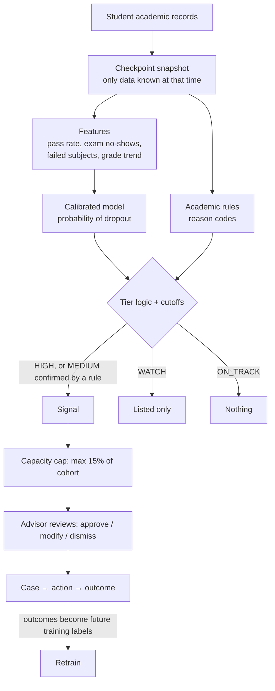

# Kagaz ML — Early Academic Risk Signals

This folder trains and runs the machine-learning part of Kagaz: it looks at a
student's academic record and decides whether to raise an **early risk
signal** for an advisor to review. This README explains everything: what data
is used, how the model works, how false alarms are kept down, how to train it
(including on your own dataset), how to read the results, and what the limits
are.

Deeper design documents: [`../blueprint/16-risk-signal-pipeline.md`](../blueprint/16-risk-signal-pipeline.md)
(how it works), [`17-model-training-guide.md`](../blueprint/17-model-training-guide.md)
(training procedure), [`18-dataset-requirements.md`](../blueprint/18-dataset-requirements.md)
(data).

---

## Contents

1. [What it does, in one paragraph](#1-what-it-does-in-one-paragraph)
2. [Key terms](#2-key-terms)
3. [The pipeline step by step](#3-the-pipeline-step-by-step)
4. [Data used](#4-data-used)
5. [Checkpoints: only what is known at the time](#5-checkpoints-only-what-is-known-at-the-time)
6. [Features](#6-features)
7. [What the model predicts (label)](#7-what-the-model-predicts-label)
8. [The model and calibration](#8-the-model-and-calibration)
9. [The cutoff: how false alarms are kept down](#9-the-cutoff-how-false-alarms-are-kept-down)
10. [Risk tiers and the capacity cap](#10-risk-tiers-and-the-capacity-cap)
11. [Academic rules (reason codes)](#11-academic-rules-reason-codes)
12. [Explanations for each student](#12-explanations-for-each-student)
13. [Release check](#13-release-check)
14. [Fairness check](#14-fairness-check)
15. [Quick start](#15-quick-start)
16. [Training on Kaggle](#16-training-on-kaggle)
17. [Using your own dataset](#17-using-your-own-dataset)
18. [Reading the results](#18-reading-the-results)
19. [Scoring students for the demo](#19-scoring-students-for-the-demo)
20. [Configuration](#20-configuration)
21. [If results are weak: tuning order](#21-if-results-are-weak-tuning-order)
22. [Code layout](#22-code-layout)
23. [Tests](#23-tests)
24. [Limits and honest caveats](#24-limits-and-honest-caveats)
25. [Questions judges may ask](#25-questions-judges-may-ask)

---

## 1. What it does, in one paragraph

At three points in a student's first year — at admission, after semester 1,
after semester 2 — the system looks only at **academic data known at that
moment** (prior grades, subjects registered, subjects passed, exams taken,
average grade, change between semesters). A gradient-boosted model estimates
the probability that the student will drop out, and that probability is
**calibrated** so 80% really means about 8 in 10. Simple academic rules check
concrete warning signs ("passed 2 of 6 subjects"). A **signal** is raised only
if the probability is above a cutoff chosen so that at least **85%** of flagged
students really are at risk, or above a lower cutoff **and** confirmed by a
rule. Signals are capped at **15%** of a cohort so advisors can act on every one.
Each signal comes with plain-language reasons, and a person reviews it before
anything happens.

## 2. Key terms

| Term | Plain meaning |
|---|---|
| **Probability / risk score** | The model's estimate (0 to 1) that a student will drop out |
| **Calibration** | Adjusting scores so they match reality: of students scored 0.7, about 70% actually drop out |
| **Cutoff (threshold)** | Score above which a student is flagged |
| **Precision** | Of the students flagged, the share who really were at risk. High precision = few false alarms |
| **Recall** | Of all students who were at risk, the share that got flagged. High recall = few missed students |
| **False positive** | Flagged, but turned out fine (a false alarm) |
| **ROC AUC** | How well scores rank at-risk students above others. 0.5 = random, 1.0 = perfect |
| **PR AUC** | Like ROC AUC but focused on the at-risk group; more informative when at-risk students are a minority |
| **Brier score** | Average squared error of the probabilities. Lower is better |
| **Train / test split** | 80% of students used to build the model; 20% kept aside and used once to check it |
| **Out-of-fold (OOF)** | Each training student scored by a model that did not see them (5-fold). Used to pick cutoffs honestly |
| **Leakage** | Accidentally using information from the future (e.g. final results) to "predict" it. Makes a model look good in testing and fail in use |
| **Checkpoint** | A point in time with its own model, using only data available then |
| **Tier** | HIGH / MEDIUM / WATCH / ON_TRACK, decided from score + rules |
| **Capacity cap** | Maximum share of a cohort that can receive a signal |

## 3. The pipeline step by step



| Step | What happens | Code |
|---|---|---|
| 1. Load | Read CSV, map column names, clean values | `data.py` |
| 2. Label | Turn the outcome into 1 (at risk) / 0 | `labels.py` |
| 3. Features | Build checkpoint-specific factors | `features.py` |
| 4. Split | 80% train / 20% test, stratified | `train.py` |
| 5. Out-of-fold scores | 5-fold calibrated scores on train | `train.py`, `models.py` |
| 6. Cutoffs | Choose HIGH / MEDIUM / WATCH cutoffs from precision targets | `thresholds.py` |
| 7. Final model | Fit calibrated model on all of train | `train.py` |
| 8. Test | Score the untouched 20% once; tiers, baselines, fairness | `evaluate.py` |
| 9. Release check | Approve or reject | `train.py` |
| 10. Save | Model, manifest (with SHA-256), report | `train.py` |
| 11. Score | New students → probability, tier, signal, reasons | `score.py`, `signal.py`, `rules.py`, `explain.py` |

## 4. Data used

**Academic data only.** First dataset: UCI *Predict Students' Dropout and
Academic Success* (4,424 students, one higher-education institution in
Portugal, outcomes Graduate / Dropout / Enrolled). Of its 37 columns, 15 are
model inputs, 4 are kept for the fairness check only, and 1 is the outcome.

| Model inputs | |
|---|---|
| Prior grades | Previous qualification grade, admission grade |
| Course | Programme (difficulty differs by course) |
| Per semester (1 and 2) | Subjects enrolled, credited, evaluated (exams taken), approved (passed), without evaluation (no exam), average grade |

| Never model inputs | Used for |
|---|---|
| Gender, age at enrolment, displaced, special educational needs | Fairness check only |
| Names, roll numbers | Display only. Passed through to output, never seen by the model |

| Dropped entirely | Why |
|---|---|
| Family background, marital status, nationality, unemployment / inflation / GDP | Not academic |
| Tuition fees up to date, debtor, scholarship | Not academic. These do carry predictive signal in this dataset; leaving them out is a deliberate scope choice |

## 5. Checkpoints: only what is known at the time

| Checkpoint | When | Uses | Role |
|---|---|---|---|
| `cp0` | Admission | Prior grades, course | Earliest, weakest signal; often only WATCH |
| `cp1` | After semester 1 | + semester 1 results | **Main early warning** |
| `cp2` | After semester 2 | + semester 2 results + change | Confirms, escalates or clears |

A test fails the build if semester-2 data reaches `cp0`/`cp1`, or if any
protected column reaches any model. If your dataset has no semester-2 columns,
`cp2` is skipped automatically.

## 6. Features

| Feature | Formula | Captures |
|---|---|---|
| Pass rate | passed ÷ enrolled | Keeping up |
| Attempt rate | exams taken ÷ enrolled | Showing up to exams |
| Exam no-show ratio | subjects with no exam ÷ enrolled | Disengagement |
| Failed subjects | enrolled − passed | Backlog |
| Average grade | as given; **missing** if nothing passed | Quality of work |
| No-grade flag | 1 if nothing passed | Separates "no grade" from "low grade" |
| No-units flag | 1 if no subjects registered | Not registered |
| Grade change (`cp2`) | sem 2 grade − sem 1 grade | Improving or slipping |
| Pass-rate change (`cp2`) | sem 2 − sem 1 pass rate | Same, for passing |
| Total failed (`cp2`) | sem 1 + sem 2 failed | Cumulative backlog |
| Raw counts, prior grades, course | as given | Context |

Data quirk handled: the dataset stores grade **0** when no subject was passed.
That is not a real mark, so it becomes "missing" plus the no-grade flag.
If a whole feature is absent from your dataset (e.g. no admission grade), it is
left out of the model and the training log says so.

## 7. What the model predicts (label)

| `--label` | At risk (1) | Not at risk (0) | Use |
|---|---|---|---|
| `dropout` (default) | Dropout | Graduate, Enrolled | Most serious outcome |
| `not_on_time` | Dropout, Enrolled (still studying past normal length) | Graduate | Wider net; also catches students falling behind |

## 8. The model and calibration

| Choice | Value | Why |
|---|---|---|
| Main model | Histogram gradient-boosted trees (`scikit-learn`) | Strong on small tables, handles missing values, seconds on CPU |
| Comparison | Rules-only score; logistic regression | The model must beat rules; if logistic regression is as good, the report recommends it (simpler) |
| Calibration | Isotonic, 5-fold (`--calibration sigmoid` available) | Makes the cutoff meaningful |
| Hardware | CPU only | Full run ≈ 15–20 s for 4,424 rows |

## 9. The cutoff: how false alarms are kept down

1. Each training student gets an honest out-of-fold probability.
2. Sort students by probability, highest first. Moving the cutoff down one
   step at a time, compute precision of everyone at or above it.
3. **HIGH cutoff** = the lowest cutoff where precision is still ≥ **85%** for
   it *and every cutoff above it*, with at least **30** students flagged. The
   "every cutoff above" rule stops a lucky narrow band from being picked.
4. Same method for **MEDIUM** (≥ 70%) and **WATCH** (≥ 50%).
5. Checked **once** on the 20% test students. If HIGH precision there is more
   than 5 points below target, the model is **not approved**.
6. If no cutoff reaches 85% (common at admission), HIGH is switched **off** for
   that checkpoint — the target is never quietly lowered.

## 10. Risk tiers and the capacity cap

| Tier | Condition | Signal? |
|---|---|---|
| **HIGH** | probability ≥ HIGH cutoff | Yes |
| **MEDIUM** | MEDIUM cutoff ≤ probability < HIGH cutoff **and** ≥ 1 academic rule fires | Yes |
| **WATCH** | probability ≥ WATCH cutoff, or MEDIUM band with no rule | No — listed for staff |
| **ON_TRACK** | below WATCH cutoff | No |

**Capacity cap:** if signals exceed 15% of the scored cohort, only the
highest-probability ones keep their signal; the rest become WATCH with
`capacity_capped = True`. Size this to how many students your advisors can
actually contact.

## 11. Academic rules (reason codes)

| Code | Fires when | Default |
|---|---|---|
| `LOW_PASS_RATE` | passed ÷ enrolled < threshold | 0.50 |
| `EXAM_NO_SHOW` | subjects with no exam ≥ threshold | 1 |
| `FAILED_UNITS` | subjects not passed ≥ threshold | 2 |
| `LOW_GRADE` | semester average < threshold (on a 0–20 scale) | 10 |
| `GRADE_DROP` (`cp2`) | semester 2 average lower than semester 1 by ≥ threshold | 2 |

Rules confirm MEDIUM scores and give staff checkable facts. Thresholds are in
`kagaz_ml/config.py`.

## 12. Explanations for each student

Every scored student gets:
- **Rule reasons** — e.g. "passed 2 of 6 subjects in semester 1; no exam taken
  in 3 subject(s) in semester 1".
- **Model factors** — for each factor group, the student's values are replaced
  with a typical student's and the student is re-scored; the difference is that
  group's contribution, e.g. "exams taken in semester 1 (+18 pts)". The top
  three are shown. Works with any model; no extra library needed.

## 13. Release check

A checkpoint model is **APPROVED** only if:
- a HIGH cutoff exists at the precision target on training data;
- HIGH-tier precision on the test split ≥ target − 0.05;
- model PR AUC on test > rules-only PR AUC (`cp1`, `cp2`).

A non-blocking **note** appears if logistic regression is as good as or better
than the main model. If a model is not approved, the scorer still works but
marks every row "model not approved by release check; show for review only".

## 14. Fairness check

Gender, age band, displaced and special needs are **never inputs**. After
scoring the test split, the report shows for each group: signal rate,
false-positive rate (flagged but fine) and miss rate (at risk but not
flagged), plus the max/min false-positive-rate ratio. Large gaps mean the
system wrongly flags one group more often and must be reviewed. (A blocking
limit for this ratio is still an open decision.)

## 15. Quick start

```bash
cd ml
python -m venv .venv && source .venv/bin/activate
pip install -r requirements.txt
python -m pytest tests -q                                   # ~10 s
python -m kagaz_ml.train --data data/dataset.csv --out artifacts
python -m kagaz_ml.score --model artifacts/cp1 --input students.csv --output scored.csv
```

`data/` and `artifacts/` are git-ignored; real student data is never committed.

## 16. Training on Kaggle

1. New notebook (CPU; no GPU needed) → **Add input** → your dataset (e.g.
   "Predict Students' Dropout and Academic Success").
2. Upload this `ml/` folder (as a Kaggle dataset) or `!git clone` the repo and
   `%cd` into `ml`.
3. Run one of:
   ```bash
   !python kaggle_train.py                                         # finds the UCI CSV itself
   !python kaggle_train.py /kaggle/input/<folder>/<file>.csv
   !python kaggle_train.py /kaggle/input/<folder>/<file>.csv --mapping mapping.json
   !python kaggle_train.py <file>.csv --label not_on_time --model logreg
   ```
4. Download from the Output panel: `artifacts/` (models, manifests, reports)
   and `demo_scored_cp1.csv`.

Time: the run takes well under a minute. Plan 1–2 hours to run, read reports
and try settings; the rest of the time can go to the demo.

## 17. Using your own dataset

Your file can use any column names, any grade scale and any outcome labels.
You only need, at minimum: **subjects registered** and **subjects passed** in
semester 1, and a **final outcome** for training.

**Step 1 — create a mapping template**
```bash
python -m kagaz_ml.mapping --data my_students.csv --out mapping.json
```
It lists every header in your file, fills in the ones it recognises, and
guesses your outcome values.

**Step 2 — complete `mapping.json`**
```json
{
  "columns": {
    "prev_qual_grade": "Class 12 %",
    "admission_grade": null,
    "course": "Branch",
    "s1_enrolled": "Sem1 Subjects Registered",
    "s1_approved": "Sem1 Subjects Cleared",
    "s1_evaluations": "Sem1 Exams Appeared",
    "s1_without_eval": "Sem1 Exams Absent",
    "s1_grade": "Sem1 SGPA",
    "s1_credited": null,
    "s2_enrolled": null, "s2_approved": null, "s2_evaluations": null,
    "s2_without_eval": null, "s2_grade": null, "s2_credited": null,
    "gender": "Sex",
    "target": "Status"
  },
  "target_values": {"Dropped out": "Dropout", "Passed out": "Graduate", "Continuing": "Enrolled"},
  "grade_scale": 10
}
```

| Key | Meaning |
|---|---|
| `columns` | Pipeline name → your header. `null` = you don't have it (filled as missing, or left out of the model) |
| `target_values` | Each of your outcome values → `Dropout`, `Graduate` or `Enrolled`. Map your at-risk outcome (dropped / detained / discontinued) to `Dropout`, the good outcome to `Graduate`, still-studying-late to `Enrolled` |
| `grade_scale` | Maximum of your semester grade: `10` for SGPA, `100` for percentage, `20` for UCI. Grades are rescaled to 0–20 so rule thresholds keep their meaning |

Pipeline column names you can map:

| Name | Meaning | Required |
|---|---|---|
| `s1_enrolled` | Semester 1 subjects registered | **Yes** |
| `s1_approved` | Semester 1 subjects passed | **Yes** |
| `target` | Final outcome | **Yes** for training |
| `s1_evaluations` | Semester 1 exams appeared | Recommended |
| `s1_without_eval` | Semester 1 subjects with no exam / absent | Recommended |
| `s1_grade` | Semester 1 average grade / SGPA | Recommended |
| `s1_credited` | Semester 1 subjects credited by exemption | Optional |
| `s2_*` (same six) | Semester 2 | Optional — enables `cp2` |
| `prev_qual_grade` | Grade before university (e.g. class 12 %) | Optional |
| `admission_grade` | Entrance / admission score | Optional |
| `course` | Programme / branch | Optional |
| `gender`, `age_at_enrollment`, `displaced`, `special_needs` | Fairness check only | Optional |

**Step 3 — train**
```bash
python -m kagaz_ml.train --data my_students.csv --mapping mapping.json --out artifacts
```
The mapping is saved inside the model, so scoring uses it automatically.

What happens automatically:
- Checkpoints your data cannot support (e.g. no semester 2) are skipped.
- Features your data does not have at all are left out and listed in the log.
- Unknown outcome values stop the run with a list of the values to map.
- A mapped header that is not in the file stops the run with its name.

**Privacy with real data:** remove phone numbers and emails before training.
Names and roll numbers may stay in the file — columns named `name`,
`student_id` or `roll_no` are only copied to the output for display — but
prefer a pseudonymous id for training files. Real student data needs the
institution's permission and a review under India's DPDP Act 2023.

## 18. Reading the results

Each checkpoint writes three files to `artifacts/<cp>/`:

| File | Contents |
|---|---|
| `model.joblib` | Model, features, cutoffs, rules, mapping |
| `manifest.json` | SHA-256 of model and data, library versions, config, every metric, release result |
| `report.md` | Human-readable report |

Read `report.md` in this order:

| Section | Check |
|---|---|
| Release check | APPROVED, or reasons it was not; any note recommending logistic regression |
| Test split | ROC AUC, PR AUC (compare with at-risk rate), Brier |
| Cutoffs | Which tiers are enabled; train precision and recall per tier |
| Signals on test | Precision near or above target; signal rate ≤ capacity; how many capped |
| Tiers table | "Actually at risk" should fall HIGH → MEDIUM → WATCH → ON_TRACK |
| Baselines | Model must beat rules-only |
| Fairness | Gaps in false-positive rate between groups |
| Calibration | Predicted ≈ observed per bin |

All numbers come from the run; none are written by hand.

## 19. Scoring students for the demo

```bash
python -m kagaz_ml.score --model artifacts/cp1 --input students.csv --output scored.csv
```

| Output column | Meaning |
|---|---|
| `student_id` / `roll_no` / `name` | Copied from input if present (display only) |
| `checkpoint` | Model used |
| `risk_probability` | Calibrated probability |
| `tier` | HIGH / MEDIUM / WATCH / ON_TRACK |
| `signal` | True if a signal is raised |
| `capacity_capped` | True if moved to WATCH by the cap |
| `rule_reasons`, `rule_codes` | Academic rules that fired |
| `model_factors` | Top three factor contributions |
| `note` | Present if the model was not approved |

- The scorer checks the model file's SHA-256 against the manifest and refuses a
  modified file.
- The capacity cap applies to each scored file, so score one cohort per file.
- `kaggle_train.py` also writes `demo_scored_cp1.csv` (all rows, with the real
  outcome). It includes training rows: use it for display, not as accuracy.

## 20. Configuration

All in `kagaz_ml/config.py`; recorded in every manifest.

| Setting | Default | Meaning | CLI flag |
|---|---|---|---|
| `label` | `dropout` | What counts as at risk | `--label` |
| `model` | `hgb` | `hgb` or `logreg` | `--model` |
| `calibration` | `isotonic` | or `sigmoid` | `--calibration` |
| `test_size` | 0.20 | Share kept aside for testing | |
| `cv_folds` | 5 | Folds for out-of-fold scores and calibration | |
| `seed` | 42 | Reproducibility | |
| `high_precision` | 0.85 | HIGH tier precision target | `--high-precision` |
| `medium_precision` | 0.70 | MEDIUM tier target (+ rule) | |
| `watch_precision` | 0.50 | WATCH list target | |
| `min_alerts` | 30 | Minimum students above a cutoff | |
| `capacity_share` | 0.15 | Max share of cohort with a signal | `--capacity-share` |
| `precision_tolerance` | 0.05 | Allowed shortfall on test | |
| `RULES` | see §11 | Rule thresholds | |

## 21. If results are weak: tuning order

Change one thing at a time; judge by the out-of-fold numbers; read the test
split once at the end.

1. `--model logreg` vs `hgb`.
2. `--calibration sigmoid` when there are few at-risk students.
3. `--label not_on_time` if dropout alone is too rare for a HIGH cutoff.
4. Lower `--high-precision` (e.g. 0.80) only with a stated reason — never just
   to show more alerts in the demo.
5. Adjust rule thresholds in `config.py`.

## 22. Code layout

```
ml/
├── kaggle_train.py          one-command runner for Kaggle
├── requirements.txt
├── kagaz_ml/
│   ├── config.py            all settings, cutoff targets, rule thresholds
│   ├── data.py              load CSV, map columns (UCI or your mapping), clean
│   ├── mapping.py           mapping-template generator for your dataset
│   ├── labels.py            dropout / not_on_time
│   ├── features.py          checkpoint features, explanation groups
│   ├── rules.py             academic rules → reason codes
│   ├── models.py            gradient boosting / logistic regression + calibration
│   ├── thresholds.py        precision-based cutoff selection
│   ├── signal.py            tiers + capacity cap
│   ├── explain.py           per-student factor contributions
│   ├── evaluate.py          metrics, calibration table, fairness
│   ├── train.py             training CLI, release check, reports
│   ├── score.py             scoring CLI with model hash check
│   └── synthetic.py         invented data for tests only
└── tests/                   29 tests
```

## 23. Tests

```bash
python -m pytest tests -q
```

| Test file | Checks |
|---|---|
| `test_data_and_features.py` | Both CSV formats load; missing columns error; grade-0 handling; **no future data in earlier checkpoints**; **protected columns never inputs**; labels |
| `test_cutoffs_and_tiers.py` | Cutoffs meet the precision target and stop before a weak band; no cutoff when unreachable; ties; tier logic; rule corroboration; capacity cap |
| `test_train_and_score.py` | Full training on all checkpoints; artifacts and hashes; later checkpoints rank better; capacity respected; tampered model refused; scoring output |
| `test_own_dataset.py` | Custom headers, SGPA 0–10 scale, custom outcome labels, missing semester 2; template generator; bad mappings rejected; train + score with saved mapping |

Tests run on **synthetic** data from `synthetic.py`. Synthetic numbers are
never presented as results.

## 24. Limits and honest caveats

- **No model catches every at-risk student.** At 85% precision, about 15 of
  every 100 HIGH signals are false alarms, and some at-risk students fall below
  the cutoff. That is why a person reviews every signal and WATCH exists.
- **The UCI data is from one Portuguese institution.** It proves the pipeline
  works end to end; it does not prove the same accuracy at an Indian campus.
  That must be measured on the campus's own data.
- **No year column in UCI**, so the test split is random-stratified. With
  campus data covering several years, train on older cohorts and test on the
  newest.
- **No attendance or internal marks in UCI.** In the product, attendance enters
  through the rules engine; with campus data it becomes a model feature and
  allows a mid-semester checkpoint (earlier warning).
- **Fees are excluded by choice** although they are predictive in this dataset.
- A saved model must be loaded with the **same scikit-learn version** it was
  trained with (recorded in the manifest).

## 25. Questions judges may ask

**Is this just a rule like "attendance below 75%"?**
No. Rules give readable reasons and confirm medium-risk scores, but the main
score is a model that combines many factors (pass rate, exam no-shows, grade
level and trend, prior grades, course) and is calibrated to real outcomes. The
report shows it beating the rules-only baseline.

**How do you avoid flooding staff with false alarms?**
The HIGH cutoff is chosen so at least 85% of flagged students really were at
risk, verified on students the model never saw; MEDIUM needs a rule to agree;
and a capacity cap limits signals to what advisors can handle.

**Can it cheat by using end-of-year results?**
No. Each checkpoint only sees data available at that time, and a test fails if
later data leaks into an earlier checkpoint.

**Does it discriminate?**
Gender, age, disability and similar fields are never inputs. They are used
only to measure whether false alarms are spread evenly across groups, and the
report shows that measurement.

**Why should a mentor trust a flag?**
Every flag shows the exact facts (e.g. "passed 2 of 6 subjects") and the
factors that pushed the score up, and nothing happens without a person
approving it.

**Will it work at our university?**
The same code trains on your data through a mapping file. Whether it is
accurate enough there is measured by the same release check on your students
before it is used.
